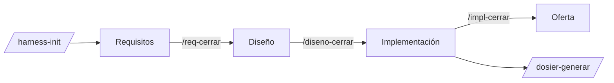

# prueba-saf

Detección de obstáculos estáticos en la vía de un tranvía con un radar frontal 3D, a partir de la «Prueba práctica SAF» del equipo SAF de Ikerlan. El repositorio contiene el proyecto (requisitos, diseño, implementación del grid de ocupación, oferta y dosier) y el **harness de ingeniería** para Claude Code con el que se ha desarrollado.

| | |
|---|---|
| Código del proyecto | `SAF` · módulo C `ogrid` |
| Fases | requisitos → diseño → implementación → oferta, cada una cerrada con su etiqueta en git |
| Versiones cerradas | requisitos 1.2 · diseño 1.2 · implementación 1.2 · oferta 1.0 |
| Harness | versión 1.2.0 (carpeta `harness/`) |

## 1. Cómo lanzar el harness

El harness está en `harness/` y se **instala** en `.claude/`, que no se versiona porque contiene rutas absolutas de tu máquina. Hace falta [Claude Code](https://claude.com/claude-code).

**1. Dependencias** (macOS; `h doctor` indica lo que falte en cualquier equipo):

```bash
brew install pandoc cmake cppcheck llvm clang-format shellcheck doxygen
npm install -g @mermaid-js/mermaid-cli
pipx install lizard && pipx install gcovr          # o pip3 install --user, según tu Python
pip3 install --user python-docx python-pptx paho-mqtt
```

Para medir la cobertura en macOS conviene compilar los tests con GNU `gcc` (`brew install gcc`): el `llvm-cov` de Apple hace que `gcovr` invente ramas. El preset `host-test` de `CMakePresets.json` ya apunta a `gcc-16`.

**2. Instalar el harness en el proyecto:**

```bash
./harness/install.sh --target .              # crea ./.claude (comandos, agentes, skills, hooks, runtime)
./harness/install.sh --target . --update     # actualizar tras un cambio en harness/
./harness/install.sh --target . --uninstall
```

**3. Abrir Claude Code en la carpeta del proyecto** (`claude`) y ejecutar:

```text
/harness-init            # configuración, estado de fases, carpetas docs/, hooks de git y rama develop
/req-iniciar <fichero>   # primera fase: requisitos
```

El CLI también se usa a mano: `.claude/harness/bin/h --help` (conviene definir `H=".claude/harness/bin/h"`). `h doctor` comprueba las dependencias y `h gate status` muestra el estado de las fases.

## 2. Cómo funciona



- **Fases con puertas.** No se avanza sin cerrar la anterior, y solo la persona usuaria puede cerrar (`/*-cerrar`) o reabrir (`/fase-reabrir`) una fase. Cada cierre exige un checklist automático (`h gate check`), crea una etiqueta (`req-v1.2`, `design-v1.2`, `impl-v1.2`, `offer-v1.0`) e integra la rama de la fase en `develop` y `main`.
- **Código y tests independientes.** Cada función se escribe en un sandbox por un agente `implementador` y sus tests en otro por un `ingeniero-tests`, sin verse entre sí, a partir de un contrato aprobado. Solo los scripts mueven sus entregas al repositorio.
- **Verificación determinista.** `h test` ejecuta, por función y para todo el proyecto: compilación con `-Werror`, tests con ASan y UBSan, cobertura del 100 % de líneas y ramas, MISRA C:2012 (cppcheck), clang-tidy, clang-format, complejidad (lizard), Doxygen y símbolos prohibidos.
- **Git.** Una rama por fase y por función, Conventional Commits en inglés con trailer `Refs:`, fusiones `--no-ff`, etiquetas por fase y hooks que validan los mensajes, protegen `develop` y `main` y exigen el último test en verde antes de subir.
- **Estilo único.** Paleta y tipografía de `harness/tokens/tokens.json` para la interfaz, los diagramas Mermaid, los Word y las presentaciones.

## 3. Componentes del harness

### Comandos (28, en `harness/commands/`)

| Fase | Comandos |
|---|---|
| Transversal | `/harness-init`, `/fase-estado`, `/fase-reabrir`, `/plantilla-registrar`, `/diagrama` |
| 1 · Requisitos | `/req-iniciar`, `/req-iterar`, `/req-exportar`, `/req-cerrar` |
| 2 · Diseño | `/diseno-iniciar`, `/diseno-revisar`, `/diseno-alternativa`, `/diseno-comparar`, `/diseno-exportar`, `/diseno-cerrar` |
| 3 · Implementación | `/impl-iniciar`, `/impl-funcion`, `/impl-test`, `/impl-integrar`, `/impl-frontend`, `/impl-exportar`, `/impl-cerrar` |
| 4 · Oferta | `/oferta-iniciar`, `/oferta-seccion`, `/oferta-exportar`, `/oferta-presentacion`, `/oferta-cerrar` |
| Dosier | `/dosier-generar` |

Los comandos `*-cerrar` y `/fase-reabrir` no los puede invocar Claude por iniciativa propia.

### Agentes (7, en `harness/agents/`)

| Agente | Qué hace |
|---|---|
| `analista-requisitos` | Normaliza requisitos al formato STD-REQ y detecta ambigüedades, huecos y contradicciones |
| `revisor-diseno` | Revisa el diseño contra los requisitos y los estándares (fallos, huecos, mejoras, validado) |
| `arquitecto-alternativas` | Desarrolla diseños alternativos que no se implementan |
| `implementador` | Escribe una función en C a partir de su contrato, sin ver los tests |
| `ingeniero-tests` | Escribe los tests Unity de una función, sin ver la implementación |
| `auditor-estandares` | Revisa el código contra las reglas de STD-C que las herramientas no comprueban |
| `redactor-tecnico` | Redacta documentos técnicos (implementación, dosier, oferta) a partir del material existente |

### Skills (9, en `harness/skills/`)

`fases`, `requisitos`, `export-word`, `diagramas`, `matriz-ponderada`, `implementacion-aislada`, `git-flujo`, `oferta` y `dosier`: instrucciones de cada tipo de trabajo que Claude carga cuando hace falta.

### Estándares (15, en `harness/standards/`)

| Estándar | Fichero | Ámbito |
|---|---|---|
| STD-PRO | `proceso.md` | Proceso por fases, reglas de comportamiento |
| STD-REQ | `requisitos-redaccion.md` | Redacción de requisitos (ISO 29148 + EARS) |
| STD-DOC | `documentacion.md` | Estructura y estilo de los documentos |
| STD-C | `c-codificacion.md` | Código C: MISRA, nombres, funciones, errores |
| STD-TST | `testing.md` | Tests independientes, cobertura, log |
| STD-GIT | `git.md` | Ramas, commits, merges, etiquetas, hooks |
| STD-SAF | `seguridad-funcional.md` | Seguridad funcional, fallos y modos |
| STD-CFG | `configuracion.md` | Parámetros con rango y validación |
| STD-DAT | `datos-prueba.md` | Datos de prueba y grabaciones de radar |
| STD-MQTT | `mqtt.md` | Topics, payloads y QoS |
| STD-NET | `ethernet.md` | Red y direccionamiento |
| STD-LOG | `logging.md` | Registros y niveles |
| STD-UI | `frontend.md` | Estilo visual, interfaz y diagramas |
| STD-SH | `shell.md` | Scripts de shell |
| STD-DEP | `despliegue.md` | Despliegue |

`harness/standards/00-indice.md` es el índice con todos los identificadores de regla.

### Hooks

- **Claude Code** (`harness/hooks/`): `phase_guard.py` bloquea las escrituras en carpetas de fases bloqueadas o cerradas, y `guard_paths.py` aísla al implementador y al ingeniero de tests en sus sandboxes.
- **Git** (`harness/git-hooks/`, activos mediante `.githooks/`): `commit-msg`, `pre-commit` y `pre-push`.

### CLI `h` (`harness/bin/h` → `harness/scripts/`)

Un único punto de entrada: `h init|doctor|scaffold`, `h gate status|check|close|reopen`, `h req lint|questions`, `h diagram render`, `h matrix render`, `h export <documento>`, `h template`, `h git start|start-phase|start-feature|finish|release`, `h impl validate|next|status|set`, `h sandbox prepare|collect|clean`, `h test <F-NNN>|--all`, `h log change`, `h trace`, `h offer budget|section|status`, `h pptx build`, `h dossier build`. `h --help` lo lista todo.

### Plantillas, tokens y pruebas

- `harness/templates/`: Word (`docx`, con la plantilla de requisitos de Pages recreada), documentos Markdown, proyecto C con CMake (`c-project`), `frontend` y `deploy`.
- `harness/tokens/`: `tokens.json` (fuente de verdad), `tokens.css` y `mermaid-config.json`.
- `harness/tests/`: autotests del propio harness (`run.sh`; `run.sh --e2e` recorre las cuatro fases con un proyecto C real).

El detalle de cada pieza está en [`harness/README.md`](harness/README.md).

## 4. Estructura del repositorio

```text
harness/            harness de ingeniería (fuente); se instala en .claude/
docs/
  01-requisitos/    requisitos.md · dudas.md · entradas/
  02-diseno/        diseno.md · viabilidad-radar.md · justificacion-c.md · revision.md · diagramas/
  03-implementacion/ implementacion.md · plan.json · contratos/ · casos/ · trazabilidad.md · wcet-medidas.md
  04-oferta/        oferta.md · presupuesto.json · presentacion.json · diagramas/ · entradas/
  dosier/           contexto.md · dosier.md (generado)
  export/           Word y PowerPoint generados (no se versionan)
include/ogrid/      cabeceras públicas del módulo
src/ogrid/          código C del grid de ocupación (una función por fichero)
tests/              unit/ · integration/ (incluye el benchmark de tiempos)
frontend/ · tools/  visor del grid y su generador de escenarios
config/ · cmake/    desviaciones MISRA, supresiones y toolchain cruzado
third_party/        Unity y CMock
.harness/           estado de las fases (state.json)
```

## 5. Trabajo habitual

```bash
# estado
.claude/harness/bin/h gate status

# verificar una función o todo el proyecto
.claude/harness/bin/h test F-001
.claude/harness/bin/h test --all

# medir tiempos (Release, sin sanitizers)
cmake --preset host-bench && cmake --build build/host-bench && build/host-bench/bench_wcet_ogrid

# visor del grid con el código C real (http://localhost:8080)
python3 tools/ogrid_demo.py --serve

# regenerar los documentos Word y la presentación
.claude/harness/bin/h export requisitos     # o diseno, implementacion, oferta, dosier
.claude/harness/bin/h pptx build
```

Los Word se escriben en `docs/export/`, que no se versiona: se regeneran a partir de los Markdown.
