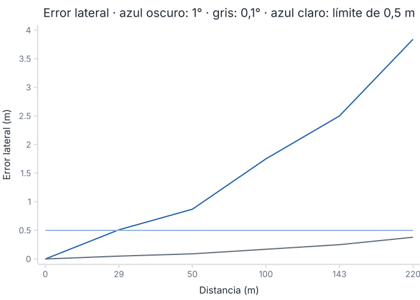
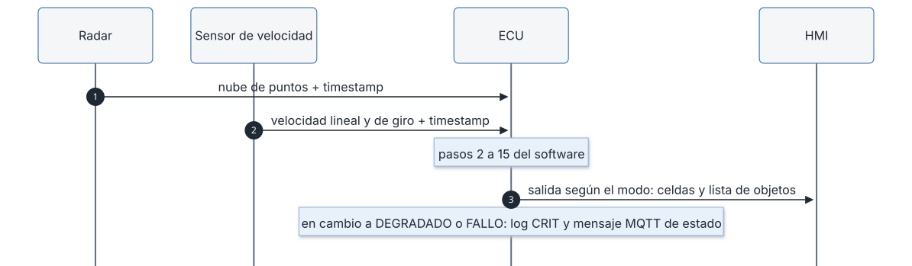

# Documento de diseño

| Campo | Valor |
|---|---|
| Proyecto | prueba-saf |
| Código | SAF-DIS |
| Versión | 1.0 |
| Fecha | 2026-11-02 |
| Autor | Alicia Garcia |
| Estado | Cerrado |

> Este documento recoge **solo** el diseño definido por el usuario (STD-DOC DOC-GEN-01). Los valores que dependen del hardware elegido se fijan según la regla de §10.

Fuentes (sin modificar, en `entradas/`): `Diseño de Hardware.docx` (HW), `Diseño de Software.docx` (SW), `Máquina de Estados.docx` (ME).

## 1. Contexto y objetivos del diseño

Sistema de detección de obstáculos en vía mediante radar frontal, con procesamiento en el borde (edge) a bordo del tranvía (SYS-IMP-03). Salida hacia el HMI del conductor (HW).

Justificación de la arquitectura edge (HW): buena latencia, disponibilidad, certificable y más segura frente a ataques que el procesamiento en la nube. Se descarta el procesamiento en la nube por latencia, fiabilidad y restricciones de tiempo de procesamiento y análisis, que pondrían en riesgo el cumplimiento de los estándares del proyecto (SYS-IMP-03, SYS-T-01, SYS-GEN-01).

Entregables de la fase (SYS-IMP-06, SYS-IMP-07, SYS-IMP-08, SYS-IMP-10, SYS-IMP-11): el plan de viabilidad del radar (SYS-IMP-06) es `viabilidad-radar.md` y la justificación del lenguaje (SYS-IMP-11) es `justificacion-c.md`. El diseño hardware y software es este documento (SYS-IMP-07) y el diagrama pipeline de un ciclo es la figura de §4 (SYS-IMP-08). El pseudocódigo (SYS-IMP-10) corresponde a «un componente del sistema»; el enunciado propone la actualización de la probabilidad de ocupación de una celda solo como ejemplo, y el componente que se desarrolla se elige antes de implementar. El borrador de oferta (SYS-IMP-12) corresponde a la fase de Oferta.

Entorno operativo nominal (SYS-GEN-02): tranvía bidireccional en Vitoria-Gasteiz, velocidad máxima regulada de 50 km/h (13,9 m/s), radar frontal a 1 m sobre el suelo, ancho de vía de 1 m (H-01) y alcance de 220 m a lo largo de la vía.

## 2. Requisitos de referencia

Versión de requisitos: `req-v1.0`. Cada apartado cita los requisitos que cubre.

## 3. Arquitectura hardware

| Elemento | Definición del usuario | Requisitos |
|---|---|---|
| ECU edge | Recibe los datos, procesa y publica en el HMI. Modelo, CPU y memoria: se fijan según la regla de §10 (R-HW) | SYS-IMP-03, SYS-IMP-04 |
| Radar | Radar de ocupación dinámico 3D: distancia, azimut y altura. Proporciona timestamp de medida a la ECU. Montado a 1 m sobre el suelo. Modelo concreto pendiente de decisión del cliente (valoración funcional y presupuestaria) | SYS-IN-01, SYS-IN-04, SYS-IN-05, SYS-PR-07, H-05 |
| Sensor de velocidad | Mide velocidad lineal y de giro. Proporciona timestamp de medida a la ECU | SYS-IN-02, SYS-IN-03, SYS-IN-04 |
| HMI | Salida de avisos e información de la ECU; entrada de sign in y resets (ME) | SYS-OUT-06, SYS-OUT-11, SYS-SAF-04, SYS-SAF-16 |
| Radar frontal activo | El sign in del conductor en el HMI indica qué cabina está activa y por tanto qué radar frontal se activa (los tranvías suelen ser bidireccionales) (ME). Número de radares instalados: se fija según la regla de §10 (R-HW); la propuesta al cliente es un segundo radar por redundancia | SYS-IN-01 |

Parámetros de partida (HW):

| Parámetro | Valor definido | Observación | Requisitos |
|---|---|---|---|
| Altura del radar | 1 m sobre el suelo | Parámetro de configuración | SYS-IN-05 |
| Precisión de azimut y altura del radar | 0,1° | Precisión que debe tener el radar, calculada en la justificación siguiente; la hoja de datos del radar elegido la confirma (H-033) | SYS-DET-06, H-06 |
| Error de desalineación del radar respecto al eje | según R-HW (§10) | Parámetro distinto de la precisión del radar (H-033) | SYS-DET-07, SYS-SAF-13, H-04 |
| Error de localización | 0,005 m en distancia (provisional); error lateral = distancia × tan(precisión de azimut): 0,38 m a 220 m con 0,1° | Valor provisional hasta tener la especificación del radar; el error de altura crece con la distancia. Límite de discriminación lateral a 220 m: según R-HW (§10) (H-033) | SYS-DET-06, SYS-DET-05, H-06 |
| Velocidad máxima del tranvía | 50 km/h = 13,9 m/s (velocidad regulada en Vitoria-Gasteiz) | | H-07 |
| Alcance de detección | 220 m a lo largo de la vía (SW, paso 5) | | SYS-DET-01, SYS-PR-11 |

Evoluciones futuras sugeridas al cliente en la oferta (no son requisitos, HW):

- Acceso de la ECU al sistema de freno para detener el tranvía en emergencia.
- Acceso de la ECU a la nube para actualizaciones de la flota desde un centro de control, telemetría adicional y descarga de mapas (el envío de logs y trazabilidad ya es requisito, SYS-IMP-04). Recibir actualizaciones o mapas exigiría cambiar SYS-IMP-04, que limita la nube a enviar datos (H-032).
- Segundo radar, para reducir el error de altura a gran distancia y aportar redundancia.

### Justificación de la precisión angular de 0,1°

Se partió de 1° como valor provisional. El cálculo muestra que no basta para decidir si un eco está sobre la vía:

- Error lateral = distancia × tan(precisión de azimut). Con 1° a 220 m: 220 m × tan(1°) = 3,84 m, casi 4 veces el ancho de la vía (1 m, H-01) y 15 celdas de 0,25 m.
- Criterio: para decidir si un eco está dentro o fuera de la vía (SYS-DET-05), el error lateral debe ser menor que la mitad del ancho de vía, 0,5 m.
- Precisión máxima admisible a 220 m: atan(0,5 m / 220 m) = 0,130°. Se toma 0,1°, el valor redondo inferior.
- Comprobación con 0,1°: 220 m × tan(0,1°) = 0,384 m, menor que 0,5 m. Con 1° el criterio solo se cumple hasta 0,5 m / tan(1°) = 28,6 m.

| Distancia | Error lateral con 1° | Error lateral con 0,1° |
|---|---|---|
| 29 m | 0,51 m | 0,05 m |
| 50 m | 0,87 m | 0,09 m |
| 100 m | 1,75 m | 0,17 m |
| 143 m | 2,50 m | 0,25 m (una celda) |
| 220 m | 3,84 m | 0,38 m |

**Leyenda.** Azul oscuro: error lateral con 1° de precisión angular. Gris: error lateral con 0,1°. Azul claro (horizontal): límite de 0,5 m, la mitad del ancho de vía.

El mismo error afecta a la altura del eco: a 220 m es de 0,38 m, menor que la altura mínima del objeto (0,6 m), lo que permite aplicar el filtro de techo (paso 8) y la altura del objeto (paso 11). Un error menor de 0,1° mejoraría el margen: 0,065° daría 0,25 m, una celda, a 220 m. Un segundo radar reduciría este error y aportaría redundancia (propuesta al cliente, §3).

## 4. Arquitectura software

Lenguaje: C, por ser el diseño una ECU edge (SW). El software cumple los requisitos elaborados y los estándares fijados en el harness (SYS-IMP-01, SYS-IMP-02, SYS-IMP-11). Estructura de módulos, tareas y hebras: se define en implementación respetando SYS-IMP-01 y SYS-IMP-02.

Funcionalidades en el orden del ciclo (SW):

| Paso | Definición del usuario | Requisitos |
|---|---|---|
| 1 | Recibe en paralelo la nube del radar y la velocidad lineal y de giro | SYS-IN-01, SYS-IN-02, SYS-IN-03 |
| 2 | Valida los datos según estándares y requisitos; los timestamps se validan contra el reloj de la ECU, que es la referencia (H-017); sincronización con el reloj del radar y tolerancia según R-HW (§10); velocidad del tranvía menor que 0 → se rechaza la detección y se pasa a DEGRADADO (SYS-PR-10, SYS-SAF-19); aquí se cuenta si la trama trae algún eco, incluidos raíles, para SYS-SAF-12 (H-034) | SYS-IN-06, SYS-IN-07 |
| 3 | Sincroniza en la ECU, con los timestamps de medida, las velocidades al instante de la «fotografía» de la nube, interpolando si hace falta (H-020); actualiza la posición del tranvía y estima la curva (puede ser recta) | SYS-PR-02, SYS-PR-06, H-02, H-03 |
| 4 | Convierte la nube de (r, azimut, elevación) a (x, y, z) considerando la altura del radar | SYS-PR-07, SYS-IN-05 |
| 5 | Descarta elementos dinámicos y elementos con señal muy débil. Los objetos en movimiento sobre la vía no se reportan (H-007); un eco descartado no cambia el valor de ninguna celda (H-024) | SYS-PR-05 |
| 6 | Pasa de coordenadas (x, y) a coordenadas de vía (s, d) y descarta lo situado a más de 220 m a lo largo de la vía, s > 220 m (H-014) | SYS-PR-01, SYS-PR-11 |
| 7 | Descarta lo que está fuera de la vía | SYS-DET-05 |
| 8 | Descarta lo que está por encima del techo (evita falsos positivos por puentes); se traza a SYS-DET-04 solo como medio para reducir falsas alarmas (H-006) | SYS-DET-04 |
| 9 | Descarta raíles: detecciones muy cercanas a las coordenadas de los raíles | SYS-PR-03 |
| 10 | Actualiza el grid en log-odds, que empieza en 0: por cada haz, eco en la celda suma +0,85; onda que pasa sin eco suma −0,40; celda oculta detrás de un eco no cambia | SYS-PR-08 |
| 11 | Extrae las celdas con p > 0,85 (H-026), agrupa las contiguas y obtiene posición, tamaño y altura de cada objeto | SYS-PR-04, SYS-OUT-01, SYS-OUT-02 |
| 11b | Descarta los objetos con alguna dimensión menor de 0,6 m (H-015) | SYS-DET-02, SYS-DET-08 |
| 12 | Compara los objetos con los del ciclo anterior y los reporta si llevan más de 2 ciclos seguidos, es decir N = 3 (H-005) | SYS-PR-09, SYS-OUT-10 |
| 13 | Calcula confianza e incertidumbre de cada objeto según distancia, ciclos confirmados, incertidumbre de la curva y error del radar (precisión de azimut y altura y localización, H-016, H-033); la incertidumbre crece con la distancia (error lateral = distancia × tan(precisión de azimut)) y la confianza crece con los ciclos confirmados y decrece con la distancia y con la incertidumbre de la curva; también calcula el timestamp de la detección y su alcance estimado, igual a la coordenada s del objeto (SYS-OUT-04, SYS-OUT-05); la fórmula exacta se fija con la hoja de datos del radar (R-HW) | SYS-OUT-03, SYS-OUT-04, SYS-OUT-05, SYS-OUT-08 |
| 14 | Gestiona el modo según la máquina de estados; en cada cambio a DEGRADADO o FALLO registra un log CRIT y publica el mensaje MQTT de estado (H-035) | SYS-SAF-01, SYS-OUT-07, SYS-OUT-09 |
| 15 | Crea la salida según el modo, en dos salidas: estado por celdas (SYS-OUT-06) y lista de objetos (SYS-OUT-11) (H-035) | SYS-OUT-06, SYS-OUT-11, SYS-SAF-05, SYS-SAF-06 |

Valores fijados según la regla R-HW de §10 (dependen del radar o del vehículo elegidos): umbral de «señal muy débil» (paso 5), altura del techo del tranvía (paso 8), distancia y tolerancia a raíles y parámetros del filtro de persistencia (paso 9, SYS-PR-03) y fórmulas de confianza e incertidumbre (paso 13). La vecindad de agrupación del paso 11 es de 8 celdas (lados y diagonales), según SYS-PR-04.

## 5. Comunicaciones

| Enlace | Protocolo definido | Requisitos |
|---|---|---|
| Radar → ECU | Marcado por el fabricante del radar; lo más común Automotive Ethernet, también CAN FD en algunos casos | SYS-IN-01, SYS-IN-04 |
| Sensor de velocidad → ECU | Lo marca el fabricante del tranvía o del sensor (R-HW, §10) | SYS-IN-02, SYS-IN-03 |
| ECU ↔ HMI | El que ya use el tranvía para comunicarse entre sí; lo más común Ethernet ferroviario (ECN, IEC 61375) con capa de seguridad EN 50159 | SYS-OUT-06, SYS-OUT-11 |
| ECU → nube | MQTT con el cifrado necesario. Obligatorios (H-004): mensaje MQTT de estado y diagnóstico (QoS 1, retained) y log CRIT en cada paso a DEGRADADO o FALLO. Propuesta al cliente: telemetría adicional, actualizaciones de flota y mapas. No preocupa la latencia ni es crítico perder mensajes de telemetría | SYS-IMP-04, SYS-OUT-07, SYS-OUT-09 |

Fallos de MQTT o de la nube (H-018, H-029): durante una caída del broker se pierden los mensajes MQTT, sin cola ni reenvío; no se registran como fallo de la máquina de estados ni son críticos para la seguridad funcional, porque el sistema funciona completo sin la nube (SYS-IMP-04). Perder la conexión con el broker no cambia el modo. Esto se aparta de MQ-QOS-03 (pérdida del broker → evento de fallo y estado seguro) por decisión del usuario; desviación a registrar con su análisis de impacto (SAF-07): la nube no interviene en el procesamiento ni en la salida al HMI.

### 5.1 Red y direccionamiento (STD-NET)

| Nodo | Función | VLAN | IP/máscara | Puertos | Protocolo | Dirección del tráfico |
|---|---|---|---|---|---|---|
| ECU, radar, HMI | Direccionamiento, VLAN y puertos según la red del tranvía (R-HW, §10) | R-HW | R-HW | R-HW | Ethernet (radar y HMI) | Radar → ECU → HMI |

### 5.2 Topics MQTT (STD-MQTT)

| Topic | Publicador | Suscriptores | QoS | Retained | Periodo | Payload (esquema) | Requisitos |
|---|---|---|---|---|---|---|---|
| saf/ecu/status | ECU (LWT online/offline) | Nube | 1 | Sí | Evento en cada cambio de modo | v, seq, ts_ms, src, mode (init, normal, degraded, fault), reason | SYS-OUT-07 |
| saf/ecu/diagnostic | ECU | Nube | 1 | No | Periodo configurable (R-HW) | v, seq, ts_ms, src, contadores de huecos y desorden por seq (MQ-QOS-02), estado de entradas | SYS-OUT-07, SYS-IN-07 |
| saf/ecu/log | ECU | Nube | 1 | No | Evento | v, seq, ts_ms, src, level, msg | SYS-OUT-09, SYS-IMP-04 |
| saf/ecu/objects | ECU | Nube | 0 | No | 50 ms (opcional, trazabilidad) | v, seq, ts_ms, src, lista de objetos con position_s_m, position_d_m, size_m, uncertainty_m, confidence, id | SYS-OUT-11, SYS-IMP-04 |

Notas de la propuesta: prefijo `saf` del código del proyecto, minúsculas y `snake_case` (MQ-TOP-02); cabecera común y unidades SI en los campos (MQ-PAY-02, MQ-PAY-04); JSON UTF-8 por ahora (MQ-PAY-01); la caída del broker no cambia el modo (H-018, H-029) y las publicaciones nunca bloquean el hilo de proceso (MQ-QOS-04). Los avisos al HMI van por IEC 61375, no por MQTT (§5). No se generan esquemas JSON de los payloads (MQ-PAY-03): desviación decidida por el usuario, a registrar con su análisis de impacto (SAF-07); los tests de integración validan los mensajes contra la tabla de esta sección.

## 6. Datos y algoritmo del grid de ocupación

### 6.1 Representación del grid

Celda cuadrada de 0,25 m (decisión del usuario), con eje longitudinal s a lo largo de la vía y eje lateral d a lo ancho: 220 m / 0,25 m = 880 celdas de largo por 4 de ancho (vía de 1 m, H-01), es decir, 3 520 celdas en memoria fija (SYS-IMP-01). Un objeto de 0,6 m ocupa al menos 3 celdas por lado (SYS-PR-08, SYS-DET-01).

### 6.2 Modelo inverso del sensor

Cada celda guarda un log-odds l que empieza en 0 (decisión del usuario, 2026-11-02). Por cada haz del radar: si hay eco en la celda se suma +0,85; si la onda pasa por la celda sin eco se suma −0,40; si la celda está detrás de un eco (oculta) no cambia (SW paso 10). La escala es log-odds con logaritmo natural (H-013, H-026), con p = 1 / (1 + e^−l): una detección da p ≈ 0,70, dos seguidas p ≈ 0,845 y tres seguidas p ≈ 0,93, por lo que el umbral p > 0,85 (l > 1,73) no se alcanza hasta la tercera detección, coherente con N = 3; cada paso sin eco resta 0,40. Estados de celda derivados (H-012): ocupado si p > 0,85; zona no estudiada si la celda nunca se ha observado o se ha reiniciado; probabilidad baja de obstáculo si ha sido observada y p ≤ 0,85; nunca «libre». Regla general (H-024, H-031): dentro de un ciclo (conjunto de ráfagas) cada celda mantiene su valor mientras ninguna regla de este apartado le aplique un cambio; esto vale para las celdas no vistas en el ciclo y para las que solo reciben ecos descartados. Límites del log-odds de cada celda: máximo 3,4 (p ≈ 0,97; una celda saturada deja de ser «ocupado» en 5 ciclos, 250 ms) y mínimo −0,8 (garantiza confirmar un obstáculo en 3 ecos, N = 3) (SYS-PR-08, SYS-SAF-07).

### 6.3 Actualización y dinámica (decaimiento, estáticos vs. móviles)

Los elementos dinámicos se descartan antes de actualizar el grid (SW paso 5, SYS-PR-05) y no modifican ninguna celda (H-024). Al volver de FALLO el grid se reinicia a «desconocido» porque las mediciones anteriores no son fiables (ME). Una celda no observada mantiene su valor, sin decaimiento temporal (H-031). El umbral y la histéresis de velocidad para clasificar un eco como dinámico se fijan con la hoja de datos del radar (R-HW, §10, SYS-PR-05).

### 6.4 Flujo por ciclo

Ver §4 (pasos 1 a 15) y la figura de arquitectura software. Umbral de extracción de objetos: p > 0,85 (H-026). Confirmación: el objeto se reporta si lleva más de 2 ciclos seguidos, N = 3 (H-005, SYS-PR-09), independiente de las 3 mediciones de SYS-SAF-12. Aviso (H-025): se considera aviso la notificación del objeto en la lista de objetos, es decir, cuando se reporta tras N ciclos; el estado por celdas (SYS-OUT-06) es información de celda y puede mostrar «ocupado» antes. Salida: celdas ocupadas, probabilidad baja de obstáculo o zona no estudiada; nunca «libre» (SYS-SAF-07, SYS-OUT-06).

## 7. Modos y estados del sistema

El último estado activo debe ser conocido al encender el tranvía de nuevo, para que el fallo no pueda resetearse de forma no segura (ME). Esto es una mejora futura (H-009): en esta versión el sistema arranca siempre en INIT, y el mecanismo previsto es una marca en memoria no volátil escrita al entrar en DEGRADADO o FALLO y leída en INIT, con paso a FALLO si existe.

| Estado | Comportamiento definido (ME) | Requisitos |
|---|---|---|
| INIT | Entrega «no hay vigilancia» mientras comprueba niveles básicos de funcionamiento y espera un input del conductor. Estado inicial tras el arranque | SYS-SAF-06 |
| NORMAL | Funcionamiento normal: cumple los requisitos | SYS-SAF-15 |
| DEGRADADO | Sigue funcionando y da alertas y datos con confianza reducida | SYS-SAF-05 |
| FALLO | No entrega ninguna celda como libre: «no hay vigilancia» | SYS-SAF-06, SYS-SAF-07 |

| Transición | Condiciones definidas (ME) | Requisitos |
|---|---|---|
| INIT → NORMAL | Autodiagnóstico del radar; datos válidos durante 1 ciclo; cálculo de predicciones durante 1 ciclo; sign in del conductor en el HMI (que también identifica la cabina activa). En el futuro la señal de INIT podría darla el arranque del tranvía | SYS-SAF-01 |
| INIT → FALLO | Falla cualquier condición de INIT; INIT tarda más de 3 min desde el arranque, incluido el sign in (H-028); hay un fallo memorizado (implementación futura) | SYS-SAF-01 |
| NORMAL → DEGRADADO | No se detecta nada, ni siquiera los raíles, en 3 mediciones seguidas (H-002); desalineación del radar | SYS-SAF-12, SYS-SAF-13 |
| DEGRADADO → NORMAL | Se exigen a la vez (H-003): reset nivel 1 desde el HMI; condiciones que llevaron a DEGRADADO limpiadas; funcionamiento normal ininterrumpido, p. ej. mediciones correctas durante 4 ciclos seguidos del radar, es decir 200 ms, que se cumplen antes del reset: el reset solo se acepta cuando ya se han cumplido (H-027). Este valor podrá cambiar tras las fases de test y verificación | SYS-SAF-04 |
| DEGRADADO → FALLO | Estado degradado continuado en el tiempo; cualquier condición de fallo estando en degradado, p. ej. aviso de autofallo del radar | SYS-SAF-14 |
| FALLO → DEGRADADO | No es posible | SYS-SAF-16 |
| NORMAL → FALLO | No se recibe ninguna trama durante el timeout de trama de 100 ms, 2 periodos del radar (H-008, H-040); el timestamp de los datos no avanza o retrocede; un dato no está disponible; fallo autodiagnosticado por el radar | SYS-SAF-08, SYS-SAF-09, SYS-SAF-10, SYS-SAF-11 |
| FALLO → NORMAL | Reset nivel 2 desde el HMI: solo una persona autorizada, con doble autenticación; solo se acepta si las condiciones están limpias. El grid se reinicia a «desconocido» | SYS-SAF-16 |

Huecos y puntos a contrastar con los requisitos (se tratan en `/diseno-revisar`):

- Tiempo máximo continuado en DEGRADADO antes de pasar a FALLO: 30 s (SYS-SAF-14), del orden del doble del tiempo de recorrer los 220 m a 13,9 m/s (15,8 s). El umbral de desalineación (SYS-SAF-13) se fija según R-HW (§10).
- NORMAL → DEGRADADO también por exceso de falsas alarmas (SYS-SAF-18) y por velocidad del tranvía negativa (SYS-SAF-19). El máximo de falsas alarmas se mide por hora de operación (SYS-DET-04); su valor es calibrable y se valida en test con el cliente.
- Los requisitos definen tres modos (SYS-SAF-01) y el material añade INIT como cuarto estado.
- Resuelto (H-002): «sin detección ni raíles durante 3 mediciones» lleva a DEGRADADO, como SYS-SAF-12.
- Resuelto (H-011): se elimina la condición «con raíles → DEGRADADO».
- Resuelto (H-010): un reset de nivel equivocado se rechaza, se mantiene el modo y se registra un log.
- Resuelto (H-009): la persistencia del último estado es una mejora futura y no cuenta como mitigación vigente.
- Resuelto (H-003): el reset de degradado a normal exige reset nivel 1, condiciones limpias y 4 ciclos correctos a la vez.
- Resuelto (H-001): SYS-SAF-01 pide tres modos como mínimo (requisitos v1.1), por lo que INIT es un cuarto estado admitido.

## 8. Gestión de fallos y seguridad funcional (STD-SAF)

| Modo de fallo | Causa | Efecto | Detección | Mitigación | Notificación | Recuperación | Requisito |
|---|---|---|---|---|---|---|---|
| Ausencia de tramas | Radar o enlace caído | Sin datos | Ninguna trama durante el timeout de trama | Paso a FALLO | log CRIT y mensaje MQTT de estado (SYS-OUT-07, SYS-OUT-09) | Reset nivel 2 (§7) | SYS-SAF-08 |
| Timestamp incoherente | Reloj o datos corruptos | Datos no fiables | Timestamp que no avanza o retrocede | Paso a FALLO | log CRIT y mensaje MQTT de estado (SYS-OUT-07, SYS-OUT-09) | Reset nivel 2 (§7) | SYS-SAF-09, SYS-IN-06 |
| Dato de entrada no disponible | Fallo del sensor de velocidad u otro | Datos incompletos | Dato ausente | Paso a FALLO | log CRIT y mensaje MQTT de estado (SYS-OUT-07, SYS-OUT-09) | Reset nivel 2 (§7) | SYS-SAF-10 |
| Fallo del radar | Autodiagnóstico del radar | Detección no fiable | Notificación del radar | Paso a FALLO | log CRIT y mensaje MQTT de estado (SYS-OUT-07, SYS-OUT-09) | Reset nivel 2 (§7) | SYS-SAF-11 |
| Sin ecos ni raíles | Radar sin eco útil (obstrucción, radar apagado o fallo del radar) | Confianza reducida | 3 mediciones seguidas sin ninguna detección | Paso a DEGRADADO | log CRIT y mensaje MQTT de estado (SYS-OUT-07, SYS-OUT-09) | Reset nivel 1, condiciones limpias y 4 ciclos (§7) | SYS-SAF-12 |
| Desalineación del radar | Montaje o golpe | Error de posición | Desalineación detectada | Paso a DEGRADADO | log CRIT y mensaje MQTT de estado (SYS-OUT-07, SYS-OUT-09) | Reset nivel 1, condiciones limpias y 4 ciclos (§7) | SYS-SAF-13 |
| Degradado prolongado | Causa no resuelta | Detección con confianza reducida | Tiempo continuado en DEGRADADO | Paso a FALLO | log CRIT y mensaje MQTT de estado (SYS-OUT-07, SYS-OUT-09) | Reset nivel 2 (§7) | SYS-SAF-14 |
| Fallo de INIT | Autodiagnóstico o datos no válidos | Sin vigilancia | Condición de INIT falla o INIT supera 3 min desde el arranque | Paso a FALLO | log CRIT y mensaje MQTT de estado (SYS-OUT-07, SYS-OUT-09) | Reset nivel 2 (§7) | SYS-SAF-01 |
| Reset indebido de fallo | Reset no autorizado o de nivel equivocado | Reanudar con fallo activo | Autenticación, condiciones y nivel del reset | Reset nivel 2 con doble autenticación, solo con condiciones limpias; un reset del nivel equivocado se rechaza y se registra un log (H-010). Persistencia del último estado al reiniciar: mejora futura (H-009), no cuenta como mitigación vigente | log WARN del reset rechazado; log CRIT del paso a FALLO si procede | Reset nivel 2 válido | SYS-SAF-16 |
| Datos corruptos de trama | Ruido o error del enlace | Trama inutilizable | Validación de cada trama (SYS-IN-07) | Se descarta la trama y se cuenta; si no llega ninguna válida en 100 ms, paso a FALLO | log CRIT al pasar a FALLO; contador en saf/ecu/diagnostic | Reset nivel 2 (§7) | SYS-IN-07 |
| Huecos en la numeración (seq) | Pérdida de tramas en el enlace | Menos datos por ciclo | Hueco en seq (MQ-QOS-02) | Solo contador de diagnóstico; el modo no cambia salvo que venza el timeout de trama | Contador en saf/ecu/diagnostic | No procede | SYS-IN-07 |
| Saturación de CPU | Carga superior a la prevista | Ciclo más largo que 50 ms o entrega mayor de 128 ms | Medida del tiempo de ciclo y de la latencia de proceso | Paso a FALLO | log CRIT y mensaje MQTT de estado (SYS-OUT-07, SYS-OUT-09) | Reset nivel 2 (§7) | SYS-T-01 |
| Desbordamiento | Valor fuera del rango de una variable | Resultado numérico incorrecto | Comprobación de rangos (programación defensiva, SAF-04) | Paso a FALLO | log CRIT y mensaje MQTT de estado (SYS-OUT-07, SYS-OUT-09) | Reset nivel 2 (§7) | SYS-IMP-02 |

Fuera de esta tabla por decisión del usuario (H-018): fallos de MQTT, del broker y de la nube, que no afectan al modo ni a la seguridad funcional (§5).

## 9. Rendimiento y presupuesto temporal

- Periodo del radar y de las velocidades: 50 ms (SYS-IN-01, SYS-IN-02, SYS-IN-03).
- Tiempo máximo de entrega de objetos: 128 ms (SYS-T-01), entendido como latencia de proceso de cada ciclo desde la recepción de la nube (H-026), distinto del timeout de trama. El timeout de ausencia de tramas es un parámetro distinto, de 100 ms (H-008, H-040, SYS-SAF-08).
- A 13,9 m/s el tranvía avanza 1,78 m durante los 128 ms de entrega. El presupuesto temporal por paso del ciclo y el margen de CPU se fijan con el hardware de la ECU elegido (R-HW, §10).

## 10. Configuración (STD-CFG)

| Parámetro | Valor definido | Unidad | Rango admitido | Requisito |
|---|---|---|---|---|
| Altura del radar | 1 m | m | Esquema CFG-01 | SYS-IN-05 |
| Precisión de azimut y altura del radar | 0,1° (calculado en §3) | ° | Esquema CFG-01 | SYS-DET-06 |
| Error de desalineación respecto al eje | R-HW | ° | Esquema CFG-01 | SYS-DET-07 |
| Error de localización | 0,005 m (provisional) | m | Esquema CFG-01 | SYS-DET-06 |
| Alcance | 220 m | m | Esquema CFG-01 | SYS-DET-01, SYS-PR-11 |
| Velocidad máxima del tranvía | 50 km/h = 13,9 m/s | m/s | Esquema CFG-01 | H-07 |
| Tamaño de celda | 0,25 m | m | Esquema CFG-01 | SYS-PR-08 |
| Voto por eco | +0,85 | log-odds | Esquema CFG-01 | SYS-PR-08 |
| Voto por paso de la onda sin eco | −0,40 | log-odds | Esquema CFG-01 | SYS-PR-08 |
| Log-odds inicial de la celda | 0 | log-odds | Esquema CFG-01 | SYS-PR-08 |
| Log-odds máximo | 3,4 | log-odds | Esquema CFG-01 | SYS-PR-08 |
| Log-odds mínimo | −0,8 | log-odds | Esquema CFG-01 | SYS-PR-08 |
| Umbral de extracción de objetos | p > 0,85 | probabilidad | Esquema CFG-01 | SYS-PR-04 |
| Ciclos de confirmación N | 3 (más de 2 seguidos) | ciclos | Esquema CFG-01 | SYS-PR-09 |
| Mediciones sin detección ni raíles para degradado | 3 | mediciones | Esquema CFG-01 | SYS-SAF-12 |
| Timeout de trama para fallo | 100 ms (2 periodos del radar) | ms | Esquema CFG-01 | SYS-SAF-08 |
| Tiempo máximo de entrega de objetos | 128 ms | ms | Esquema CFG-01 | SYS-T-01 |
| Ciclos de recuperación a normal | 4 (podrá cambiar tras test) | ciclos | Esquema CFG-01 | SYS-SAF-04 |
| Tiempo máximo de INIT | 3 min desde el arranque | s | Esquema CFG-01 | SYS-SAF-01 |
| Tiempo máximo en DEGRADADO | 30 s | s | Esquema CFG-01 | SYS-SAF-14 |
| Umbral de desalineación | R-HW | ° | Esquema CFG-01 | SYS-SAF-13 |
| Máximo de falsas alarmas | Calibrable, validado en test con el cliente | falsas alarmas por hora de operación | Esquema CFG-01 | SYS-DET-04 |
| Umbral de señal débil, altura del techo, distancia a raíles, parámetros del filtro de persistencia, umbral de velocidad de objeto dinámico, tolerancia de reloj | R-HW | según el parámetro | Esquema CFG-01 | SYS-PR-03, SYS-PR-05, SYS-IN-06 |

**Regla R-HW.** Los valores marcados R-HW dependen del radar, la ECU, la red o el vehículo elegidos y no tienen valor por defecto en este diseño: se fijan con la hoja de datos correspondiente antes de implementar, y hasta entonces el sistema no arranca en modo operativo con ellos sin definir (CFG-02). La precisión angular de 0,1° sale del cálculo de §3 y la hoja de datos del radar la confirma; los 0,005 m son provisionales y esa hoja los sustituye.

**Rangos.** El rango `[min, max]` de cada parámetro y su valor por defecto los fija el esquema `config/ogrid.schema.json` (CFG-01), generado a partir de esta tabla en implementación. Coherencias cruzadas que debe validar al arrancar (CFG-02): log-odds máximo mayor que el umbral de ocupado (l > 1,73); log-odds mínimo + N × voto por eco mayor que el umbral de ocupado (−0,8 + 3 × 0,85 = 1,75); timeout de trama múltiplo del periodo del radar (50 ms) y menor que el tiempo máximo de entrega; tiempo máximo en DEGRADADO mayor que el tiempo de recorrer el alcance a la velocidad máxima (15,8 s).

## 11. Trazabilidad requisito → apartado

| Requisito | Apartado(s) del diseño |
|---|---|
| SYS-GEN-01 | 1 |
| SYS-IN-01, SYS-IN-02, SYS-IN-03, SYS-IN-04 | 3, 4, 5 |
| SYS-IN-05 | 3, 10 |
| SYS-IN-06 | 4, 8 |
| SYS-IN-07 | 4, 8  |
| SYS-PR-01, SYS-PR-02, SYS-PR-06, SYS-PR-07 | 4 |
| SYS-PR-03, SYS-PR-04, SYS-PR-05, SYS-PR-09 | 4, 6  |
| SYS-PR-08 | 4, 6 |
| SYS-DET-02, SYS-DET-08 | 4 (paso 11b) |
| SYS-PR-11, SYS-DET-01 | 3, 4, 10 |
| SYS-DET-05, SYS-DET-06, SYS-DET-07 | 3, 4, 10 |
| SYS-OUT-01, SYS-OUT-02, SYS-OUT-03, SYS-OUT-08, SYS-OUT-10 | 4 |
| SYS-OUT-11, SYS-OUT-04, SYS-OUT-05 | 4 (pasos 13 y 15) |
| SYS-OUT-06 | 4, 6, 7 |
| SYS-OUT-07, SYS-OUT-09 | 4 (paso 14), 5, 8 |
| SYS-T-01 | 1, 9 |
| SYS-SAF-01, SYS-SAF-05, SYS-SAF-06, SYS-SAF-07, SYS-SAF-08, SYS-SAF-09, SYS-SAF-10, SYS-SAF-11, SYS-SAF-12, SYS-SAF-13, SYS-SAF-14, SYS-SAF-15 | 7, 8, 10 |
| SYS-SAF-04, SYS-SAF-16 | 7, 8 |
| SYS-SAF-18, SYS-SAF-19, SYS-PR-10, SYS-DET-04 | 4 (paso 2), 7 |
| SYS-GEN-02 | 1 |
| SYS-IMP-01, SYS-IMP-02, SYS-IMP-11 | 4 |
| SYS-IMP-06, SYS-IMP-07, SYS-IMP-08, SYS-IMP-10, SYS-IMP-11 | 1, 4 y documentos aparte de esta carpeta (SYS-IMP-10: componente a elegir antes de implementar) |
| SYS-IMP-03, SYS-IMP-04 | 1, 3, 5 |

SYS-IMP-12 (borrador de oferta) corresponde a la fase de Oferta.

## Historial de cambios

| Versión | Fecha | Autor | Cambios |
|---|---|---|---|
| 0.1 | 2026-11-01 | Alicia Garcia | Creación a partir del diseño aportado por el usuario |
| 1.0 | 2026-11-02 | Alicia Garcia | Revisión de diseño completa (41 hallazgos resueltos), votos del grid, 0,1° de precisión angular, topics MQTT, entregables y cierre de la fase |
