# Justificación del lenguaje C

| Campo | Valor |
|---|---|
| Proyecto | prueba-saf |
| Código | SAF-DIS-03 |
| Versión | 1.0 |
| Fecha | 2026-11-03 |
| Autor | Alicia Garcia |
| Estado | Cerrado |

Este documento cubre SYS-IMP-11 (enunciado R3): justifica la elección de C (C11 con MISRA, determinismo y sin memoria dinámica) frente a lenguajes alternativos. El diseño fija C por ser una ECU edge (`diseno.md` §4).

## 1. Requisitos que condicionan la elección

| Requisito | Condición | Consecuencia para el lenguaje |
|---|---|---|
| SYS-IMP-01 | 0 llamadas a asignación dinámica en todo el software | El lenguaje no debe asignar memoria de forma implícita |
| SYS-IMP-02 | Salidas idénticas en 1000 repeticiones y ciclo ≤ 128 ms | Tiempos acotados y sin pausas no controladas |
| SYS-GEN-01 | Normativa de seguridad funcional (EN 50126/50128/50129, SIL 2, sin certificar) | Subconjunto de lenguaje con reglas verificables |
| SYS-IMP-03 | Procesamiento en la ECU a bordo | Ejecución con recursos acotados, sin dependencia de la nube |
| SYS-T-01 | Entrega de objetos en 128 ms | Coste de ejecución predecible |

Estándar de codificación aplicado: STD-C (`c-codificacion.md`), basado en ISO C11 y MISRA C:2012.

## 2. Argumentos a favor de C

1. **Sin asignación implícita.** En C, toda reserva de memoria es explícita. Para cumplir SYS-IMP-01 basta prohibir `malloc`, `calloc`, `realloc`, `free`, `alloca` y los arrays de longitud variable (C-LIB-01) y comprobarlo con análisis estático.
2. **Sin recolector de memoria ni excepciones.** El flujo de control es el escrito en el código. Esto ayuda a acotar el tiempo de cada ciclo (SYS-IMP-02, C-FUN-06, C-FUN-09).
3. **Subconjunto estándar y verificable.** MISRA C:2012 define reglas para C. STD-C exige C11 estricto (`-std=c11 -pedantic`), cero avisos con GCC y Clang, comprobación con `cppcheck --addon=misra` y desviaciones registradas (C-LNG-01, C-LNG-02, C-LNG-03). Los tests usan `-fsanitize=address,undefined` (C-LNG-05).
4. **Datos de tamaño fijo.** El grid usa 880 × 4 = 3 520 celdas en almacenamiento estático (`diseno.md` §6.1). STD-C obliga a tipos de ancho fijo (C-TYP-01) y a comprobar con `_Static_assert` las hipótesis de plataforma (C-LNG-06).
5. **Núcleo puro y sin dependencias.** El núcleo solo usa unas pocas cabeceras estándar (C-LIB-03) y no hace E/S ni lee el reloj (C-LIB-04, C-CON-02). Así, la misma entrada produce la misma salida.
6. **Entorno edge/ECU.** C se compila para el objetivo sin entorno de ejecución adicional. STD-C pide que el código compile también con el preset de compilación cruzada (C-LNG-07).
7. **Alineación con la seguridad funcional.** El enfoque de lenguaje restringido con reglas comprobables encaja con SYS-GEN-01 y con los estándares del harness (STD-C, referencia EN 50128).

## 3. Comparación con alternativas

Comparación por criterios técnicos generales, no por productos concretos.

| Alternativa | Criterio frente a SYS-IMP-01 y SYS-IMP-02 | Valoración |
|---|---|---|
| Lenguajes con recolector de memoria o intérprete (p. ej. de uso general en scripts o máquinas virtuales) | Asignación implícita y pausas no controladas del recolector; difícil demostrar 0 asignaciones y tiempo acotado | No adecuados al requisito |
| C++ | Compatible con C en muchos aspectos, pero tiene asignación implícita en bibliotecas estándar, excepciones y plantillas. Exigiría prohibirlas y fijar un subconjunto propio | Posible con restricciones adicionales; el diseño no lo adopta porque STD-C y SYS-IMP-11 se basan en C11 con MISRA |
| Lenguajes con comprobaciones fuertes en compilación (p. ej. Ada o Rust) | Pueden trabajar sin memoria dinámica y con tiempo acotado | Alternativas técnicamente posibles; el diseño no las adopta porque el estándar de codificación del proyecto, el proceso de verificación (cppcheck MISRA, clang-tidy) y el entorno están definidos para C |

La comparación no se apoya en datos externos del proyecto. El criterio de decisión es el cumplimiento comprobable de SYS-IMP-01, SYS-IMP-02 y STD-C con el menor número de restricciones añadidas.

## 4. Riesgos de C y controles

| Riesgo de C | Control en STD-C |
|---|---|
| Comportamiento indefinido | C-LNG-05: prohibido; tests con sanitizadores |
| Conversiones implícitas con pérdida | C-TYP-03, `-Wconversion` (C-LNG-02) |
| Desbordamiento de valores | Comprobación de rangos (SAF-04); paso a FALLO en `diseno.md` §8 (SYS-IMP-02) |
| Punteros nulos o fuera de rango | C-FUN-04: validación de parámetros |
| Recursión y bucles sin cota | C-FUN-06: prohibida la recursión, bucles con cota estática |
| Estado oculto | C-FUN-08: el estado se pasa explícitamente |
| Errores ignorados | C-FUN-05, C-ERR-02 |

## 5. Conclusión

C11 con MISRA C:2012 cumple los requisitos del proyecto de forma verificable: 0 asignaciones dinámicas (SYS-IMP-01), salidas deterministas con tiempo acotado (SYS-IMP-02) y un subconjunto de lenguaje comprobable para la seguridad funcional (SYS-GEN-01). Los riesgos propios del lenguaje se cubren con las reglas obligatorias de STD-C.

## Historial de cambios

| Versión | Fecha | Autor | Cambios |
|---|---|---|---|
| 0.1 | 2026-11-02 | Alicia Garcia | Creación a partir de `diseno.md` §4 y STD-C |
| 1.0 | 2026-11-03 | Alicia Garcia | Cierre del documento junto con el diseño |
