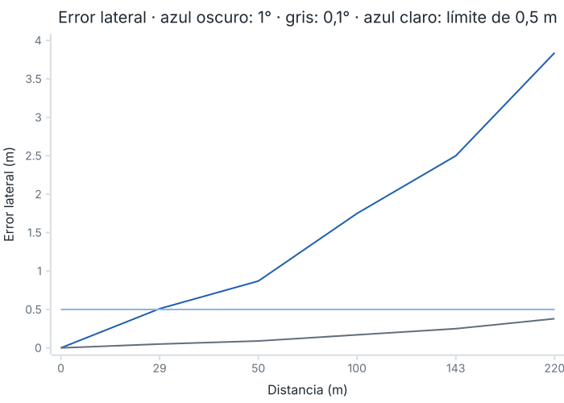

# Plan de viabilidad del uso del radar

| Campo | Valor |
|---|---|
| Proyecto | prueba-saf |
| Código | SAF-DIS-01 |
| Versión | 1.0 |
| Fecha | 2026-11-03 |
| Autor | Alicia Garcia |
| Estado | Cerrado |

Este documento cubre SYS-IMP-06 (enunciado R1): capacidades y limitaciones del radar para detectar obstáculos en la vía. Usa solo los datos decididos en `diseno.md` (v1.1) y en los requisitos v1.2. Los valores que dependen del radar elegido se fijan con su hoja de datos (regla R-HW, `diseno.md` §10).

## 1. Caso de uso y datos de partida

| Dato | Valor | Fuente |
|---|---|---|
| Entorno | Tranvía bidireccional, Vitoria-Gasteiz | SYS-GEN-02 |
| Velocidad máxima | 50 km/h = 13,9 m/s | H-07, `diseno.md` §3 |
| Alcance de detección | 220 m a lo largo de la vía | SYS-DET-01, SYS-PR-11 |
| Objeto mínimo | 0,6 m × 0,6 m × 0,6 m | SYS-DET-02, SYS-DET-08 |
| Ancho de vía | 1 m | H-01 |
| Radar | 3D (distancia, azimut y altura), a 1 m sobre el suelo, periodo de 50 ms | H-05, SYS-IN-01, SYS-IN-05 |
| Precisión de azimut y altura | 0,1 ° (calculada en §3.1; el 1 ° inicial era provisional) | SYS-DET-06, H-06 |
| Error de localización en distancia | 0,005 m (provisional) | SYS-DET-06 |
| Celda del grid | 0,25 m; 880 × 4 celdas | `diseno.md` §6.1 |

El campo de visión del sistema es lo que el radar alcanza a detectar y entrega como nube de puntos (H-08).

## 2. Capacidades

| Capacidad | Valor o decisión | Requisito |
|---|---|---|
| Medida 3D | Distancia, azimut y altura de cada eco; la conversión a (x, y, z) usa la altura del radar (paso 4) | H-05, SYS-PR-07, SYS-IN-05 |
| Objeto mínimo en el grid | Un objeto de 0,6 m ocupa al menos 3 celdas por lado | `diseno.md` §6.1 |
| Cadencia | Una nube cada 50 ms | SYS-IN-01 |
| Entrega | 128 ms de latencia de proceso; a 13,9 m/s el tranvía recorre 128 ms × 13,9 m/s = 1,78 m | SYS-T-01, `diseno.md` §9 |
| Tiempo de recorrido del alcance | 220 m / 13,9 m/s = 15,8 s | `diseno.md` §7 |
| Confirmación | Se reporta un objeto tras más de 2 ciclos seguidos, N = 3 | H-005, SYS-PR-09 |

## 3. Limitaciones

### 3.1 Error lateral creciente con la distancia

El error de medida en azimut y altura crece con la distancia (H-06). Se partió de 1 ° como valor provisional y se calculó si bastaba:

- error lateral = distancia × tan(precisión de azimut).
- Con 1 ° a 220 m: 220 m × tan(1 °) = 3,84 m, casi 4 veces la vía (1 m, H-01) y 15 celdas de 0,25 m.
- Criterio: para decidir si un eco está dentro o fuera de la vía (SYS-DET-05) el error lateral debe ser menor que la mitad del ancho de vía, 0,5 m.
- Precisión máxima admisible a 220 m: atan(0,5 m / 220 m) = 0,130 °. Se toma 0,1 °.
- Comprobación con 0,1 °: 220 m × tan(0,1 °) = 0,384 m, menor que 0,5 m. Con 1 ° el criterio solo se cumple hasta 0,5 m / tan(1 °) = 28,6 m.

| Distancia | Error lateral con 1 ° | Error lateral con 0,1 ° |
|---|---|---|
| 29 m | 0,51 m | 0,05 m |
| 50 m | 0,87 m | 0,09 m |
| 100 m | 1,75 m | 0,17 m |
| 143 m | 2,50 m | 0,25 m (una celda) |
| 220 m | 3,84 m | 0,38 m |

**Leyenda.** Azul oscuro: error lateral con 1° de precisión angular. Gris: error lateral con 0,1°. Azul claro (horizontal): límite de 0,5 m, la mitad del ancho de vía.

Consecuencias:

- El radar debe tener una precisión angular de 0,1 ° para cubrir los 220 m. Con 1 ° la discriminación lateral solo es fiable hasta ≈ 29 m.
- El error de altura es el mismo: 0,38 m a 220 m, menor que la altura mínima del objeto (0,6 m). Afecta al filtro de techo (paso 8) y a la altura del objeto (paso 11).
- La hoja de datos del radar elegido confirma el valor (regla R-HW).

### 3.2 Latencia y distancia recorrida

La entrega tarda como máximo 128 ms (SYS-T-01). En ese tiempo el tranvía avanza 1,78 m. El presupuesto temporal por paso y el margen de CPU se fijan con la ECU elegida (R-HW).

### 3.3 Dependencia de parámetros sin fijar

Los siguientes valores no tienen valor por defecto en el diseño y los aporta el radar o el vehículo elegidos (R-HW): umbral de señal débil, umbral de velocidad de objeto dinámico, altura del techo, distancia a raíles, parámetros del filtro de persistencia, tolerancia de reloj, error de desalineación y umbral de desalineación (`diseno.md` §4 y §10).

## 4. Riesgos y mitigaciones decididas

| Riesgo | Efecto | Mitigación en el diseño | Requisito |
|---|---|---|---|
| Curvas | Error en la conversión a coordenadas de vía (s, d) | Estimación de la curva con velocidad lineal y giro sincronizados (paso 3); hipótesis de giro constante; la incertidumbre de la curva reduce la confianza (paso 13) | SYS-PR-02, SYS-PR-06, H-02, H-03 |
| Puentes y techo | Falsos positivos por elementos sobre el tranvía | Descarte de lo situado por encima del techo (paso 8); se limita a reducir falsas alarmas | SYS-DET-04, paso 8 de `diseno.md` |
| Ecos de raíles | Falsas alarmas por el raíl | Descarte de detecciones muy cercanas a las coordenadas de los raíles, con filtro de persistencia (paso 9) | SYS-PR-03 |
| Desalineación del radar | Error de posición | Hipótesis de radar montado y calibrado (H-04); cálculo de la desalineación y paso a DEGRADADO si se detecta | SYS-DET-07, SYS-SAF-13 |
| Objetos en movimiento | Falsas alarmas en la vía | Se descartan antes de actualizar el grid y no modifican ninguna celda; no se reportan (pasos 5 y 10) | SYS-PR-05, pasos 5 y 10 de `diseno.md` |
| Ecos aislados o ruido | Falsas alarmas | Voto log-odds: eco +0,85, paso sin eco −0,40, saturación en [−0,8; 3,4]; umbral p > 0,85, que se alcanza con la tercera detección; confirmación con N = 3 | SYS-PR-08, SYS-PR-09 |
| Objetos pequeños | Alertas por objetos menores que el mínimo | Descarte de objetos con alguna dimensión menor de 0,6 m (paso 11b) | SYS-DET-02, SYS-DET-08 |
| Pérdida de ecos o del radar | Sin vigilancia | Modos INIT, NORMAL, DEGRADADO y FALLO; 3 mediciones sin detección ni raíles llevan a DEGRADADO; timeout de trama de 100 ms lleva a FALLO; la salida nunca entrega «libre» | SYS-SAF-01, SYS-SAF-07, SYS-SAF-08, SYS-SAF-12 |
| Exceso de falsas alarmas | Pérdida de utilidad | Paso a DEGRADADO; el máximo se mide por hora de operación y se valida en test con el cliente | SYS-SAF-18, SYS-DET-04 |

## 5. Hipótesis de partida

| ID | Hipótesis | Efecto en la viabilidad |
|---|---|---|
| H-01 | Ancho de vía de 1 m | Fija las 4 celdas de ancho y el límite de 0,5 m de error lateral |
| H-02 | Giro constante en el horizonte de análisis | Permite estimar la curva con velocidad y giro |
| H-03 | Velocidad y giro con periodo de 50 ms y timestamp de medida | Permite sincronizarlos con cada nube |
| H-04 | Radar montado y calibrado con el eje del tranvía | Sin ella, el error lateral crece con la desalineación |
| H-05 | Radar 3D | Permite filtrar por altura (techo, altura del objeto) |
| H-06 | El error de azimut y altura crece con la distancia | Origen de la limitación de §3.1 |
| H-07 | Velocidad máxima fijada en diseño: 13,9 m/s | Fija 1,78 m en 128 ms y 15,8 s en 220 m |
| H-08 | Campo de visión = lo que el radar detecta y entrega | Lo que el radar no detecta queda fuera de la vigilancia |

## 6. Qué debe aportar el radar elegido o un segundo radar

El diseño no fija el modelo de radar (`diseno.md` §3). El radar elegido debe aportar, con su hoja de datos, los valores marcados R-HW:

1. Precisión de azimut y altura de 0,1 ° o mejor, calculada en §3.1 (error lateral de 0,38 m a 220 m); la hoja de datos del radar la confirma.
2. Error de localización en distancia, que sustituye a los 0,005 m provisionales.
3. Umbral de señal débil y umbral y histéresis de velocidad para clasificar un eco como dinámico.
4. Timestamp de medida, sincronización con el reloj de la ECU y tolerancia de reloj.
5. Autodiagnóstico y aviso de autofallo (SYS-SAF-11).
6. Protocolo de enlace (Automotive Ethernet o CAN FD, según el fabricante) y periodo de 50 ms.

Se recomienda un segundo radar: reduciría el error de medida, sobre todo el de altura a gran distancia, y aportaría redundancia, que mejora la seguridad de un sistema que requiere seguridad funcional (EN 50126, EN 50128 y EN 50129, SIL 2). Es una propuesta al cliente, no un requisito; el número de radares se fija según la regla R-HW (`diseno.md` §3).

## 7. Conclusión de viabilidad

- El sistema es viable con los datos decididos: la detección de un objeto de 0,6 m sobre la vía es compatible con el diseño de grid y filtros, y la latencia máxima corresponde a 1,78 m de recorrido.
- Cubrir 220 m exige un radar con precisión angular de 0,1 °, que da 0,38 m de error lateral a esa distancia (§3.1). Con 1 ° solo es fiable hasta ≈ 29 m.
- Aun siendo viable con un radar, el sistema se beneficiaría de un segundo radar: reduce el error de medida y aporta redundancia, lo que mejora la seguridad de un sistema que requiere seguridad funcional. Se propone al cliente en la oferta.
- La viabilidad definitiva sobre los 220 m se confirma con la hoja de datos del radar elegido (regla R-HW) y con los tests con el cliente (SYS-DET-04).

## Historial de cambios

| Versión | Fecha | Autor | Cambios |
|---|---|---|---|
| 0.1 | 2026-11-02 | Alicia Garcia | Creación a partir de `diseno.md` y requisitos v1.1 |
| 0.2 | 2026-11-02 | Alicia Garcia | Precisión angular de 0,1 ° con cálculo y figura; conclusión con recomendación de segundo radar |
| 1.0 | 2026-11-03 | Alicia Garcia | Cierre del documento junto con el diseño: referencias a `diseno.md` v1.1 y a los requisitos v1.2 |
