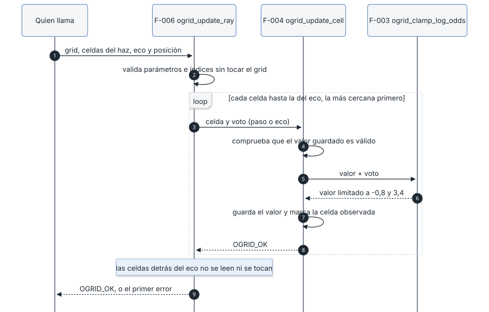
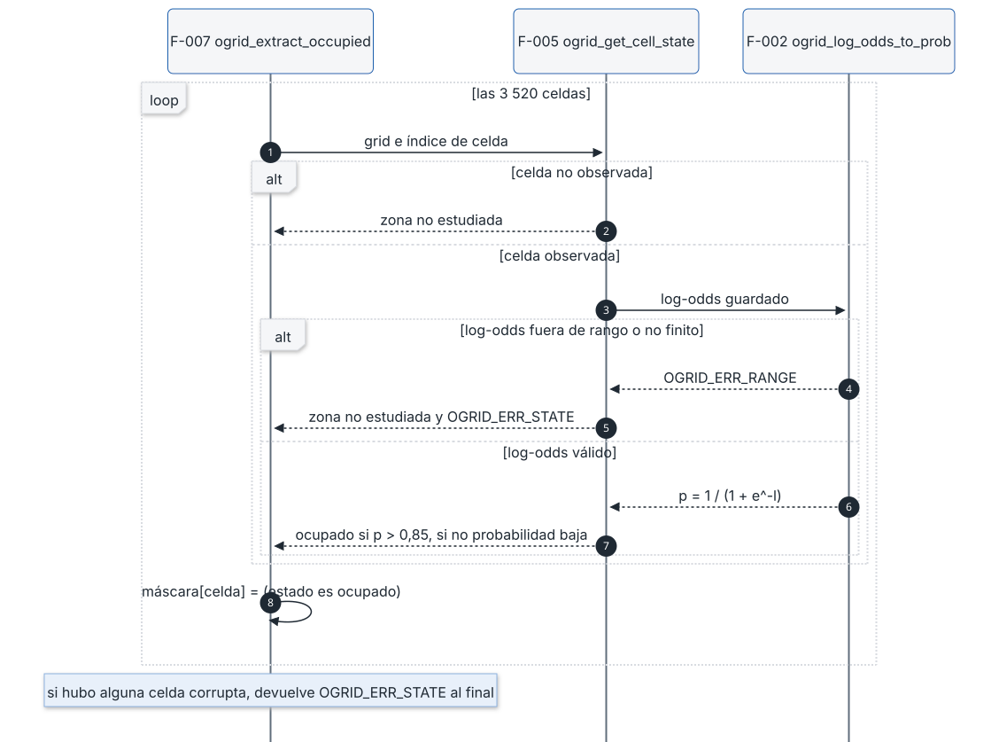

# Documento de implementación

| Campo | Valor |
|---|---|
| Proyecto | prueba-saf |
| Código | SAF-IMP |
| Versión | 1.2 |
| Fecha | 2026-11-03 |
| Autor | Alicia Garcia |
| Estado | Cerrado |

## 1. Alcance implementado

Se implementa el núcleo del grid de ocupación en log-odds (diseno.md §6 y paso 10, versión 1.2), por ser el componente central del sistema y el que SYS-IMP-10 toma como ejemplo. Son siete funciones, F-001 a F-007 (`plan.json`). Requisitos cubiertos: SYS-PR-08, SYS-SAF-07, SYS-PR-04 (solo la máscara de celdas ocupadas, que es la entrada de la agrupación) y SYS-IMP-01 (sin memoria dinámica).

El estado por celdas no se publica al HMI: el análisis de la rejilla es interno y al HMI solo llega la lista de objetos con el modo del sistema y el indicador de vigilancia (SYS-OUT-11, diseno.md §5.3 y §6.5). SYS-OUT-06 se retiró en los requisitos v1.2. Por eso la función F-008 («estado por celdas», que publicaba ese estado) se retiró del plan.

Además del módulo se entrega un visor de solo lectura que reproduce el grid paso a paso con el código C real (§7). Se añade un análisis de los tiempos de ejecución (WCET empírico) del módulo en el equipo de desarrollo (§4.5).

Quedan fuera de este alcance: el WCET en la ECU (§4.5), agrupación en objetos, filtro de tamaño, confirmación de N ciclos (pasos 11 a 12), geometría y conversión a coordenadas de vía, máquina de estados y desplazamiento del grid con el avance del tranvía. Ver «Pendientes y límites» al final.

Decisiones de implementación (el diseño no las fijaba), tomadas por el usuario el 2026-11-02:

- Representación numérica: `float` de 32 bits (IEEE-754 binary32) mediante `ogrid_real_t` (C-TYP-02). Ocupa 4 bytes por valor y la comprobación está en `ogrid_platform.h`.
- Grid fijo en coordenadas de vía (s, d): el módulo recibe índices de celda ya calculados.
- Los valores del modelo (votos, límites, umbral) son constantes de compilación por defecto en `ogrid_limits.h`, tomadas de diseno.md §10.
- El campo `observed` de cada celda es `uint8_t`, con los valores `OGRID_OBSERVED_NO` (0) y `OGRID_OBSERVED_YES` (1). Con `bool`, UBSan añade una rama que ningún test puede cubrir y no se alcanza el 100 % de ramas exigido (STD-TST §3). El cambio obligó a rehacer F-001 y F-004, que escriben o reescriben ese campo.
- Los tests se compilan con `gcc-16` (preset `host-test`). Con el `llvm-cov` de Apple, `gcovr` inventaba ramas que no existen en el código.

## 2. Arquitectura del módulo



Las flechas «llama a» van de la función que usa a la función que le da servicio: por ejemplo, F-005 llama a F-002 para obtener la probabilidad. Las flechas «lee» y «escribe» indican qué hace cada función con el grid.

### 2.1 Cómo encajan las funciones

El módulo `ogrid` guarda una rejilla de 880 × 4 celdas (la vía de 220 m dividida en cuadrados de 0,25 m). Cada celda tiene dos datos: su **log-odds**, un número que mide cuánta evidencia hay de que exista un obstáculo, y si alguna vez ha sido **observada**. Las siete funciones se reparten en tres papeles:

- **Escriben el grid.** `ogrid_reset_grid` (F-001) lo deja todo en «zona no estudiada» al arrancar o al volver de FALLO. Para cada haz del radar, `ogrid_update_ray` (F-006) recorre las celdas que cruza y llama a `ogrid_update_cell` (F-004) con el voto que toca. F-004 suma el voto al log-odds y pide a `ogrid_clamp_log_odds` (F-003) que lo mantenga entre −0,8 y 3,4.
- **Leen el grid.** `ogrid_get_cell_state` (F-005) decide en qué estado está una celda. Para ello necesita la probabilidad, que calcula `ogrid_log_odds_to_prob` (F-002) con p = 1 / (1 + e^−l).
- **Entrega el resultado.** `ogrid_extract_occupied` (F-007) devuelve una máscara con las celdas ocupadas, que será la entrada de la agrupación en objetos. Pregunta a F-005, de modo que la máscara y el estado de celda nunca se contradicen. Al HMI no llega el estado por celdas, sino solo la lista de objetos que saldrá de esa agrupación.

**Orden de dependencias.** Cada función solo usa funciones anteriores del plan: F-004 usa F-003; F-005 usa F-002; F-006 usa F-004; F-007 usa F-005. Por eso se implementan en este orden, de las más básicas a las compuestas.

**Ejemplo de un obstáculo.** Una celda empieza con log-odds 0 y no observada, es decir, «zona no estudiada». Un haz con eco en ella suma +0,85, y ya cuenta como observada. El log-odds pasa de 0 a 0,85, p = 0,70 y el estado es «probabilidad baja de obstáculo». Con el segundo eco llega a 1,70 (p = 0,8455), todavía por debajo del umbral 0,85. Con el tercero sube a 2,55 (p = 0,93) y la celda pasa a **ocupado**. Un eco suelto no basta. Si en cambio la onda pasa por la celda sin eco, resta 0,40, y si la celda queda detrás de un eco no cambia. El mínimo de −0,8 asegura que, aunque la celda haya perdido mucha evidencia, tres ecos seguidos la vuelvan a marcar como ocupada.

**Qué no ocurre nunca.** No existe el estado «libre»: que el radar no vea nada en una celda no demuestra que esté despejada (SYS-SAF-07). La probabilidad numérica y el estado por celdas son internos y no salen del módulo.

**Errores y seguridad.** Todas las funciones devuelven un código (`OGRID_OK`, `OGRID_ERR_PARAM`, `OGRID_ERR_RANGE` u `OGRID_ERR_STATE`) y no tocan nada si el parámetro es inválido. Si el grid contiene un valor corrupto, las funciones de lectura lo tratan como «zona no estudiada» y devuelven `OGRID_ERR_STATE`, para que quien las llama pase a un estado seguro.

**Qué queda fuera.** Este módulo no decide qué celdas cruza cada haz (eso es geometría), no agrupa celdas en objetos, no los confirma tras N ciclos y no desplaza el grid con el avance del tranvía.

### 2.2 Secuencia de un haz



F-006 valida todo el haz antes de tocar el grid. Después recorre las celdas de la más cercana a la más lejana y llama a F-004 por cada una. F-004 comprueba el valor guardado, suma el voto, pide a F-003 que lo limite y escribe el resultado. Las celdas detrás del eco no se leen ni se modifican (contrato F-006, POST-2).

### 2.3 Secuencia de la derivación del estado de una celda



F-007 pregunta a F-005 por cada una de las 3 520 celdas. F-005 devuelve «zona no estudiada» sin mirar el log-odds si la celda no está observada. Si está observada, pide la probabilidad a F-002 y la compara con el umbral 0,85. Un valor corrupto da «zona no estudiada» con `OGRID_ERR_STATE`. F-007 pone `true` solo en las celdas ocupadas y devuelve un único `OGRID_ERR_STATE` al final si encontró alguna corrupta.

## 3. Funciones

Cada ficha resume el contrato (`contratos/F-NNN-*.md`), explica el algoritmo del código de `src/ogrid/` y recoge los casos de `casos/casos-F-NNN.md` y las iteraciones de `log-tests.md`. Todas las funciones devuelven `ogrid_status_t`. Ninguna usa variables globales ni memoria dinámica.

### 3.1 F-001 · `ogrid_reset_grid`

**Requisitos:** SYS-PR-08, SYS-SAF-07, SYS-IMP-01 (contrato). Diseño: §6.1, §6.2 y §6.3.

**Propósito.** Deja las 3 520 celdas en «zona no estudiada» con log-odds 0. Se usa en el arranque y al volver de FALLO, porque las mediciones anteriores dejan de ser fiables (diseno.md §6.3).

**Firma.**

```c
ogrid_status_t ogrid_reset_grid(ogrid_t *grid_out);
```

**Contrato resumido.**

- PRE-1: `grid_out` no es `NULL`. Si lo es, devuelve `OGRID_ERR_PARAM` y no toca nada.
- POST-1 y POST-2: con `OGRID_OK`, todas las celdas tienen `log_odds_lo` igual a `OGRID_LOG_ODDS_INIT` (0,0) exacto y `observed` igual a `OGRID_OBSERVED_NO`.
- POST-3: ninguna celda queda ocupada ni con probabilidad baja. POST-4: es idempotente.
- Errores: `OGRID_OK` y `OGRID_ERR_PARAM`.

**Algoritmo.** Si el puntero es nulo, devuelve `OGRID_ERR_PARAM`. Si no, recorre las celdas de la 0 a la 3 519 y escribe en cada una el log-odds inicial y `observed = OGRID_OBSERVED_NO`. No lee nunca el contenido previo, así que da igual lo que hubiera en memoria. Cuesta O(3 520) con un bucle de cota fija.

**Decisiones.**

- Escribe campo a campo y no usa `memset`: el valor inicial sale de `OGRID_LOG_ODDS_INIT`, y el patrón de bits de 0,0 como `float` no está garantizado como «todo ceros» (comentario en `ogrid_reset_grid.c`).
- Un único retorno al final, con la guarda al principio (desviación DEV-001, ver §4.4).

**Casos de test (15, TC-F001-01 a 15).**

- Resultado y exactitud: TC-01 a 05 (OK, 3 520 celdas con 0,0 bit a bit y `observed` = NO, celdas 0 y 3 519, tamaño 3 520).
- Seguridad (SYS-SAF-07): TC-06 a 08 (partir de todo ocupado o todo con probabilidad baja y comprobar que nada queda con evidencia).
- Datos sucios: TC-09 (memoria a 0xFF, con NaN).
- Idempotencia y restauración: TC-10 y TC-11.
- Errores: TC-12 a 14 (puntero nulo, sin cambios en otros datos, código distinto de RANGE y STATE).
- Aislamiento (SYS-IMP-01): TC-15 (dos grids contiguos, solo se reinicia el primero).

**Iteraciones fallidas: 4** (plan.json).

| Ejecución | Fallo | Causa raíz |
|---|---|---|
| 1 | TC-F001-15, cobertura de ramas 60 %, MISRA con 11 hallazgos | El test comparaba bytes en bruto, relleno de la estructura incluido, y el contrato no lo garantiza. El ingeniero de tests pasó a comparar campo a campo (TC-10, 13 y 15). |
| 2 | Cobertura de ramas 60 %, MISRA con 11 hallazgos | Cobertura: `gcovr` con el `llvm-cov` de Apple inventaba 16 ramas en las líneas de asignación; MISRA: reglas 2.3, 2.4 y 2.5 en las cabeceras y 8.7 en la función pública, resueltas con las desviaciones DEV-002 y DEV-003. |
| 3 | Cobertura L 90,9 % y R 20,0 % (MISRA ya sin hallazgos) | Mismo artefacto de medición de `gcovr` con `llvm-cov`; un primer intento de separar el build de cobertura del de sanitizers no lo resolvió y se deshizo. |
| 4 | Cobertura 100 % pero resultado global FAIL | Todos los controles en verde, pero el árbol de trabajo tenía cambios sin commitear (el preset de `gcc-16`), y el informe no habilita el merge (GIT-MG-02). Con la compilación con `gcc-16` la cobertura se mide bien. |

La ejecución 5 pasó. Las ejecuciones 6 y 7 son cambios de auditoría de estándares (C-PRE-04, C-DOC-04: incluir `stdint.h` y `stdbool.h` y añadir el comentario de justificación). La ejecución 8 es la repetición tras pasar `observed` a `uint8_t` (§1).

### 3.2 F-002 · `ogrid_log_odds_to_prob`

**Requisitos:** SYS-PR-08. Diseño: §6.2.

**Propósito.** Convierte el log-odds de una celda en probabilidad de ocupación. Es la única conversión del módulo. La probabilidad es interna y no sale del módulo.

**Firma.**

```c
ogrid_status_t ogrid_log_odds_to_prob(ogrid_real_t log_odds_lo, ogrid_real_t *prob_out);
```

**Contrato resumido.**

- PRE-1: `prob_out` no es `NULL` (`OGRID_ERR_PARAM`). PRE-2: `log_odds_lo` es finito y está en [−0,8; 3,4] (`OGRID_ERR_RANGE`). Se comprueba PRE-1 antes que PRE-2.
- POST-1: `*prob_out` = 1 / (1 + e^−l) con error absoluto ≤ 1·10⁻⁶. POST-2: valores de referencia (0 → 0,5; 0,85 → 0,7005671; 1,70 → 0,8455347; 2,55 → 0,9275735; 3,4 → 0,9677045; −0,8 → 0,3100255).
- POST-3: 0 < p < 1 y estrictamente creciente. POST-5: con error, `*prob_out` no cambia.
- Errores: `OGRID_OK`, `OGRID_ERR_PARAM`, `OGRID_ERR_RANGE`.

**Algoritmo.** Comprueba el puntero. Después comprueba que l está en el intervalo con la forma positiva `(l >= MIN) && (l <= MAX)` negada: un NaN falla toda comparación, así que queda rechazado sin un caso aparte, igual que los infinitos. Si pasa, calcula `1 / (1 + expf(-l))`. Como l ≥ −0,8, el argumento de `expf` es como mucho 0,8 y no puede desbordar. Tiempo constante.

**Decisiones.** Se usa `expf` (float32) y no `exp`, para ser coherente con `ogrid_real_t` (assert estático en `ogrid_types.h`). Se comprueba el dominio antes de llamar a `<math.h>` (C-LIB-03). Un solo fichero, una sola conversión (C-NAM-06).

**Casos de test (27, TC-F002-01 a 27).**

- Valores analíticos: TC-02 a 09 (0, 0,85, 1,70, 2,55, 3,4, −0,8, valores literales del contrato y puntos interiores).
- Propiedades: TC-10 a 13 (acotación, monotonía en un barrido de 85 puntos, cadena creciente, simetría p(l) + p(−l) = 1).
- Límites y rangos inválidos: TC-14 a 19 (un ulp fuera de cada extremo, −1,0 y 4,0, NaN, ±infinito, ±`FLT_MAX`).
- Salida intacta tras error: TC-20 a 23, 25 y 26.
- Punteros nulos: TC-24 y 25. Determinismo: TC-27.

**Iteraciones fallidas: 0.** Tras la ejecución 1 hubo un cambio de auditoría del implementador: se corrigió un comentario de desbordamiento invertido y se eliminó la macro redundante `OGRID_PROB_ONE`. La ejecución 2 pasó.

### 3.3 F-003 · `ogrid_clamp_log_odds`

**Requisitos:** SYS-PR-08, SYS-SAF-07. Diseño: §6.2.

**Propósito.** Limita un log-odds al intervalo [−0,8; 3,4]. El máximo evita que una celda saturada tarde en dejar de ser «ocupado» (5 ciclos). El mínimo garantiza que tres ecos seguidos confirmen un obstáculo.

**Firma.**

```c
ogrid_status_t ogrid_clamp_log_odds(ogrid_real_t value_lo, ogrid_real_t *clamped_lo_out);
```

**Contrato resumido.**

- PRE-1: `clamped_lo_out` no es `NULL` (`OGRID_ERR_PARAM`). PRE-2: `value_lo` es finito (`OGRID_ERR_RANGE`). PRE-1 va antes que PRE-2.
- POST-1: dentro del intervalo, el valor sale igual, exacto. POST-2 y POST-3: por debajo sale −0,8 y por encima 3,4. POST-4: idempotente. POST-5: con error, la salida no cambia.
- Errores: `OGRID_OK`, `OGRID_ERR_PARAM`, `OGRID_ERR_RANGE`.

**Algoritmo.** Cadena de comparaciones. Primero, puntero nulo. Segundo, si el valor no está entre −`FLT_MAX` y `FLT_MAX` (forma negada, que también rechaza NaN), `OGRID_ERR_RANGE`. Tercero, si es menor que el mínimo, escribe el mínimo. Cuarto, si es mayor que el máximo, escribe el máximo. Si no, copia el valor. Tiempo constante, dos comparaciones de límites.

**Decisiones.** Cualquier valor finito es admisible, aunque esté lejos del intervalo: se limita, no se rechaza. `FLT_MAX` es el límite de finitud correcto porque `ogrid_real_t` es float32 (comentario añadido por una auditoría C-TYP-02).

**Casos de test (23, TC-F003-01 a 23).** Comparaciones exactas, sin tolerancia.

- Dentro del intervalo: TC-01 a 03, y los extremos −0,8 y 3,4 (TC-04 a 06, también un ulp dentro).
- Límites y particiones: TC-07 a 12 (un ulp fuera, −1,0, −100, 3,5, 4,0, 100, ±`FLT_MAX`, valores del diseño ±10).
- Propiedades: TC-13 a 15 (idempotencia, acotación y monotonía en un barrido de −5 a 5).
- Errores: TC-16 a 19 (NaN, ±infinito, salida intacta), TC-20 y 21 (puntero nulo).
- Sin estado residual y determinismo: TC-22 y 23.

**Iteraciones fallidas: 0.** Cambio de auditoría tras la ejecución 1 (comentario sobre `FLT_MAX`). La ejecución 2 pasó.

### 3.4 F-004 · `ogrid_update_cell`

**Requisitos:** SYS-PR-08, SYS-SAF-07. Diseño: §6.2 (regla general H-024/H-031) y paso 10.

**Propósito.** Aplica a una celda el voto de un haz: eco suma +0,85, paso sin eco suma −0,40 y celda oculta detrás de un eco no cambia. El resultado se limita a [−0,8; 3,4]. Es la regla que hace que un eco suelto no confirme un obstáculo y que tres seguidos sí.

**Firma.**

```c
ogrid_status_t ogrid_update_cell(ogrid_t *grid_io, uint32_t cell_idx, ogrid_vote_kind_t vote);
```

**Contrato resumido.**

- PRE-1: `grid_io` no es `NULL`. PRE-2: `vote` es uno de los tres votos válidos. Ambas dan `OGRID_ERR_PARAM`.
- PRE-3: `cell_idx` < 3 520 (`OGRID_ERR_RANGE`). PRE-4: el log-odds guardado es finito y está en [−0,8; 3,4] (`OGRID_ERR_STATE`). Se comprueba en ese orden y se devuelve el error de la primera que falla. PRE-4 se comprueba con cualquier voto, también con el de celda oculta.
- POST-1 y POST-2: eco y paso dejan limitar(anterior + voto) y `observed` = `OGRID_OBSERVED_YES`. POST-3: oculta no cambia nada. POST-4: solo cambia esa celda y el valor queda en el intervalo. POST-5: desde −0,8, tres ecos dejan p > 0,85. POST-6: con error, el grid no cambia.
- Errores: `OGRID_OK`, `OGRID_ERR_PARAM`, `OGRID_ERR_RANGE`, `OGRID_ERR_STATE`.

**Algoritmo.** Valida en cadena: grid y voto, índice, y valor guardado (la función auxiliar `is_stored_value_valid` usa la forma positiva de la comparación, así que rechaza NaN). Si todo es válido y el voto no es «oculta», `apply_delta` suma el voto al log-odds, llama a F-003 para limitarlo, guarda el resultado y pone `observed = OGRID_OBSERVED_YES`. Si el voto es «oculta», no hace nada. Tiempo constante.

**Decisiones.**

- Con la celda corrupta, el voto «oculta» también devuelve `OGRID_ERR_STATE`: así una celda corrupta nunca pasa inadvertida (contrato, orden de comprobación).
- Se eliminó una segunda validación dentro de `apply_delta`. Era una rama defensiva inalcanzable, porque el valor ya está validado antes; impedía llegar al 100 % de ramas. El estado devuelto por F-003 se descarta de forma explícita con `(void)`.
- Un eco o un paso marca la celda como observada, aunque esté en el mínimo y no cambie su valor (TC-F004-07).

**Casos de test (32, TC-F004-01 a 32).**

- Eco: TC-02 a 05 (+0,85, tres ecos 0,85 / 1,70 / 2,55, saturación en 3,4, desde −0,8).
- Paso: TC-06 a 09 (−0,40, mínimo exacto −0,8, eco y paso → 0,45).
- Oculta: TC-10 y 11 (celda sin observar y celda observada con 1,25, sin cambios).
- Propiedades: TC-12 a 17 (resto del grid intacto, índices 0, 3, 4 y 3 519, 400 votos mixtos dentro del intervalo, monotonía de 10 ecos, tres ecos desde −0,8 dan 1,75 > 1,7346, un eco no basta).
- Errores: TC-18 a 22 (grid nulo, voto inválido, índices 3 520, 3 521 y `UINT32_MAX`), TC-23 a 26 (celdas con NaN, ±infinito, un ulp fuera, ±10 y ±`FLT_MAX` dan `OGRID_ERR_STATE`; −0,8 y 3,4 almacenados son válidos).
- Secuencia, determinismo y orden de comprobación: TC-27, 28, 29 (oculta con celda corrupta), 30 a 32 (PARAM antes que RANGE, RANGE antes que STATE).

**Iteraciones fallidas: 2.**

| Ejecución | Fallo | Causa raíz |
|---|---|---|
| 1 | Cobertura L 96,3 %, R 91,7 % (28 casos) | Cláusulas del contrato sin ejercitar: voto «oculta» sobre celda corrupta y orden de las precondiciones. El ingeniero de tests añadió TC-F004-29 a 32. |
| 2 | Misma cobertura (32 casos) | Rama defensiva inalcanzable en `apply_delta`. El implementador quitó la segunda validación. |

La ejecución 3 pasó. La ejecución 5 es la repetición tras pasar `observed` a `uint8_t` (§1).

### 3.5 F-005 · `ogrid_get_cell_state`

**Requisitos:** SYS-PR-08, SYS-SAF-07. Diseño: §6.2 (estados derivados, H-012).

**Propósito.** Deriva el estado de una celda: ocupado, probabilidad baja de obstáculo o zona no estudiada. No existe «libre».

**Firma.**

```c
ogrid_status_t ogrid_get_cell_state(const ogrid_t *grid, uint32_t cell_idx, ogrid_cell_state_t *state_out);
```

**Contrato resumido.**

- PRE-1: `grid` y `state_out` no son `NULL` (`OGRID_ERR_PARAM`). PRE-2: `cell_idx` < 3 520 (`OGRID_ERR_RANGE`).
- POST-1: celda no observada → `OGRID_CELL_UNSURVEYED`, con cualquier log-odds, NaN incluido. POST-2: observada y p > 0,85 → `OGRID_CELL_OCCUPIED`. POST-3: observada y p ≤ 0,85 → `OGRID_CELL_LOW_PROB`. POST-4: nunca otro valor.
- POST-5: si `observed` no es 0 ni 1, o si una celda observada tiene un log-odds corrupto, devuelve `OGRID_ERR_STATE` y `*state_out` = `OGRID_CELL_UNSURVEYED`. POST-6: con `OGRID_ERR_PARAM` u `OGRID_ERR_RANGE` la salida no cambia, y el grid nunca se modifica.
- Errores: `OGRID_OK`, `OGRID_ERR_PARAM`, `OGRID_ERR_RANGE`, `OGRID_ERR_STATE`.

**Algoritmo.** Tras validar puntero e índice, mira `observed`. Si vale `OGRID_OBSERVED_NO`, devuelve «zona no estudiada» sin mirar el log-odds. Si vale `OGRID_OBSERVED_YES`, la función auxiliar `derive_observed_state` pide la probabilidad a F-002. Si F-002 rechaza el valor, devuelve `OGRID_ERR_STATE` y «zona no estudiada». Si p > 0,85 devuelve «ocupado», y si no, «probabilidad baja». Cualquier otro valor de `observed` es una celda corrupta: `OGRID_ERR_STATE` y «zona no estudiada». Tiempo constante.

**Decisiones.** Ante datos corruptos la salida es el estado seguro «zona no estudiada», nunca «libre» ni «probabilidad baja» (SYS-SAF-07). El log-odds de una celda no observada ni se mira ni es un error, porque `reset` y las celdas ocultas pueden dejar valores sin significado. La comparación es estricta (`>`), como pide el contrato.

**Casos de test (31, TC-F005-01 a 31).**

- Estados: TC-01 a 03 (OK, no observada con cualquier log-odds), TC-04 y 05 (l = 1,70 → baja, l = 2,55 → ocupado).
- Umbral y límites: TC-06 a 09 (l = 1,73 baja y l = 1,74 ocupado, extremos −0,8, 0 y 3,4).
- Propiedades: TC-10 y 11 (monotonía y salida siempre en los tres estados).
- Datos corruptos: TC-12 a 18 (`observed` = 2, 255, 3 y 7; log-odds NaN, ±infinito y fuera de rango), TC-31 (la celda corrupta no afecta a una vecina sana).
- Errores y orden: TC-19 a 24 y TC-27 a 30 (punteros nulos, índices 3 520, 3 521 y `UINT32_MAX`, orden PARAM, RANGE, STATE).
- Inmutabilidad e independencia de celdas: TC-25 y 26.

No se prueba l exactamente en el umbral ln(0,85 / 0,15) = 1,734601: con float32 no se puede decidir p = 0,85. Se usan 1,73 y 1,74, a unos 4·10⁻⁴ de p, muy por encima del error de `expf`. Los casos de test dejan dos dudas anotadas: el contrato no fija explícitamente el orden PARAM, RANGE, STATE (TC-27 a 30 asumen el orden implícito), y una celda no observada con NaN devuelve OK (TC-03).

**Iteraciones fallidas: 0** según `plan.json`. El log (`log-tests.md`) empieza en la ejecución 2 de esta función (ambas PASS, 31 casos); la ejecución 1 consta solo en `.harness/reports/F-005/run-1.json`.

### 3.6 F-006 · `ogrid_update_ray`

**Requisitos:** SYS-PR-08, SYS-SAF-07. Diseño: §6.2 y paso 10.

**Propósito.** Aplica un haz a las celdas que recorre, de la más cercana a la más lejana. Las anteriores al eco reciben «paso sin eco», la del eco recibe «eco» y las posteriores quedan ocultas. Sin eco, todas reciben «paso sin eco». Qué celdas cruza el haz lo calcula la geometría, que está fuera de este alcance.

**Firma.**

```c
ogrid_status_t ogrid_update_ray(ogrid_t *grid_io, const uint32_t *cells_in, uint32_t cell_count,
                                bool has_echo, uint32_t echo_pos);
```

**Contrato resumido.**

- PRE-1: `grid_io` no es `NULL`. PRE-2: `cells_in` no es `NULL` si `cell_count` > 0. Ambas dan `OGRID_ERR_PARAM`.
- PRE-3: `cell_count` ≤ 3 520. PRE-4: todos los índices son < 3 520, incluidos los de detrás del eco. PRE-5: si hay eco, `echo_pos` < `cell_count`. Las tres dan `OGRID_ERR_RANGE`.
- Orden: parámetros, rango y, por último, estado de las celdas. Con `cell_count` = 0, sin eco devuelve OK sin hacer nada y con eco devuelve `OGRID_ERR_RANGE`.
- POST-1 a POST-3: votos de paso, eco y celdas ocultas como en el propósito; las celdas que no están en el haz no cambian. POST-5: el ejemplo [10, 11, 12, 13] con eco en la posición 2 da −0,40, −0,40, +0,85 y la 13 sin cambio. POST-7: ante `OGRID_ERR_PARAM` u `OGRID_ERR_RANGE` el grid no se modifica.
- `OGRID_ERR_STATE` (propagado de F-004): las celdas anteriores a la corrupta pueden estar ya actualizadas; la corrupta y las posteriores no cambian. Una celda corrupta detrás del eco no da error, porque no se lee.
- Errores: `OGRID_OK`, `OGRID_ERR_PARAM`, `OGRID_ERR_RANGE`, `OGRID_ERR_STATE`.

**Algoritmo.** Tiene dos fases, en este orden.

1. **Validar.** Comprueba los punteros. Después `validate_ray` revisa `cell_count`, `echo_pos` y todos los índices de `cells_in`. Hasta aquí no se ha tocado el grid.
2. **Votar.** Calcula cuántas celdas procesar: hasta la del eco incluida si hay eco, o todas si no lo hay. `apply_votes` recorre esas celdas en orden y llama a F-004 con «paso» o, en la posición del eco, con «eco». Se detiene en el primer error de F-004. Las celdas de detrás del eco ni se leen ni se votan.

Para marcar «sin eco», la posición del eco se sustituye por `cell_count`, un valor que el bucle nunca alcanza; así no hace falta otro indicador. Coste O(`cell_count`) ≤ 3 520 llamadas a F-004.

**Decisiones.** Validar todo antes de modificar garantiza que un error de parámetro o de rango no deje cambios a medias (POST-7). Los índices de detrás del eco también se validan, para que el resultado no dependa de la posición del eco. Con una celda corrupta, la función se detiene y quien llama debe llevar el sistema a estado seguro (C-ERR-02) y reiniciar con F-001.

**Casos de test (46, TC-F006-01 a 46).**

- Ejemplo del contrato y particiones del eco: TC-01 a 09 (con y sin eco, eco en la primera y en la última posición, una sola celda, celdas ocultas y ajenas sin cambios).
- Valores analíticos y límites: TC-10 a 17 (0,5 + paso = 0,1, 0,5 + eco = 1,35, saturaciones en 3,4 y −0,8, varios haces seguidos, 30 haces mixtos).
- Haz vacío: TC-18 y 19 (OK) y TC-39 y 40 (con eco, `OGRID_ERR_RANGE`).
- Errores de parámetro y de rango: TC-20 a 33 y TC-41 a 44 (punteros nulos, `echo_pos` y `cell_count` fuera de rango, índice inválido en cualquier posición, haz máximo de 3 520 celdas válido, atomicidad, precedencia PARAM > RANGE > STATE).
- Celdas corruptas: TC-34 a 36 (valor fuera de rango, NaN e infinito dan `OGRID_ERR_STATE`), TC-45 y 46 (corrupta detrás del eco, no hay error).
- Haz sano y determinismo: TC-37 y 38.

**Iteraciones fallidas: 1.**

| Ejecución | Fallo | Causa raíz |
|---|---|---|
| 1 | TC-F006-34 y 36 fallan (38 casos); cobertura de ramas 96,2 % | Los tests daban por hecho que un `observed` corrupto produce `OGRID_ERR_STATE`, pero F-004 solo comprueba el log-odds. El ingeniero de tests corrigió TC-34 y 36 y añadió TC-39 a 46. |

La ejecución 2 pasó. La ejecución 3 es un cambio de auditoría (C-DOC-04) con solo comentarios.

### 3.7 F-007 · `ogrid_extract_occupied`

**Requisitos:** SYS-PR-04, SYS-PR-08. Diseño: §6.4 y paso 11 (H-026).

**Propósito.** Marca en una máscara las celdas ocupadas (p > 0,85). Es la entrada de la agrupación en objetos (SYS-PR-04), que queda fuera de este alcance. Usa la misma regla que el estado de celda, así que ambas salidas no se contradicen.

**Firma.**

```c
ogrid_status_t ogrid_extract_occupied(const ogrid_t *grid, bool *mask_out);
```

**Contrato resumido.**

- PRE-1: `grid` y `mask_out` no son `NULL` (`OGRID_ERR_PARAM`). `mask_out` apunta a un array de 3 520 `bool`.
- POST-1: `mask_out[i]` es `true` si y solo si F-005 daría «ocupado» para esa celda. POST-2: una celda no observada nunca es `true`. POST-3: l = 1,70 es `false` y l = 2,55 es `true`.
- POST-4: una celda corrupta queda en `false`, el resto de la máscara se calcula igual y devuelve `OGRID_ERR_STATE`. POST-5: no modifica el grid, y con `OGRID_ERR_PARAM` no toca la máscara.
- Errores: `OGRID_OK`, `OGRID_ERR_PARAM`, `OGRID_ERR_STATE`.

**Algoritmo.** Tras comprobar los punteros, recorre las 3 520 celdas. Por cada una llama a F-005 con un estado inicial «zona no estudiada». Si F-005 devuelve error, anota `OGRID_ERR_STATE` y sigue. Escribe `mask_out[idx] = (estado == ocupado)`. Como F-005 deja «zona no estudiada» en caso de error, la celda corrupta queda en `false`. Al terminar devuelve `OK` o un único `OGRID_ERR_STATE`. Coste O(3 520), una llamada a F-005 por celda.

**Decisiones.** No se repite la regla de ocupación: se delega en F-005, de modo que la máscara y el estado de celda no pueden diferir. El recorrido no se detiene en la primera celda corrupta, porque el contrato exige una máscara completa. Los índices que se pasan a F-005 son siempre válidos, así que no hay ramas inalcanzables para los tests.

**Casos de test (20, TC-F007-01 a 20).**

- Punteros nulos: TC-01 a 03.
- Máscara: TC-04 a 09 (grid nuevo, celdas no observadas con cualquier log-odds, l = 1,70 `false`, l = 2,55 `true`, l = 1,73 y 1,74 en el umbral, extremos −0,8, 0 y 3,4).
- Celdas corruptas: TC-10 a 13 y TC-17 (un ulp fuera de rango, NaN, ±infinito, `observed` 2, 128 y 255, y mezcla de siete corruptas con cuatro válidas dan un único `OGRID_ERR_STATE`).
- Patrones y consistencia con F-005: TC-14 a 16 (patrón módulo 7 con 1 508 `true`, máscara igual al estado «ocupado» en todas las celdas, celdas 0 y 3 519).
- Inmutabilidad, monotonía y determinismo: TC-18 a 20.

**Iteraciones fallidas: 0.** Cambio de auditoría tras la ejecución 1 (comentario de justificación, C-DOC-04). La ejecución 2 pasó.

## 4. Verificación

### 4.1 Proceso (implementación y test independientes)

El código y los tests los escriben dos agentes distintos, cada uno en su sandbox, sin verse (STD-TST TST-IND-03):

- El **implementador** escribe `src/` y `include/` a partir del contrato de la función. No ve `tests/` ni los informes de cobertura.
- El **ingeniero de tests** escribe `tests/` a partir del contrato, los requisitos y el diseño, y deriva los casos de `casos/casos-F-NNN.md`. No ve `src/`.
- El orquestador no escribe código ni tests. Cada ejecución de `h test F-NNN` añade una entrada a `log-tests.md` y cada corrección registra agente, causa raíz y commit.

Cada función se integra en una rama `feature/…` y pasa a `develop` solo si `h test F-NNN` da PASS en todos los checks (STD-TST §3). Cada función tuvo como máximo 4 iteraciones fallidas, por debajo del límite de 5 (TST-LOG-04).

### 4.2 Resultados por función

Resultado de la última ejecución registrada en `log-tests.md`. En todas, build, MISRA, tidy, format, complexity, doxygen y forbidden dan PASS, y la cobertura del fichero de la función es 100,0 % de líneas y 100,0 % de ramas.

| Función | Casos | Iteraciones fallidas | Ejecuciones en el log | Última ejecución |
|---|---|---|---|---|
| F-001 `ogrid_reset_grid` | 15 | 4 | 8 | 8, PASS |
| F-002 `ogrid_log_odds_to_prob` | 27 | 0 | 2 | 2, PASS |
| F-003 `ogrid_clamp_log_odds` | 23 | 0 | 2 | 2, PASS |
| F-004 `ogrid_update_cell` | 32 | 2 | 5 | 5, PASS |
| F-005 `ogrid_get_cell_state` | 31 | 0 | 2 (ejecuciones 2 y 3) | 3, PASS |
| F-006 `ogrid_update_ray` | 46 | 1 | 3 | 3, PASS |
| F-007 `ogrid_extract_occupied` | 20 | 0 | 2 | 2, PASS |
| **Total** | **194** | | | |

### 4.3 Integración completa

`h test --all` en la rama `test/integration` (ejecución 1, 2026-11-02 23:08) da **PASS** en todos los checks: build, unit+integration, coverage, MISRA, tidy, format, complexity, doxygen y forbidden. Ejecuta 209 casos: los 194 unitarios y 15 de integración. La cobertura es 100,0 % de líneas y 100,0 % de ramas en los siete ficheros de `src/ogrid/`.

Los 15 casos `TC-INT-01` a `15` (`tests/integration/test_integration_ogrid.c`) usan solo la API pública, con valores calculados a mano desde los requisitos y el diseño:

| Caso | Qué comprueba |
|---|---|
| TC-INT-01 | Tras el reinicio, todas las celdas están en «zona no estudiada». |
| TC-INT-02 a 04 | Un eco no confirma, dos no confirman y tres confirman «ocupado». |
| TC-INT-05 | Los pasos bajan el valor hasta el mínimo −0,8. |
| TC-INT-06 | Tres ecos tras una racha de pasos confirman. |
| TC-INT-07 y 08 | Una celda oculta detrás del eco no cambia, ya observada o no. |
| TC-INT-09 | Un haz con pasos, eco y celdas ocultas. |
| TC-INT-10 | Un haz vacío sin eco no hace nada. |
| TC-INT-11 | Los pasos erosionan una celda ocupada. |
| TC-INT-12 | Un reinicio tras acumular evidencia devuelve todo a «zona no estudiada». |
| TC-INT-13 | Un grid mezclado no produce nunca el estado «libre». |
| TC-INT-14 | Varios ciclos completos con varios haces. |
| TC-INT-15 | La evidencia tras un reinicio empieza de cero. |

El informe de integración (`.harness/reports/integration/latest.json`) no incluye el check `cross-aarch64`. `h test --all` solo lo ejecuta si el compilador `aarch64-linux-gnu-gcc` está instalado, y no lo está en esta máquina. La portabilidad al objetivo no se ha comprobado.

### 4.4 Cumplimiento de estándares y desviaciones

Los checks de `h test` (STD-TST §3) son:

| Check | Herramienta | Criterio | Resultado |
|---|---|---|---|
| build | CMake `host-test`, `gcc-16` | sin avisos con C-LNG-02 (`-Wall -Wextra -Wpedantic -Wconversion … -Werror`) | PASS |
| unit | Unity + CTest, ASan y UBSan | 100 % de casos | PASS (209 casos) |
| coverage | gcovr | 100 % líneas y 100 % ramas | PASS |
| misra | cppcheck con addon MISRA | 0 hallazgos no registrados | PASS |
| tidy | clang-tidy | 0 hallazgos | PASS |
| format | clang-format | 0 diferencias | PASS |
| complexity | lizard | CC ≤ 10, ≤ 60 líneas, ≤ 5 parámetros | PASS |
| doxygen | parser de `h test` | C-DOC-01/02 | PASS |
| forbidden | parser de `h test` | 0 símbolos de C-LIB-01/02 y 0 marcadores C-DOC-05 | PASS |

El check `forbidden` respalda SYS-IMP-01 (sin memoria dinámica), cuyo método de verificación es la inspección.

**Desviaciones MISRA C:2012** (`config/misra-desviaciones.md`, aprobadas por Alicia Garcia el 2026-11-02; supresiones en `config/cppcheck-suppressions.txt`):

| ID | Regla | Ámbito | Justificación | Riesgo |
|---|---|---|---|---|
| DEV-001 | 15.5 (un único punto de salida) | Proyecto | Las cláusulas de guarda al inicio mejoran la legibilidad y evitan anidamiento profundo (C-FUN-03). | Bajo: el retorno anticipado ocurre antes de cualquier efecto lateral. |
| DEV-002 | 2.3, 2.4, 2.5 (tipos, etiquetas y macros sin usar) | `include/ogrid/*.h` | Las cabeceras declaran la API y las constantes para sus consumidores; el análisis por unidad de traducción no ve usados los que esa unidad no necesita. | Bajo: son solo declaraciones, no generan código. |
| DEV-003 | 8.7 (símbolo con enlace externo usado en una sola unidad) | Funciones públicas de `src/ogrid/` | Una función pública por fichero (C-NAM-06): cada una forma la API y se usa desde otras unidades o desde los tests. | Bajo: el enlace externo es el pretendido. |

### 4.5 Tiempos de ejecución (WCET)

**Qué es y qué no es.** Es una medida empírica del tiempo de ejecución en el equipo de desarrollo: Apple M5, macOS (Darwin arm64 25.5.0), `gcc-16` (16.2.0), preset `host-bench` en Release, sin sanitizers ni cobertura (`wcet-medidas.md`). **No es el WCET de la ECU**, cuyo procesador no está elegido (regla R-HW, diseno.md §9 y §10). El valor «máx» es el máximo observado en 3 ejecuciones, no una cota demostrada. Sirve para contrastar los objetivos de la sección 7 de los contratos y el presupuesto de diseno.md §9 (SYS-T-01, SYS-IMP-02), y para estimar; no sustituye la medida en destino. Las cifras de los escenarios y la metodología están en `casos/casos-wcet-ogrid.md`; los resultados en bruto, en `wcet-medidas.md`.

#### Método 1: cuenta de operaciones del peor camino

Se cuenta desde el código de `src/ogrid/`, sin suponer tiempos. En ninguna función hay memoria dinámica ni recursión, y todos los bucles tienen cota estática (`OGRID_CELL_COUNT` = 880 × 4 = 3 520, `ogrid_limits.h`). La operación más costosa del módulo es la exponencial `expf` de `ogrid_log_odds_to_prob`, que se llama una vez por cada celda observada que se evalúa.

| Función | Bucles y cota | Llamadas anidadas en el peor camino | Exponenciales `expf` | Resto del peor camino |
|---|---|---|---|---|
| F-001 `ogrid_reset_grid` | 1 bucle, 3 520 iteraciones | ninguna | 0 | 7 040 escrituras (2 por celda) y 1 comparación de puntero |
| F-002 `ogrid_log_odds_to_prob` | ninguno | ninguna | 1 | 3 comparaciones, 1 negación, 1 suma y 1 división |
| F-003 `ogrid_clamp_log_odds` | ninguno | ninguna | 0 | 5 comparaciones y 1 escritura |
| F-004 `ogrid_update_cell` | ninguno | 1 a F-003 | 0 | hasta 9 comparaciones, 1 suma y 2 escrituras |
| F-005 `ogrid_get_cell_state` | ninguno | 1 a F-002 (celda observada) | 1 | 6 comparaciones |
| F-006 `ogrid_update_ray` | `validate_ray`: hasta 3 520 iteraciones; `apply_votes`: hasta 3 520 iteraciones | hasta 3 520 a F-004 y, por ellas, 3 520 a F-003 | 0 | 3 520 comparaciones de índice, más las de F-004 y F-003 |
| F-007 `ogrid_extract_occupied` | 1 bucle, 3 520 iteraciones | 3 520 a F-005 y, por ellas, 3 520 a F-002 | 3 520 | 3 520 escrituras en la máscara |

Notas de la cuenta:

- F-006 llega a las 3 520 llamadas a F-004 cuando el haz tiene 3 520 celdas y no hay eco, o el eco está en la última celda; con eco antes, procesa hasta la celda del eco incluida (`apply_votes`, `process_count`). Las celdas detrás del eco solo se validan.
- F-005 con la celda no observada o corrupta (`observed` distinto de 0 y 1) no llega a F-002 y no calcula `expf`. F-007 en el peor caso tiene las 3 520 celdas observadas y válidas.
- F-002 comprueba el dominio antes de llamar a `expf` (C-LIB-03), así que no hay rutas con entradas fuera de dominio hacia `expf`.

#### Método 2: medida

El ejecutable es `tests/integration/bench_wcet_ogrid.c` (caja negra, solo la API pública de `include/ogrid/`). Metodología (`casos/casos-wcet-ogrid.md`):

- Reloj `clock_gettime_nsec_np(CLOCK_UPTIME_RAW)` en macOS, de resolución medida 41 ns. Una lectura vacía cuesta unos 8,9 ns (escenario «reloj: lectura vacía»).
- Lotes adaptativos: cada medida cronometra un lote de K llamadas (calibrado por escenario hasta que dura al menos 200 µs) y divide entre K. El error de cuantización (resolución / duración del lote) queda entre 0,02 % y 0,15 % en todos los escenarios, por debajo del 1 %.
- Entradas de peor caso: rutas con exponencial, haces de 10, 880 y 3 520 celdas, con y sin eco en la última celda (sin celdas ocultas, todas se leen), y 3 520 celdas observadas en la máscara con mitad, todas y ninguna ocupadas.
- El estado se restaura fuera del cronómetro. En los haces, cada llamada del lote usa una ventana distinta para que ninguna celda sature.
- Precalentamiento de 50 repeticiones; 2 000 repeticiones en los escenarios rápidos y 500 en los que recorren el grid. Entradas fijas, sin aleatoriedad. Resultados anti-eliminados con variables `volatile`.
- Se ejecutó 3 veces seguidas. Las tablas dan, por escenario, la mediana de las 3 medianas y el máximo de los 3 máximos, en ns por llamada.

| Función | Escenario más costoso | Mediana (ns) | Máx. observado (ns) |
|---|---|---:|---:|
| F-001 `ogrid_reset_grid` | grid de 3 520 celdas sucio | 796 | 908 |
| F-002 `ogrid_log_odds_to_prob` | barrido [−0,8; 3,4] | 1,80 | 2,08 |
| F-002 | l = −0,8 (mínimo) | 1,77 | 2,10 |
| F-003 `ogrid_clamp_log_odds` | por debajo (−5) | 0,808 | 14,6 (*) |
| F-003 | por encima (10) | 0,770 | 2,39 |
| F-004 `ogrid_update_cell` | eco desde 3,4 (saturada) | 2,08 | 3,22 |
| F-004 | eco desde 0,0 | 2,08 | 2,35 |
| F-004 | oculta desde 0,0 | 1,15 | 2,38 |
| F-005 `ogrid_get_cell_state` | observada, l = 1,70 (probabilidad baja) | 2,62 | 3,29 |
| F-005 | observada, l = 2,55 (ocupada) | 2,62 | 2,99 |
| F-006 `ogrid_update_ray` | 10 celdas, eco en la última | 22,4 | 36,7 |
| F-006 | 880 celdas, eco en la última | 1 780 | 2 710 |
| F-006 | 3 520 celdas, sin eco | 7 030 | 10 100 |
| F-006 | 3 520 celdas, eco en la última | 7 030 | 11 900 |
| F-007 `ogrid_extract_occupied` | 3 520 observadas, todas ocupadas | 9 150 | 10 600 |
| F-007 | 3 520 observadas, mitad ocupadas | 9 150 | 10 300 |
| F-007 | grid sin observar (referencia inferior) | 3 200 | 3 610 |

(*) Valor aislado de la ejecución 3 (las ejecuciones 1 y 2 dan 1,52 y 1,29 ns). No se ha investigado su causa; es compatible con una interrupción del sistema operativo u otro efecto de la máquina de medida, pero no está confirmado. Las medianas de las tres ejecuciones coinciden.

**Coste por celda.** Con el máximo observado, los haces largos (880 y 3 520 celdas) cuestan entre 2,4 y 3,4 ns por celda, y la máscara de 3 520 celdas observadas, entre 2,8 y 3,0 ns por celda (tablas «Estimaciones por haz y por celda» de `wcet-medidas.md`). Con la mediana salen unos 2,0 ns por celda en los haces (1 780 ns / 880 y 7 030 ns / 3 520) y unos 2,6 ns en la máscara (9 150 ns / 3 520). El haz de 10 celdas sale más caro por celda (hasta 3,7 ns) porque en él pesa el coste fijo de la validación y de la llamada. Reiniciar el grid cuesta 0,23 ns por celda con la mediana (796 ns / 3 520).

#### Contraste con los objetivos de los contratos

Sección 7 de cada contrato, contra el máximo observado en el equipo de desarrollo (no en la ECU):

| Función | Objetivo del contrato | Máx. observado en el M5 | ¿Se cumple en el M5? |
|---|---|---:|---|
| F-001 | muy inferior a 1 ms | 0,908 µs | Sí: unas 1 100 veces menos que 1 ms. |
| F-002 | muy inferior a 1 µs | 2,10 ns | Sí: 0,21 % de 1 µs. |
| F-003 | muy inferior a 1 µs | 14,6 ns (valor aislado; 2,39 ns sin él) | Sí: 1,5 % de 1 µs en el peor caso. |
| F-004 | muy inferior a 1 µs | 3,22 ns | Sí: 0,32 % de 1 µs. |
| F-005 | muy inferior a 1 µs | 3,29 ns | Sí: 0,33 % de 1 µs. |
| F-006 | decenas de µs por haz | 2,71 µs (880 celdas) y 11,9 µs (3 520 celdas) | Sí: por debajo del orden fijado, incluso con el haz máximo de 3 520 celdas. |
| F-007 | bajo 1 ms | 10,6 µs | Sí: 1,1 % de 1 ms. |

Estas cifras son del M5 y no prueban que los objetivos se cumplan en la ECU. Se midió con la memoria caliente (precalentamiento y lotes repetidos), de modo que no incluyen fallos de caché que sí podrían darse en el ciclo real. La medida con caché fría no se ha hecho y queda para la medida en la ECU.

#### Contraste con el presupuesto del diseño

Diseno.md §9: la entrega se limita a 128 ms (SYS-T-01) y, como la publicación espera al temporizador de 50 ms, el procesamiento de cada nube debe caber en 128 − 50 = 78 ms. SYS-IMP-02 exige además un ciclo máximo ≤ 128 ms.

El coste de proceso del grid en un ciclo es:

> t_ciclo(grid) = n_haces × t_haz + t_máscara (+ t_reset solo al arrancar o al volver de FALLO)

con t_haz = coste de `ogrid_update_ray` (F-006), t_máscara = coste de `ogrid_extract_occupied` (F-007) y t_reset = coste de `ogrid_reset_grid` (F-001). Faltan por sumar los pasos del pipeline que no están implementados (geometría de qué celdas cruza cada haz, agrupación en objetos, filtro de tamaño, confirmación de N ciclos, máquina de estados y publicación; ver «Pendientes y límites»). Este t_ciclo(grid) es por tanto una parte del procesamiento, no el total. El número de haces por ciclo depende del radar (R-HW) y no consta en los documentos: se fija con la hoja de datos del radar elegido (regla R-HW, `diseno.md` §10).

Con el máximo observado en el M5, y t_máscara = 10,6 µs:

| Haz | t_haz (máx.) | Haces que caben en 78 ms (todo el presupuesto, solo grid) | Haces con holgura: se usa solo el 10 % del presupuesto (7,8 ms) |
|---|---:|---:|---:|
| 880 celdas con eco en la última (haz más largo a lo largo de la vía) | 2,71 µs | 28 778 | 2 874 |
| 3 520 celdas con eco en la última (cota absoluta del módulo) | 11,9 µs | 6 553 | 654 |

El criterio del 10 % es una elección de este apartado para ilustrar una holgura, no un requisito del proyecto. El contrato de F-004 prevé que se la llame hasta unas decenas de miles de veces por ciclo de 50 ms (sección 7); con el máximo de 3,22 ns por llamada, cada 10 000 llamadas suman 32,2 µs en el M5.

**Sensibilidad (ilustración, no estimación).** La tabla multiplica los máximos del M5 por un factor de lentitud de la ECU respecto al M5 de 10, 50 y 100. Los factores son hipótesis para ver el orden de magnitud: no salen de ninguna medida ni de ninguna ECU (R-HW). Haces que caben en 78 ms, solo con el coste del grid y sin holgura:

| Factor | t_haz 880 celdas | t_haz 3 520 celdas | t_máscara | t_reset | Haces de 880 celdas en 78 ms | Haces de 3 520 celdas en 78 ms |
|---|---:|---:|---:|---:|---:|---:|
| 1 (M5, medido) | 2,71 µs | 11,9 µs | 10,6 µs | 0,908 µs | 28 778 | 6 553 |
| 10 | 27,1 µs | 119 µs | 106 µs | 9,08 µs | 2 874 | 654 |
| 50 | 135,5 µs | 595 µs | 530 µs | 45,4 µs | 571 | 130 |
| 100 | 271 µs | 1 190 µs | 1 060 µs | 90,8 µs | 283 | 64 |

Con un factor de 100, la máscara (1,06 ms) pasaría el objetivo de F-007 («bajo 1 ms»), y el haz de 3 520 celdas (1,19 ms) quedaría muy por encima de las «decenas de µs» de F-006. Con un factor de 10, el haz de 880 celdas (27,1 µs) sigue en decenas de µs.

#### Límites y siguiente paso

- No se ha compilado para la ECU: el build `cross-aarch64` no se ha ejecutado (§4.3), y no hay medida ni análisis de WCET en el hardware real. Hasta entonces, las cifras de este apartado solo valen para el M5.
- El máximo observado en 3 ejecuciones no es una cota: otra ejecución puede dar un valor mayor (por ejemplo, el valor aislado de F-003).
- Siguiente paso: elegir la ECU (R-HW), compilar con el preset `cross-aarch64`, medir con este mismo benchmark o analizar el WCET en destino, y volver a contrastar con los objetivos de los contratos y con el presupuesto de 78 ms con el número real de haces por nube.
- El benchmark se ejecuta con `cmake --preset host-bench && cmake --build build/host-bench && build/host-bench/bench_wcet_ogrid` (§6).

## 5. Trazabilidad

Ver `trazabilidad.md` (generado con `h trace`). Resumen:

- **SYS-PR-08** (Must, Test): cubierto por F-001 a F-007.
- **SYS-SAF-07** (Must, Test): cubierto por F-001, F-003 y F-005, y por los casos de seguridad de F-004 y F-006 y de la integración (sin estado «libre», datos corruptos a estado seguro).
- **SYS-PR-04** (Must, Test): `trazabilidad.md` lo marca «Cubierto» por F-007, pero solo cubre la máscara de celdas ocupadas. La agrupación en objetos no está implementada.
- **SYS-IMP-01** (Must, Inspección): `trazabilidad.md` lo marca «Fuera del alcance implementado» y solo le asocia TC-F001-15. Su comprobación es el check `forbidden` de §4.4.
- El resto de requisitos de `trazabilidad.md` figuran como «Fuera del alcance implementado».

## 6. Construcción, ejecución y despliegue

**Herramientas necesarias.** CMake 3.20 o superior; `gcc-16` (preset `host-test`); Unity en `third_party/unity` (incluido en el repositorio); `gcovr`; `cppcheck` con el addon MISRA; `clang-tidy`; `clang-format`; `lizard`; `doxygen`. Para el preset `cross-aarch64`, un compilador `aarch64-linux-gnu-gcc` o `aarch64-unknown-linux-gnu-gcc`.

**Presets de `CMakePresets.json`.**

| Preset | Uso |
|---|---|
| `host-test` | Tests: `H_TEST`, `H_COVERAGE` y `H_SANITIZE` activos (ASan y UBSan), `gcc-16`, tipo Debug. |
| `host-bench` | Medidas de tiempo (§4.5): `H_BENCH` activo, Release con `gcc-16`, sin sanitizers ni cobertura. Construye `bench_wcet_ogrid`. |
| `host-debug`, `host-release` | Compilación del módulo en el equipo, sin tests. |
| `linux-container` | Release con `gcc`, para el contenedor Linux. |
| `cross-aarch64` | Release con el toolchain `cmake/aarch64-linux-gnu.cmake`, para comprobar la portabilidad al objetivo. |

**Comandos.**

```
cmake --preset host-test
cmake --build --preset host-test
ctest --preset host-test
```

```
H="/Users/alicia/prueba-saf/.claude/harness/bin/h"
$H test F-001        # una función: los 9 checks de STD-TST §3
$H test --all        # integración completa, sobre todo el árbol
```

**Medida de tiempos (WCET empírico).** Desde la raíz del repositorio:

```
cmake --preset host-bench && cmake --build build/host-bench && build/host-bench/bench_wcet_ogrid
```

Imprime las tablas por escenario (ver §4.5). Los resultados de las 3 ejecuciones de referencia están en `wcet-medidas.md`. Solo vale para el equipo donde se ejecuta, no para la ECU.

Cada `h test` añade una entrada a `docs/03-implementacion/log-tests.md` y guarda el informe en `.harness/reports/`. `h doxygen` genera la documentación HTML en `build/doxygen/`.

**Resultado de la construcción.** Se obtiene la biblioteca estática `libogrid` (todos los `src/ogrid/*.c`, enlazada con `libm` por `expf`). Cada fichero de `tests/unit/` y de `tests/integration/` es un ejecutable de Unity.

**Despliegue.** Aún no hay aplicación: `src/app/` y `src/hal/` están vacíos (solo `.gitkeep`) y `CMakeLists.txt` solo crea el ejecutable `ogrid_app` si existen fuentes en esas carpetas. Este módulo se entrega como biblioteca estática `libogrid` junto con sus tests. El despliegue en la ECU depende del hardware y de la aplicación, que se definen cuando se elija la ECU (regla R-HW, `diseno.md` §10); quien lo integre usa el preset `cross-aarch64`, que todavía no se ha ejecutado en este entorno (decisión del usuario).

**Visor del grid.** Necesita `gcc` o `cc` y Python 3 (`tools/ogrid_demo.py` prefiere `gcc-16` si existe y, si no, usa `cc`). No usa CMake. Desde la raíz del repositorio:

```
python3 tools/ogrid_demo.py --serve    # genera los datos y sirve frontend/
```

Después se abre http://localhost:8080. El puerto se cambia con `--port`. Sin `--serve`, el script solo regenera `frontend/data/escenarios.json`. La biblioteca dinámica se deja en `build/ui/` (`.dylib` en macOS, `.so` en Linux). Ver §7.

## 7. Interfaz de usuario

### 7.1 Qué es el visor

El visor es una página web de solo lectura que reproduce, paso a paso, escenarios del grid de ocupación. No tiene ningún control que actúe sobre el sistema: solo consume datos (UI-TEC-03). Sus controles (escenario, anterior, siguiente, inicio, tema, elegir celda) solo cambian lo que se ve. Es independiente del HMI del tranvía, que recibe solo la lista de objetos (SYS-OUT-11) y no forma parte de este alcance.

Está hecho con HTML, JavaScript sin frameworks y Canvas 2D (UI-TEC-01). Los colores salen de variables CSS (UI-TEC-02). Los ficheros son `frontend/index.html`, `frontend/app.js` y `frontend/viewer.css`.

### 7.2 Qué muestra

- **Ventana del grid.** 24 celdas de largo (de s = 100 a 123) por 4 carriles (d0 a d3). El tranvía queda a la izquierda y el avance de la vía va hacia la derecha.
- **Colores por probabilidad.** Cada celda se pinta con una rampa entre «p = 0» y «p = 1» según la probabilidad que da `ogrid_log_odds_to_prob` (F-002). Las celdas no estudiadas se pintan en gris.
- **Celdas ocupadas.** Borde rojo con un anillo del color de fondo debajo, para que el rojo contraste también con la celda más oscura. La marca sale de la máscara de `ogrid_extract_occupied` (F-007).
- **Leyenda** de la rampa, la zona no estudiada y el borde de ocupado.
- **Historia de la celda elegida.** Al pulsar una celda, una tabla da, para cada ciclo, su log-odds, su probabilidad y su estado (de `ogrid_get_cell_state`, F-005).
- **Todo el grid.** Dos contadores: celdas ocupadas y celdas observadas de las 3 520, no solo de la ventana.
- **Constantes del modelo,** leídas de `include/ogrid/ogrid_limits.h`: voto por eco +0,85, voto por paso sin eco −0,4, celda oculta sin cambio, límites del log-odds de −0,8 a 3,4, ocupado si p > 0,85 y grid de 880 × 4 celdas.
- **Tema claro y oscuro,** conmutable; el claro es el de partida y la elección se recuerda en `localStorage` (UI-TEC-05).

### 7.3 Los seis escenarios

Los valores son los del log-odds de la celda que sigue cada escenario, tal como salen de `frontend/data/escenarios.json`. Al principio todas las celdas están en «zona no estudiada».

| Escenario | Celda seguida (s, d) | Log-odds por ciclo | Resultado |
|---|---|---|---|
| Un eco aislado no confirma | (110, 1) | 0,85 (p = 0,7006) | Probabilidad baja; ocupadas: 0. |
| Tres ecos seguidos confirman | (110, 1) | 0,85 / 1,70 / 2,55 (p = 0,7006 / 0,8455 / 0,9276) | Ocupado en el ciclo 3; ocupadas: 1. |
| Tras una racha de pasos, tres ecos siguen confirmando | (108, 2) | −0,4 / −0,8 / −0,8, y luego 0,05 / 0,90 / 1,75 (p = 0,852 en el último) | Ocupado en el ciclo 6; ocupadas: 1. |
| Una celda detrás de un eco no cambia | (108, 0) | −0,4 en el ciclo 1 y −0,4 en el ciclo 2 | La celda, oculta tras el eco en la celda 105, no cambia. |
| Varios haces por ciclo y un objeto de varias celdas | (110, 1) | 0,85 / 1,70 / 2,55 | Ocupado en el ciclo 3; ocupadas: 2; observadas: 50. |
| El reinicio olvida todo | (110, 1) | 0,85 / 1,70 / 2,55 y reinicio: 0 | Tras el reinicio, ocupadas 0 y observadas 0. |

En los escenarios con un solo haz se observan 11 celdas (14 en la racha de pasos y 16 en la celda oculta). El tercer escenario muestra el efecto del mínimo −0,8: desde ahí, tres ecos bastan para confirmar (diseno.md §6.2).

### 7.4 De dónde salen los números

Los números no los calcula la página ni una copia de la lógica en otro lenguaje: los calcula el código C real del módulo. El flujo es este.



1. `tools/ogrid_demo.py` compila `src/ogrid/*.c` en una biblioteca dinámica (`build/ui/libogrid`), con `gcc-16` si existe y, si no, con `cc`, enlazada con `libm`.
2. Con `ctypes` carga esa biblioteca y llama a las funciones públicas: `ogrid_reset_grid`, `ogrid_update_ray`, `ogrid_get_cell_state`, `ogrid_log_odds_to_prob` y `ogrid_extract_occupied`.
3. Ejecuta los seis escenarios ciclo a ciclo. Después de cada ciclo guarda el estado de la ventana de 24 × 4 celdas y los totales de todo el grid.
4. Escribe todo en `frontend/data/escenarios.json`. Las constantes del modelo las lee de `ogrid_limits.h` con una expresión regular, para no duplicarlas.
5. La página (`app.js`) lee ese JSON con `fetch` y lo reproduce. Si no lo encuentra, muestra «sin datos: ejecuta tools/ogrid_demo.py --serve».

El script comprueba el código de retorno de cada llamada y falla si alguna no devuelve `OGRID_OK`.

**Qué es y qué no es.** `tools/ogrid_demo.py` y `frontend/` son herramientas de la interfaz, no código del sistema ni del núcleo C (así lo dice la cabecera del script). El código del módulo (`src/ogrid/`) no se modifica. Por eso no pasaron por el ciclo de agentes aislados (implementador e ingeniero de tests, §4.1) ni por los checks de `h test`: se consideran código no crítico, tratado según STD-UI. Esa clasificación es una decisión del proyecto y el texto de `frontend.md` no la formula con esas palabras (ver «Pendientes y límites»). Los números, en cambio, sí pasan por el código verificado de §4.

**Por qué no se usó `ui_bridge.py`.** El estándar (UI-TEC-04) prevé `tools/ui_bridge.py` para datos en vivo: un puente de MQTT a Server-Sent Events. Este módulo no publica ni consume mensajes MQTT y aún no hay aplicación que los genere (§6), así que no habría nada que escuchar. Además, el puente es para flujo en vivo y aquí se necesitan escenarios repetibles y paso a paso. Por eso el visor reproduce un fichero grabado, en la línea del modo replay que menciona UI-TEC-04 (que habla de ficheros de STD-DAT; aquí el formato es propio del visor).

## Pendientes y límites

- **No implementado.** Agrupación de celdas en objetos (SYS-PR-04), filtro de tamaño, confirmación de N ciclos, geometría (qué celdas cruza cada haz y conversión a coordenadas de vía) y máquina de estados.
- **WCET medido solo en el equipo de desarrollo; falta medir en la ECU.** Las medidas son de un Apple M5 (§4.5) y el máximo observado no es una cota demostrada. El diseño fija un presupuesto de proceso de 78 ms por nube (128 ms − 50 ms, diseno.md §9); el número de haces por nube depende del radar (R-HW) y no consta.
- **Portabilidad al objetivo.** El build `cross-aarch64` no se ha ejecutado por falta del compilador en esta máquina.
- **Registro SAF-07 aplazado.** Las desviaciones MQ-QOS-03 (caída del broker sin evento de fallo) y MQ-PAY-03 (sin esquemas JSON de los payloads) están decididas por el usuario en el diseño (§5), pero su registro con análisis de impacto (SAF-07) está aplazado.
- **Visor sin capturas automáticas.** El aspecto visual del visor no se comprobó con capturas automáticas, porque no hay navegador en el entorno de desarrollo. Lo revisó y aprobó el usuario.
- **Visor fuera del ciclo de agentes aislados.** `tools/ogrid_demo.py` y `frontend/` no pasaron por implementador, ingeniero de tests ni `h test`. El flujo `/impl-frontend` del harness establece que el front-end no es código crítico: no pasa por el ciclo de agentes aislados, pero sí por STD-UI y por la revisión del usuario, que aprobó el visor. `tools/ogrid_demo.py` se trata igual por ser herramienta de la interfaz.
- **Visor con datos grabados.** Muestra una ventana fija de 24 × 4 celdas (s = 100 a 123) con seis escenarios grabados, no datos en vivo. No lee de MQTT ni de ninguna aplicación.
- **Tamaño de la rejilla.** El grid es fijo (880 × 4 celdas) y no se desplaza con el avance del tranvía.

## Historial de cambios

| Versión | Fecha | Autor | Cambios |
|---|---|---|---|
| 0.1 | 2026-11-02 | Alicia Garcia | Creación |
| 0.2 | 2026-11-02 | Alicia Garcia | Fichas F-001 a F-007, diagramas de secuencia, verificación, trazabilidad, construcción y pendientes. `observed` como `uint8_t`, F-008 retirada, tests con `gcc-16` |
| 0.3 | 2026-11-03 | Alicia Garcia | Visor del grid: §1, §6 (cómo ejecutarlo), §7 (qué es, qué muestra, seis escenarios, origen de los números, diagrama de flujo de datos) y límites del visor |
| 1.0 | 2026-11-03 | Alicia Garcia | Cierre de la fase de implementación: 7 funciones del grid integradas, integración completa en PASS, visor del grid aprobado y documento cerrado |
| 1.1 | 2026-11-03 | Alicia Garcia | Fase reabierta para el WCET: apartado 4.5 (tiempos de ejecución: cuenta de operaciones, medida en el M5, contraste con contratos y con el presupuesto de 78 ms, sensibilidad), receta del benchmark en §6, §1 y «Pendientes y límites» |
| 1.2 | 2026-11-03 | Alicia Garcia | Recierre tras reabrir el diseño (v1.2: figura de arquitectura software reorganizada y documentos de viabilidad y de justificación de C cerrados); el código del módulo no cambia y se actualiza la referencia a `diseno.md` v1.2 |
