# Dosier del proyecto

| Campo | Valor |
|---|---|
| Proyecto | prueba-saf |
| Código | SAF-DOS |
| Versión | 1.0 |
| Fecha | 2026-11-03 |
| Autor | Alicia Garcia |
| Estado | Generado |

## Contexto del proyecto

**Origen.** El proyecto parte de la «Prueba práctica SAF: detección de obstáculos con radar» del equipo SAF de la unidad DIG de Ikerlan. La práctica pide diseñar un algoritmo basado en un grid de ocupación dinámico para identificar obstáculos estáticos sobre la vía de un tranvía con un radar frontal, y se desglosa en cuatro ejercicios: un plan de viabilidad del uso del radar, el diseño del sistema, la implementación del código de un componente y una oferta al cliente.

**Problema.** Un tranvía a 50 km/h recorre unos 14 m cada segundo, y los 220 m de alcance exigidos se cubren en unos 16 s. El sistema debe detectar objetos estáticos de 0,6 m o más situados en la vía a menos de 220 m, con un único radar frontal que entrega una nube de puntos cada 50 ms; debe entregarlos al conductor en menos de 128 ms, pasar a modo degradado o declarar un error ante fallos del sensor y no dar nunca la vía por libre sin haberlo comprobado. Es un sistema que requiere seguridad funcional.

**Enfoque.** El trabajo se ha hecho en cuatro fases con puertas: requisitos, diseño, implementación y oferta. Cada fase se cierra con su versión y su etiqueta en git, y no se avanza sin cerrar la anterior. Este dosier reúne las tres primeras; la oferta, con su presentación, se entrega aparte. Para habilitar el proyecto se creó un harness de ingeniería para Claude Code, que está en la carpeta `harness/` del repositorio e impone ese flujo. El código y los tests de cada función los generan agentes de inteligencia artificial distintos que no se ven entre sí, a partir de un contrato aprobado por la autora.

**Alcance de las fases 1 a 3.**

- **Requisitos (versión 1.2).** 64 requisitos y 8 hipótesis, cerrados y aprobados.
- **Diseño (versión 1.2).** Diseño hardware y software del sistema completo, con el pipeline de un ciclo y la gestión de fallos. Como documentos de apoyo se incluyen el plan de viabilidad del radar y la justificación del lenguaje C. No se estudiaron diseños alternativos, por lo que no hay comparativa.
- **Implementación (versión 1.2).** Solo se ha implementado el módulo del grid de ocupación: siete funciones en C, 209 casos de test, tiempos de ejecución medidos en el equipo de desarrollo y un visor que reproduce escenarios con el código real. El resto del sistema está diseñado y no implementado; la oferta lo plantea como Fase B.

**Cómo leer el dosier.** La Parte I recoge qué debe hacer el sistema (requisitos). La Parte II, cómo se resuelve (diseño, viabilidad y justificación del lenguaje). La Parte III, qué se ha construido y cómo se ha verificado (implementación y trazabilidad). La Tabla 1 de la guía de lectura indica la versión de cada documento y la Tabla 2 el estado de las fases. Cada documento también existe por separado en Markdown, en `docs/`, y se puede exportar a Word con el harness.

**Figuras y tablas.** Las figuras y las tablas con título se numeran de forma continua a lo largo de todo el dosier. En la Parte II, el diseño incluye las Figuras 1 a 5: arquitectura hardware (Figura 1), error lateral frente a la distancia (Figura 2), arquitectura software (Figura 3), secuencia de un ciclo de 50 ms (Figura 4) y modos del sistema (Figura 5). El plan de viabilidad aporta las Figuras 6 a 8: alcance del radar sobre la vía y el grid (Figura 6), el mismo gráfico del error lateral con más detalle (Figura 7) y riesgos y mitigaciones (Figura 8). La justificación del lenguaje C aporta la Figura 9, que compara los criterios y las alternativas frente a C. En la Parte III, el documento de implementación incluye las Figuras 10 a 13: estructura del módulo (Figura 10), secuencia de la actualización de un haz (Figura 11), secuencia de la derivación del estado de una celda y de la máscara (Figura 12) y flujo de datos del visor (Figura 13), y la Tabla 3 recoge la trazabilidad de los requisitos hasta el diseño, las funciones y los tests. Las demás tablas de los documentos no llevan título propio y se explican en el texto que las acompaña.

## Guía de lectura

Este dosier reúne, en el orden en que se produjeron, los documentos cerrados de las tres primeras fases del proyecto. Cada parte comienza con una breve explicación de su propósito. La Tabla 1 lista los documentos incluidos, con su código, versión, fecha y fuente, y la Tabla 2 recoge el estado de las cuatro fases del proyecto.

Tabla: Documentos incluidos

| Documento | Código | Versión | Fecha | Fuente |
|---|---|---|---|---|
| Requisitos del sistema de detección de obstáculos estáticos en vía (radar frontal) | SAF-REQ | 1.2 | 2026-11-02 | `docs/01-requisitos/requisitos.md` |
| Documento de diseño | SAF-DIS | 1.2 | 2026-11-03 | `docs/02-diseno/diseno.md` |
| Plan de viabilidad del uso del radar | SAF-DIS-01 | 1.0 | 2026-11-03 | `docs/02-diseno/viabilidad-radar.md` |
| Justificación del lenguaje C | SAF-DIS-03 | 1.0 | 2026-11-03 | `docs/02-diseno/justificacion-c.md` |
| Documento de implementación | SAF-IMP | 1.2 | 2026-11-03 | `docs/03-implementacion/implementacion.md` |
| Matriz de trazabilidad | — | — | — | `docs/03-implementacion/trazabilidad.md` |

Tabla: Estado de las fases

| Fase | Estado | Versión | Tag | Cerrada |
|---|---|---|---|---|
| Requisitos | cerrada | 1.2 | req-v1.2 | 2026-11-02 |
| Diseño | cerrada | 1.2 | design-v1.2 | 2026-11-03 |
| Implementación | cerrada | 1.2 | impl-v1.2 | 2026-11-03 |
| Oferta | cerrada | 1.0 | offer-v1.0 | 2026-11-03 |


## Parte I — Requisitos

Qué debe hacer el sistema: requisitos cerrados y aprobados que son la base contractual de las fases siguientes.

### Requisitos del sistema de detección de obstáculos estáticos en vía (radar frontal)


Redacción según ISO/IEC/IEEE 29148:2018, con plantillas EARS: «El sistema deberá…» para requisitos siempre activos y «Si…, entonces el sistema deberá…» para la respuesta ante fallos.

Codificación: SYS-\<categoría\>-\<nn\> para requisitos del sistema y H-\<nn\> para hipótesis. Categorías: DET = detección y prestaciones; IN = entradas; PR = procesamiento; OUT = salida; T = tiempo; SAF = seguridad y modos de funcionamiento; GEN = normativa; IMP = implementación.

Source: R1–R4 son los requisitos del enunciado aportado por el usuario (`entradas/enunciado.txt`). «Derivado de requisitos.txt (sección, línea)» cita las notas del usuario (`entradas/requisitos.txt`); «Derivado» indica un requisito o hipótesis necesario para el diseño que no aparece explícitamente en el enunciado. Los valores entre corchetes \[X\] están pendientes de definir.

<!--
Formato de cada requisito (STD-REQ). En el markdown, un valor pendiente se escribe
[PENDIENTE: valor propuesto] (o [PENDIENTE] si no hay propuesta) y se exporta como [valor] / [X].
Ningún valor pendiente puede quedar al cerrar la fase.

##### SYS-IN-01 — Título corto
| Campo | Valor |
|---|---|
| Descripción | El sistema deberá … |
| Tipo | Funcional |
| Origen | R1 |
| Prioridad | Must |
| Método de verificación | Test |
| Criterio de aceptación | … (magnitud + unidad + condición) |
| Estado | Aprobado |

Hipótesis: código H-nn en la sección Hipótesis, Tipo = Hipótesis; Prioridad, Método de
verificación y Criterio de aceptación son opcionales.
-->


<!-- h:landscape:begin -->

⟦H-REQTABLE:docs/01-requisitos/requisitos.md⟧

<!-- h:landscape:end -->

#### Trazabilidad con el enunciado

El campo Origen combina R1–R4 (puntos del enunciado, en `entradas/enunciado.txt`) con «Derivado» (notas de `entradas/requisitos.txt` o decisiones del usuario). Esta tabla se deriva de ese campo. SYS-IMP-06, 07, 08, 10, 11 y 12 son los entregables que el enunciado pide y no están cubiertos por el resto de requisitos.

| Enunciado | Requisitos de entregable | Requisitos de comportamiento y restricción relacionados |
|---|---|---|
| R1 | SYS-IMP-06 | SYS-IN-01, SYS-GEN-02, SYS-DET-01, SYS-DET-02, SYS-DET-04, SYS-DET-05, SYS-DET-06, SYS-DET-07, SYS-DET-08, SYS-T-01, H-01, H-04, H-05, H-06, H-07, H-08 |
| R2 | SYS-IMP-07, SYS-IMP-08 | SYS-IN-01, SYS-GEN-01, SYS-IN-02, SYS-IN-03, SYS-IN-04, SYS-IN-05, SYS-IN-06, SYS-IN-07, SYS-PR-01, SYS-PR-02, SYS-PR-03, SYS-PR-04, SYS-PR-05, SYS-PR-06, SYS-PR-07, SYS-PR-08, SYS-PR-09, SYS-PR-10, SYS-PR-11, SYS-DET-01, SYS-DET-02, SYS-DET-04, SYS-DET-05, SYS-DET-06, SYS-DET-07, SYS-DET-08, SYS-OUT-01, SYS-OUT-02, SYS-OUT-03, SYS-OUT-04, SYS-OUT-05, SYS-OUT-07, SYS-OUT-08, SYS-OUT-09, SYS-OUT-10, SYS-OUT-11, SYS-T-01, SYS-SAF-01, SYS-SAF-04, SYS-SAF-05, SYS-SAF-06, SYS-SAF-07, SYS-SAF-08, SYS-SAF-09, SYS-SAF-10, SYS-SAF-11, SYS-SAF-12, SYS-SAF-13, SYS-SAF-14, SYS-SAF-15, SYS-SAF-16, SYS-SAF-18, SYS-SAF-19, SYS-IMP-01, SYS-IMP-02, SYS-IMP-03, H-02, H-03 |
| R3 | SYS-IMP-10, SYS-IMP-11 | SYS-PR-08, SYS-IMP-01, SYS-IMP-02 |
| R4 | SYS-IMP-12 |  |

#### Decisiones aplazadas a diseño

Por decisión del usuario, estos temas se deciden en `docs/02-diseno/diseno.md` y no son obligaciones de este documento. Los valores numéricos son parámetros calibrables en la configuración (STD-CFG: fichero versionado con esquema, rango y requisito; validación al arrancar).

| Duda | Requisito afectado | Qué hay que decidir en diseño |
|---|---|---|
| Q-031 | SYS-SAF-14 | Tiempo máximo de degradado continuado antes de pasar a fallo (X s). Parámetro calibrable. |
| Q-032 | SYS-SAF-04 (retirado SYS-SAF-17) | Valor y semántica del periodo de funcionamiento normal tras el reset de degradado (e.g. 2 min). Parámetro calibrable. |
| Q-033 | SYS-SAF-04, SYS-SAF-16 | Nivel de seguridad de los resets desde el HMI (autenticación, doble confirmación). |
| Q-056 | SYS-SAF-04, SYS-SAF-16 | Condiciones de recuperación de los resets (H-027): condiciones limpias, número de ciclos de funcionamiento correcto, nivel de reset y autenticación; sin valores en este documento. |
| Q-034 | SYS-SAF-04, SYS-SAF-16, SYS-OUT-07 | Interfaz con el HMI: protocolo, mensajes y confirmación de los dos resets distintos. |
| Q-051 | SYS-SAF-08 | Tiempo máximo sin trama antes de pasar a fallo. Parámetro calibrable. |
| Q-035 | SYS-SAF-12 | Semántica y valor de «3 mediciones consecutivas» y su relación con las N confirmaciones de SYS-PR-09. Parámetro calibrable. |
| Q-036 | SYS-SAF-08 a SYS-SAF-14 | Transiciones finas: condiciones de fallo estando en degradado, reset con la causa aún presente, otras vías de transición. |
| Q-038 | SYS-PR-08, SYS-SAF-05 (retirado SYS-OUT-06) | Nombres, codificación y escala de confianza; nombres de los tres valores del estado de la vía y escala de probabilidad. |
| Q-009 | SYS-IN-05 | Altura de montaje del radar (parámetro de configuración, STD-CFG). |
| Q-012 | SYS-DET-03 (retirado) | Probabilidad de detección: valor, casos de prueba y entorno de medida. |
| Q-041 | SYS-DET-04, SYS-SAF-18 | Número máximo de falsas alarmas, su unidad y ventana. Parámetro calibrable. |
| Q-010 | SYS-PR-03 | Parámetros del filtro temporal del eco de raíles. Parámetros calibrables. |
| Q-013 | SYS-PR-09 | Valor de N confirmaciones. Parámetro calibrable. |
| Q-014 | SYS-DET-06, SYS-OUT-03 | Valor del error de localización y criterio de incertidumbre. |
| Q-016 | SYS-IN-02, SYS-IN-03, H-07 | Resolución de velocidad y ω y velocidad máxima del tranvía. |
| Q-018 | H-02 | Horizonte del giro constante. |
| Q-019, Q-052 | SYS-SAF-13, SYS-DET-07 | Umbral de desalineación del radar, error angular máximo de SYS-DET-07 (ambos parámetros calibrables) y método de detección. |
| Q-021 | SYS-PR-08 (retirado SYS-OUT-06) | Tamaño y resolución de las celdas. Parámetro calibrable. |
| Q-022 | SYS-GEN-02 | Entorno operativo nominal y sus hipótesis. |
| Q-023 | SYS-IN-07 | Criterio de validez de trama y contador de fallos consecutivos (FMEA). |
| Q-025 | SYS-OUT-01 | Formato detallado de coordenadas y objeto. |
| Q-026 | SYS-OUT-04, SYS-IN-06 | Resolución y tolerancia del timestamp. |
| Q-029 | SYS-PR-05 | Umbral de velocidad e histéresis. Parámetro calibrable. |
| Q-030 | SYS-T-01 | Percentil, carga y solape de ciclos del plazo de 128 ms. |
| Q-051 | SYS-SAF-08 | Tiempo máximo sin trama antes de pasar a fallo. Parámetro calibrable. |
| Q-035 | SYS-SAF-12 | Número de mediciones consecutivas sin ningún eco antes de pasar a degradado. Parámetro calibrable. |
| Q-031 | SYS-SAF-14 | Tiempo máximo de degradado continuado antes de pasar a fallo. Parámetro calibrable. |
| Q-005 | SYS-OUT-07, SYS-OUT-09 | Topic MQTT de estado y diagnóstico y formato del log CRIT (STD-MQTT, STD-LOG). |
| — | SYS-IN-01, SYS-IN-04, SYS-SAF-15 | Duración de la ejecución de prueba de los criterios de aceptación (antes fijada en 1 h), también en SYS-SAF-15. |

#### Historial de cambios

| Versión | Fecha | Autor | Cambios |
|---|---|---|---|
| 0.1 | 2026-11-01 | Alicia Garcia | Creación a partir de la plantilla Requirements_2 |
| 0.2 | 2026-11-01 | Alicia Garcia | Ronda 1 y 2 de dudas: modos y transiciones (SYS-SAF-04, 05, 09, 12 a 17), HMI, SYS-OUT-07 a 09, SYS-T-01, SYS-IMP-03, H-01 y H-02 confirmadas. Códigos SYS-SAF-02 y SYS-SAF-03 retirados (absorbidos por SYS-SAF-12, 13 y 14), no se reutilizan |
| 0.3 | 2026-11-01 | Alicia Garcia | Ronda 3: la salida nunca declara ausencia de obstáculo (SYS-PR-08, SYS-OUT-06, SYS-SAF-05, 06, 07); detalle de la máquina de estados y de los resets aplazado a diseño (SYS-SAF-04, 08 a 14, 16, SYS-OUT-07, 09); SYS-SAF-17 retirado, código no reutilizado; sección «Decisiones aplazadas a diseño» |
| 0.4 | 2026-11-01 | Alicia Garcia | Ronda 4: objeto sobre la vía y campo de visión (Q-008, H-08); radar 3D (H-05, SYS-PR-07, SYS-IN-05; sustituye el radar 2D de requisitos.txt); tamaño mínimo 0,6 × 0,6 × 0,6 m (SYS-DET-02; sustituye «≥ 0,6 m²» de requisitos.txt L5); 220 m a lo largo de la vía (SYS-DET-01, SYS-PR-11); SYS-DET-03 retirado (probabilidad de detección a diseño), código no reutilizado; SYS-DET-04 reformulado; SYS-GEN-01 con EN 50126/50128/50129, SIL 2, sin certificar (Q-015) |
| 0.5 | 2026-11-01 | Alicia Garcia | Ronda 5: valores y parámetros aplazados a diseño sin marcadores pendientes; filtro temporal del eco de raíles (SYS-PR-03); estado por celdas (SYS-PR-08, SYS-OUT-06); marcha atrás: rechazo y degradado (SYS-PR-10, SYS-SAF-19); 220 m sin cambio de modo (SYS-PR-11); validación de timestamp y de trama (SYS-IN-06, SYS-IN-07); identificador de objeto (SYS-OUT-10); entorno operativo (SYS-GEN-02); sin memoria dinámica en todo el software (SYS-IMP-01); nube (cloud) solo para trazabilidad y logs, y funcionamiento sin ella (SYS-IMP-04, SYS-IMP-05); posición en coordenadas de vía (SYS-OUT-01); tamaño mínimo 0,6 × 0,6 × 0,6 m, SYS-DET-02, 08 |
| 0.6 | 2026-11-01 | Alicia Garcia | Ronda 6: se incorpora el enunciado R1–R4 (`entradas/enunciado.txt`); línea Source restaurada; entregables SYS-IMP-06 a SYS-IMP-12 con Origen R1, R2, R3 y R4; sección «Trazabilidad con el enunciado» |
| 0.7 | 2026-11-01 | Alicia Garcia | Ronda 7: probabilidad numérica de ocupación interna y tres estados derivados (SYS-PR-08, SYS-OUT-06, SYS-IMP-10); dos salidas, lista de objetos (SYS-OUT-11 nuevo) y estado por celdas; SYS-IMP-11 justifica C; SYS-IMP-06 como documento aparte en la fase de diseño; SYS-IMP-12 en Fase A y Fase B |
| 0.8 | 2026-11-01 | Alicia Garcia | Ronda 8: contigüidad de celdas (SYS-PR-04); SYS-IMP-05 retirado («no es relevante») y SYS-IMP-09 retirado (cubierto por SYS-SAF-01, 04 a 16, 18, 19, SYS-IN-06, 07 y SYS-OUT-07, 09), códigos no reutilizados; Origen de todos los requisitos con R1–R4 y «Derivado»; parámetros de la máquina de estados definidos en diseño (SYS-SAF-12, 13, 14, SYS-DET-04); tabla de trazabilidad regenerada |
| 0.9 | 2026-11-01 | Alicia Garcia | Ronda 9: vecindad de 8 en SYS-PR-04; sin cifra en SYS-SAF-08 (tiempo sin trama) ni en SYS-DET-07 y SYS-SAF-13 (1°), a diseño; SYS-PR-06 remite al error angular de SYS-DET-07; entregables SYS-IMP-06, 07, 08, 10, 11 y 12 se mantienen con Origen R1 a R4 |
| 0.10 | 2026-11-01 | Alicia Garcia | Duración de ejecución de los criterios de SYS-IN-01, SYS-IN-04 y SYS-SAF-15 definida en la fase de diseño (antes 1 h); los tres vuelven a Borrador. |
| 1.0 | 2026-11-01 | Alicia Garcia | Cierre de la fase de requisitos: 73 requisitos e hipótesis aprobados, 0 dudas abiertas. |
| 1.1 | 2026-11-02 | Alicia Garcia | Fase reabierta por revisión de diseño: «estático» en SYS-DET-01 y SYS-PR-09, móviles no cuentan como falsa alarma en SYS-DET-04; SYS-OUT-06 sin celda ocupada por móviles; SYS-SAF-01 (H-001), SYS-SAF-04 y SYS-SAF-16 con condiciones de recuperación (H-027), objetos estáticos (SYS-PR-05, SYS-DET-02, SYS-OUT-11, título; H-007, H-024), timestamp de medida (SYS-IN-02, SYS-IN-03, H-03; H-030), SYS-OUT-07 con conexión al broker (H-029). Los requisitos modificados vuelven a Borrador. Aprobados todos los requisitos y fase cerrada en 1.1. |
| 1.2 | 2026-11-02 | Alicia Garcia | Fase reabierta tras implementar el grid: SYS-OUT-06 retirado (código no reutilizado); el estado por celdas es solo interno (SYS-PR-08) y al HMI solo llega la lista de objetos (SYS-OUT-11), con modo e indicador de vigilancia en cada publicación (Q-060 a Q-064); aviso y alerta equivalen a incluir el objeto en la lista (SYS-PR-09, SYS-DET-02); SYS-SAF-05, 06 y 07 alineados con esa salida. Los requisitos modificados (SYS-OUT-11, SYS-DET-02, SYS-PR-09, SYS-PR-08, SYS-SAF-05, 06 y 07) vuelven a Borrador, se aprueban y la fase se cierra en 1.2 |


## Parte II — Diseño

Cómo se resuelve: diseño seleccionado, plan de viabilidad del radar, justificación del lenguaje y, si las hay, alternativas estudiadas que no se implementan y comparativa ponderada que justifica la elección.

### Documento de diseño


> Este documento recoge **solo** el diseño definido por el usuario (STD-DOC DOC-GEN-01). Los valores que dependen del hardware elegido se fijan según la regla de §10.

Fuentes (sin modificar, en `entradas/`): `Diseño de Hardware.docx` (HW), `Diseño de Software.docx` (SW), `Máquina de Estados.docx` (ME).

#### 1. Contexto y objetivos del diseño

Sistema de detección de obstáculos en vía mediante radar frontal, con procesamiento en el borde (edge) a bordo del tranvía (SYS-IMP-03). Salida hacia el HMI del conductor: la lista de objetos estáticos con el modo del sistema y el indicador de vigilancia (HW, SYS-OUT-11).

Justificación de la arquitectura edge (HW): buena latencia, disponibilidad, certificable y más segura frente a ataques que el procesamiento en la nube. Se descarta el procesamiento en la nube por latencia, fiabilidad y restricciones de tiempo de procesamiento y análisis, que pondrían en riesgo el cumplimiento de los estándares del proyecto (SYS-IMP-03, SYS-T-01, SYS-GEN-01).

Entregables de la fase (SYS-IMP-06, SYS-IMP-07, SYS-IMP-08, SYS-IMP-10, SYS-IMP-11): el plan de viabilidad del radar (SYS-IMP-06) es `viabilidad-radar.md` y la justificación del lenguaje (SYS-IMP-11) es `justificacion-c.md`. El diseño hardware y software es este documento (SYS-IMP-07) y el diagrama pipeline de un ciclo es la figura de §4 (SYS-IMP-08). El pseudocódigo (SYS-IMP-10) corresponde a «un componente del sistema»; el enunciado propone la actualización de la probabilidad de ocupación de una celda solo como ejemplo, y el componente que se desarrolla se elige antes de implementar. El borrador de oferta (SYS-IMP-12) corresponde a la fase de Oferta.

Entorno operativo nominal (SYS-GEN-02): tranvía bidireccional en Vitoria-Gasteiz, velocidad máxima regulada de 50 km/h (13,9 m/s), radar frontal a 1 m sobre el suelo, ancho de vía de 1 m (H-01) y alcance de 220 m a lo largo de la vía.

#### 2. Requisitos de referencia

Versión de requisitos: `req-v1.2`. Cada apartado cita los requisitos que cubre.

#### 3. Arquitectura hardware


| Elemento | Definición del usuario | Requisitos |
|---|---|---|
| ECU edge | Recibe los datos, procesa y publica en el HMI. Modelo, CPU y memoria: se fijan según la regla de §10 (R-HW) | SYS-IMP-03, SYS-IMP-04 |
| Radar | Radar de ocupación dinámico 3D: distancia, azimut y altura. Proporciona timestamp de medida a la ECU. Montado a 1 m sobre el suelo. Modelo concreto pendiente de decisión del cliente (valoración funcional y presupuestaria) | SYS-IN-01, SYS-IN-04, SYS-IN-05, SYS-PR-07, H-05 |
| Sensor de velocidad | Mide velocidad lineal y de giro. Proporciona timestamp de medida a la ECU | SYS-IN-02, SYS-IN-03, SYS-IN-04 |
| HMI | Recibe de la ECU la lista de objetos estáticos con el modo del sistema y el indicador de vigilancia en cada ciclo; entrada de sign in y resets (ME) | SYS-OUT-11, SYS-SAF-04, SYS-SAF-16 |
| Radar frontal activo | El sign in del conductor en el HMI indica qué cabina está activa y por tanto qué radar frontal se activa (los tranvías suelen ser bidireccionales) (ME). Número de radares instalados: se fija según la regla de §10 (R-HW); la propuesta al cliente es un segundo radar por redundancia | SYS-IN-01 |

Parámetros de partida (HW):

| Parámetro | Valor definido | Observación | Requisitos |
|---|---|---|---|
| Altura del radar | 1 m sobre el suelo | Parámetro de configuración | SYS-IN-05 |
| Precisión de azimut y altura del radar | 0,1° | Precisión que debe tener el radar, calculada en la justificación siguiente; la hoja de datos del radar elegido la confirma (H-033) | SYS-DET-06, H-06 |
| Error de desalineación del radar respecto al eje | según R-HW (§10) | Parámetro distinto de la precisión del radar (H-033) | SYS-DET-07, SYS-SAF-13, H-04 |
| Error de localización | 0,005 m en distancia (provisional); error lateral = distancia × tan(precisión de azimut): 0,38 m a 220 m con 0,1° | Valor provisional hasta tener la especificación del radar; el error de altura crece con la distancia. Límite de discriminación lateral a 220 m: según R-HW (§10) (H-033) | SYS-DET-06, SYS-DET-05, H-06 |
| Velocidad máxima del tranvía | 50 km/h = 13,9 m/s (velocidad regulada en Vitoria-Gasteiz) | | H-07 |
| Alcance de detección | 220 m a lo largo de la vía (SW, paso 5) | | SYS-DET-01, SYS-PR-11 |

Evoluciones futuras sugeridas al cliente en la oferta (no son requisitos, HW):

- Acceso de la ECU al sistema de freno para detener el tranvía en emergencia.
- Acceso de la ECU a la nube para actualizaciones de la flota desde un centro de control, telemetría adicional y descarga de mapas (el envío de logs y trazabilidad ya es requisito, SYS-IMP-04). Recibir actualizaciones o mapas exigiría cambiar SYS-IMP-04, que limita la nube a enviar datos (H-032).
- Segundo radar, para reducir el error de altura a gran distancia y aportar redundancia.

##### Justificación de la precisión angular de 0,1°

Se partió de 1° como valor provisional. El cálculo muestra que no basta para decidir si un eco está sobre la vía:

- Error lateral = distancia × tan(precisión de azimut). Con 1° a 220 m: 220 m × tan(1°) = 3,84 m, casi 4 veces el ancho de la vía (1 m, H-01) y 15 celdas de 0,25 m.
- Criterio: para decidir si un eco está dentro o fuera de la vía (SYS-DET-05), el error lateral debe ser menor que la mitad del ancho de vía, 0,5 m.
- Precisión máxima admisible a 220 m: atan(0,5 m / 220 m) = 0,130°. Se toma 0,1°, el valor redondo inferior.
- Comprobación con 0,1°: 220 m × tan(0,1°) = 0,384 m, menor que 0,5 m. Con 1° el criterio solo se cumple hasta 0,5 m / tan(1°) = 28,6 m.

| Distancia | Error lateral con 1° | Error lateral con 0,1° |
|---|---|---|
| 29 m | 0,51 m | 0,05 m |
| 50 m | 0,87 m | 0,09 m |
| 100 m | 1,75 m | 0,17 m |
| 143 m | 2,50 m | 0,25 m (una celda) |
| 220 m | 3,84 m | 0,38 m |

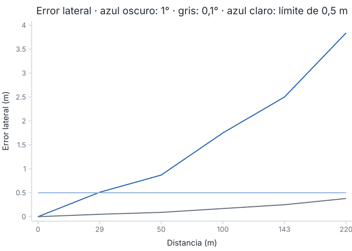

**Leyenda.** Azul oscuro: error lateral con 1° de precisión angular. Gris: error lateral con 0,1°. Azul claro (horizontal): límite de 0,5 m, la mitad del ancho de vía.

El mismo error afecta a la altura del eco: a 220 m es de 0,38 m, menor que la altura mínima del objeto (0,6 m), lo que permite aplicar el filtro de techo (paso 8) y la altura del objeto (paso 11). Un error menor de 0,1° mejoraría el margen: 0,065° daría 0,25 m, una celda, a 220 m. Un segundo radar reduciría este error y aportaría redundancia (propuesta al cliente, §3).

#### 4. Arquitectura software


Lenguaje: C, por ser el diseño una ECU edge (SW). El software cumple los requisitos elaborados y los estándares fijados en el harness (SYS-IMP-01, SYS-IMP-02, SYS-IMP-11). Estructura de módulos, tareas y hebras: se define en implementación respetando SYS-IMP-01 y SYS-IMP-02.

Funcionalidades en el orden del ciclo (SW):

| Paso | Definición del usuario | Requisitos |
|---|---|---|
| 1 | Recibe en paralelo la nube del radar y la velocidad lineal y de giro | SYS-IN-01, SYS-IN-02, SYS-IN-03 |
| 2 | Valida los datos según estándares y requisitos; los timestamps se validan contra el reloj de la ECU, que es la referencia (H-017); sincronización con el reloj del radar y tolerancia según R-HW (§10); velocidad del tranvía menor que 0 → se rechaza la detección y se pasa a DEGRADADO (SYS-PR-10, SYS-SAF-19); aquí se cuenta si la trama trae algún eco, incluidos raíles, para SYS-SAF-12 (H-034) | SYS-IN-06, SYS-IN-07 |
| 3 | Sincroniza en la ECU, con los timestamps de medida, las velocidades al instante de la «fotografía» de la nube, interpolando si hace falta (H-020); actualiza la posición del tranvía y estima la curva (puede ser recta) | SYS-PR-02, SYS-PR-06, H-02, H-03 |
| 4 | Convierte la nube de (r, azimut, elevación) a (x, y, z) considerando la altura del radar | SYS-PR-07, SYS-IN-05 |
| 5 | Descarta elementos dinámicos y elementos con señal muy débil. Los objetos en movimiento sobre la vía no se reportan (H-007); un eco descartado no cambia el valor de ninguna celda (H-024) | SYS-PR-05 |
| 6 | Pasa de coordenadas (x, y) a coordenadas de vía (s, d) y descarta lo situado a más de 220 m a lo largo de la vía, s > 220 m (H-014) | SYS-PR-01, SYS-PR-11 |
| 7 | Descarta lo que está fuera de la vía | SYS-DET-05 |
| 8 | Descarta lo que está por encima del techo (evita falsos positivos por puentes); se traza a SYS-DET-04 solo como medio para reducir falsas alarmas (H-006) | SYS-DET-04 |
| 9 | Descarta raíles: detecciones muy cercanas a las coordenadas de los raíles | SYS-PR-03 |
| 10 | Actualiza el grid en log-odds, que empieza en 0: por cada haz, eco en la celda suma +0,85; onda que pasa sin eco suma −0,40; celda oculta detrás de un eco no cambia | SYS-PR-08 |
| 11 | Extrae las celdas con p > 0,85 (H-026), agrupa las contiguas y obtiene posición, tamaño y altura de cada objeto | SYS-PR-04, SYS-OUT-01, SYS-OUT-02 |
| 11b | Descarta los objetos con alguna dimensión menor de 0,6 m (H-015) | SYS-DET-02, SYS-DET-08 |
| 12 | Compara los objetos con los del ciclo anterior y los reporta si llevan más de 2 ciclos seguidos, es decir N = 3 (H-005); reportar es incluirlos en la lista de SYS-OUT-11, y aviso y alerta equivalen a aparecer en esa lista (H-055) | SYS-PR-09, SYS-OUT-10 |
| 13 | Calcula confianza e incertidumbre de cada objeto según distancia, ciclos confirmados, incertidumbre de la curva y error del radar (precisión de azimut y altura y localización, H-016, H-033); la incertidumbre crece con la distancia (error lateral = distancia × tan(precisión de azimut)) y la confianza crece con los ciclos confirmados y decrece con la distancia y con la incertidumbre de la curva; también calcula el timestamp de la detección y su alcance estimado, igual a la coordenada s del objeto (SYS-OUT-04, SYS-OUT-05); la fórmula exacta se fija con la hoja de datos del radar (R-HW) | SYS-OUT-03, SYS-OUT-04, SYS-OUT-05, SYS-OUT-08 |
| 14 | Gestiona el modo según la máquina de estados; en cada cambio a DEGRADADO o FALLO registra un log CRIT y publica el mensaje MQTT de estado (H-035) | SYS-SAF-01, SYS-OUT-07, SYS-OUT-09 |
| 15 | Una única salida al HMI: la lista de objetos de SYS-OUT-11 con el modo del sistema y el indicador de vigilancia (H-042). La publicación la dispara un temporizador de 50 ms de la ECU y no la llegada de la nube (H-051). En INIT y FALLO el indicador es «sin vigilancia»; en DEGRADADO los objetos llevan confianza reducida (SYS-SAF-05); una lista vacía nunca significa vía libre (SYS-SAF-07). No hay otro canal de aviso (H-055) | SYS-OUT-11, SYS-SAF-05, SYS-SAF-06, SYS-SAF-07 |

Valores fijados según la regla R-HW de §10 (dependen del radar o del vehículo elegidos): umbral de «señal muy débil» (paso 5), altura del techo del tranvía (paso 8), distancia y tolerancia a raíles y parámetros del filtro de persistencia (paso 9, SYS-PR-03) y fórmulas de confianza e incertidumbre (paso 13). La vecindad de agrupación del paso 11 es de 8 celdas (lados y diagonales), según SYS-PR-04.

#### 5. Comunicaciones

| Enlace | Protocolo definido | Requisitos |
|---|---|---|
| Radar → ECU | Marcado por el fabricante del radar; lo más común Automotive Ethernet, también CAN FD en algunos casos | SYS-IN-01, SYS-IN-04 |
| Sensor de velocidad → ECU | Lo marca el fabricante del tranvía o del sensor (R-HW, §10) | SYS-IN-02, SYS-IN-03 |
| ECU ↔ HMI | El que ya use el tranvía para comunicarse entre sí; lo más común Ethernet ferroviario (ECN, IEC 61375) con capa de seguridad EN 50159. Transporta la lista de objetos, el modo y el indicador de vigilancia (§5.3) y, en sentido contrario, el sign in y los resets | SYS-OUT-11, SYS-SAF-04, SYS-SAF-06, SYS-SAF-16 |
| ECU → nube | MQTT con el cifrado necesario. Obligatorios (H-004): mensaje MQTT de estado y diagnóstico (QoS 1, retained) y log CRIT en cada paso a DEGRADADO o FALLO. Propuesta al cliente: telemetría adicional, actualizaciones de flota y mapas. No preocupa la latencia ni es crítico perder mensajes de telemetría | SYS-IMP-04, SYS-OUT-07, SYS-OUT-09 |

Fallos de MQTT o de la nube (H-018, H-029): durante una caída del broker se pierden los mensajes MQTT, sin cola ni reenvío; no se registran como fallo de la máquina de estados ni son críticos para la seguridad funcional, porque el sistema funciona completo sin la nube (SYS-IMP-04). Perder la conexión con el broker no cambia el modo. Esto se aparta de MQ-QOS-03 (pérdida del broker → evento de fallo y estado seguro) por decisión del usuario; desviación a registrar con su análisis de impacto (SAF-07): la nube no interviene en el procesamiento ni en la salida al HMI.

##### 5.1 Red y direccionamiento (STD-NET)

| Nodo | Función | VLAN | IP/máscara | Puertos | Protocolo | Dirección del tráfico |
|---|---|---|---|---|---|---|
| ECU, radar, HMI | Direccionamiento, VLAN y puertos según la red del tranvía (R-HW, §10) | R-HW | R-HW | R-HW | Ethernet (radar y HMI) | Radar → ECU → HMI |

##### 5.2 Topics MQTT (STD-MQTT)

| Topic | Publicador | Suscriptores | QoS | Retained | Periodo | Payload (esquema) | Requisitos |
|---|---|---|---|---|---|---|---|
| saf/ecu/status | ECU (LWT online/offline) | Nube | 1 | Sí | Evento en cada cambio de modo | v, seq, ts_ms, src, mode (init, normal, degraded, fault), reason | SYS-OUT-07 |
| saf/ecu/diagnostic | ECU | Nube | 1 | No | Periodo configurable (R-HW) | v, seq, ts_ms, src, contadores de huecos y desorden por seq (MQ-QOS-02), estado de entradas | SYS-OUT-07, SYS-IN-07 |
| saf/ecu/log | ECU | Nube | 1 | No | Evento | v, seq, ts_ms, src, level, msg | SYS-OUT-09, SYS-IMP-04 |
| saf/ecu/objects | ECU | Nube | 0 | No | 50 ms (copia opcional para trazabilidad) | v, seq, ts_ms, src, mode, surveillance, lista de objetos con id, position_s_m, position_d_m, size_m, uncertainty_m, confidence, detection_ts_ms, range_m | SYS-OUT-11, SYS-IMP-04 |

Notas de la propuesta: prefijo `saf` del código del proyecto, minúsculas y `snake_case` (MQ-TOP-02); cabecera común y unidades SI en los campos (MQ-PAY-02, MQ-PAY-04); JSON UTF-8 por ahora (MQ-PAY-01); la caída del broker no cambia el modo (H-018, H-029) y las publicaciones nunca bloquean el hilo de proceso (MQ-QOS-04). La lista de objetos va al HMI por IEC 61375 (§5.3), no por MQTT; el topic de la nube es su copia opcional y lleva también el modo y el indicador, para que la nube distinga una lista vacía de la ausencia de vigilancia (H-058). No se generan esquemas JSON de los payloads (MQ-PAY-03): desviación decidida por el usuario, a registrar con su análisis de impacto (SAF-07); los tests de integración validan los mensajes contra la tabla de esta sección.

##### 5.3 Mensaje ECU → HMI (SYS-OUT-11)

Una publicación por cada ciclo de 50 ms (H-049). La estructura concreta sobre IEC 61375 la fija el fabricante o el tranvía (R-HW, §10); el contenido es el siguiente:

| Campo | Nivel | Descripción | Requisito |
|---|---|---|---|
| seq, ts_ms | mensaje | Contador de secuencia y marca de tiempo de la ECU; el HMI detecta pérdida, repetición y desorden (EN 50159) | SYS-OUT-11, SYS-SAF-06 |
| mode | mensaje | Modo del sistema: init, normal, degraded o fault | SYS-OUT-11, SYS-SAF-01 |
| surveillance | mensaje | Indicador de vigilancia: con vigilancia o sin vigilancia (§7, H-050) | SYS-OUT-11, SYS-SAF-06, SYS-SAF-07 |
| id | objeto | Identificador del objeto | SYS-OUT-10 |
| position_s_m, position_d_m | objeto | Posición en coordenadas de vía, en metros | SYS-OUT-01 |
| size_m | objeto | Tamaño en tres dimensiones, en metros | SYS-OUT-02 |
| uncertainty_m, confidence | objeto | Incertidumbre y confianza de la detección | SYS-OUT-03, SYS-OUT-08 |
| detection_ts_ms | objeto | Marca de tiempo de la detección | SYS-OUT-04 |
| range_m | objeto | Alcance estimado, igual a la coordenada s del objeto | SYS-OUT-05 |

Reglas (H-049, H-051): la publicación la dispara un temporizador de 50 ms de la ECU, no la llegada de la nube; el modo y el indicador van en toda publicación, también con la lista vacía, y una lista vacía nunca significa vía libre (SYS-SAF-07); si el HMI no recibe mensajes durante el tiempo fijado según R-HW (§10), muestra «sin vigilancia» (SYS-SAF-06). El dato de cada nube llega al HMI en menos de 128 ms desde su recepción (§9, SYS-T-01).

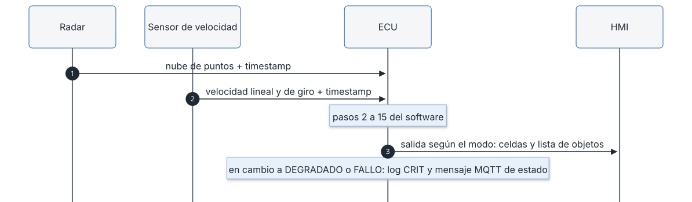

#### 6. Datos y algoritmo del grid de ocupación

##### 6.1 Representación del grid

Celda cuadrada de 0,25 m (decisión del usuario), con eje longitudinal s a lo largo de la vía y eje lateral d a lo ancho: 220 m / 0,25 m = 880 celdas de largo por 4 de ancho (vía de 1 m, H-01), es decir, 3 520 celdas en memoria fija (SYS-IMP-01). Un objeto de 0,6 m ocupa al menos 3 celdas por lado (SYS-PR-08, SYS-DET-01).

##### 6.2 Modelo inverso del sensor

Cada celda guarda un log-odds l que empieza en 0 (decisión del usuario, 2026-11-02). Por cada haz del radar: si hay eco en la celda se suma +0,85; si la onda pasa por la celda sin eco se suma −0,40; si la celda está detrás de un eco (oculta) no cambia (SW paso 10). La escala es log-odds con logaritmo natural (H-013, H-026), con p = 1 / (1 + e^−l): una detección da p ≈ 0,70, dos seguidas p ≈ 0,845 y tres seguidas p ≈ 0,93, por lo que el umbral p > 0,85 (l > 1,73) no se alcanza hasta la tercera detección, coherente con N = 3; cada paso sin eco resta 0,40. Estados de celda derivados (H-012): ocupado si p > 0,85; zona no estudiada si la celda nunca se ha observado o se ha reiniciado; probabilidad baja de obstáculo si ha sido observada y p ≤ 0,85; nunca «libre». Estos estados son internos del módulo del grid: no salen al HMI ni a la nube (H-047). Regla general (H-024, H-031): dentro de un ciclo (conjunto de ráfagas) cada celda mantiene su valor mientras ninguna regla de este apartado le aplique un cambio; esto vale para las celdas no vistas en el ciclo y para las que solo reciben ecos descartados. Límites del log-odds de cada celda: máximo 3,4 (p ≈ 0,97; una celda saturada deja de ser «ocupado» en 5 ciclos, 250 ms) y mínimo −0,8 (garantiza confirmar un obstáculo en 3 ecos, N = 3) (SYS-PR-08, SYS-SAF-07).

##### 6.3 Actualización y dinámica (decaimiento, estáticos vs. móviles)

Los elementos dinámicos se descartan antes de actualizar el grid (SW paso 5, SYS-PR-05) y no modifican ninguna celda (H-024). Al volver de FALLO el grid se reinicia a «desconocido» porque las mediciones anteriores no son fiables (ME). Una celda no observada mantiene su valor, sin decaimiento temporal (H-031). El umbral y la histéresis de velocidad para clasificar un eco como dinámico se fijan con la hoja de datos del radar (R-HW, §10, SYS-PR-05).

##### 6.4 Flujo por ciclo

Ver §4 (pasos 1 a 15) y la figura de arquitectura software. Umbral de extracción de objetos: p > 0,85 (H-026). Confirmación: el objeto se reporta si lleva más de 2 ciclos seguidos, N = 3 (H-005, SYS-PR-09), independiente de las 3 mediciones de SYS-SAF-12. Aviso y alerta (H-025, H-043): equivalen a que el objeto aparece en la lista de objetos de SYS-OUT-11, es decir, cuando se reporta tras N ciclos y sus tres dimensiones son de 0,6 m o más (SYS-PR-09, SYS-DET-02). El estado de celda es interno del módulo del grid y puede ser «ocupado» antes; no llega al HMI. Salida: la lista de objetos con el modo y el indicador de vigilancia; nunca se comunica la ausencia de obstáculo (SYS-SAF-07, SYS-OUT-11).

##### 6.5 Interfaz del módulo del grid (SYS-PR-08)

SYS-PR-08 se verifica en la interfaz del módulo del grid, porque el estado de celda no sale al HMI (H-056). El módulo ofrece: reiniciar el grid a «zona no estudiada»; aplicar un haz del radar a las celdas que atraviesa; consultar el estado de una celda, que es un tipo cerrado de tres valores (ocupado, probabilidad baja de obstáculo, zona no estudiada) sin valor «libre»; y extraer la máscara de celdas ocupadas para la agrupación en objetos (SW paso 11). Un valor corrupto de una celda se informa como error y la celda se trata como «zona no estudiada», nunca como «libre» ni como «probabilidad baja».

#### 7. Modos y estados del sistema


El último estado activo debe ser conocido al encender el tranvía de nuevo, para que el fallo no pueda resetearse de forma no segura (ME). Esto es una mejora futura (H-009): en esta versión el sistema arranca siempre en INIT, y el mecanismo previsto es una marca en memoria no volátil escrita al entrar en DEGRADADO o FALLO y leída en INIT, con paso a FALLO si existe.

| Estado | Comportamiento definido (ME) | Requisitos |
|---|---|---|
| INIT | Publica el modo init y el indicador «sin vigilancia» mientras comprueba niveles básicos de funcionamiento y espera un input del conductor. Estado inicial tras el arranque | SYS-SAF-06 |
| NORMAL | Funcionamiento normal: cumple los requisitos; publica el indicador «con vigilancia» | SYS-SAF-15 |
| DEGRADADO | Sigue funcionando: indicador «con vigilancia» y objetos de la lista con confianza reducida | SYS-SAF-05 |
| FALLO | Publica el modo fault y el indicador «sin vigilancia»; la lista no se interpreta nunca como vía libre | SYS-SAF-06, SYS-SAF-07 |

| Transición | Condiciones definidas (ME) | Requisitos |
|---|---|---|
| INIT → NORMAL | Autodiagnóstico del radar; datos válidos durante 1 ciclo; cálculo de predicciones durante 1 ciclo; sign in del conductor en el HMI (que también identifica la cabina activa). En el futuro la señal de INIT podría darla el arranque del tranvía | SYS-SAF-01 |
| INIT → FALLO | Falla cualquier condición de INIT; INIT tarda más de 3 min desde el arranque, incluido el sign in (H-028); hay un fallo memorizado (implementación futura) | SYS-SAF-01 |
| NORMAL → DEGRADADO | No se detecta nada, ni siquiera los raíles, en 3 mediciones seguidas (H-002); desalineación del radar | SYS-SAF-12, SYS-SAF-13 |
| DEGRADADO → NORMAL | Se exigen a la vez (H-003): reset nivel 1 desde el HMI; condiciones que llevaron a DEGRADADO limpiadas; funcionamiento normal ininterrumpido, p. ej. mediciones correctas durante 4 ciclos seguidos del radar, es decir 200 ms, que se cumplen antes del reset: el reset solo se acepta cuando ya se han cumplido (H-027). Este valor podrá cambiar tras las fases de test y verificación | SYS-SAF-04 |
| DEGRADADO → FALLO | Estado degradado continuado en el tiempo; cualquier condición de fallo estando en degradado, p. ej. aviso de autofallo del radar | SYS-SAF-14 |
| FALLO → DEGRADADO | No es posible | SYS-SAF-16 |
| NORMAL → FALLO | No se recibe ninguna trama durante el timeout de trama de 100 ms, 2 periodos del radar (H-008, H-040); el timestamp de los datos no avanza o retrocede; un dato no está disponible; fallo autodiagnosticado por el radar | SYS-SAF-08, SYS-SAF-09, SYS-SAF-10, SYS-SAF-11 |
| FALLO → NORMAL | Reset nivel 2 desde el HMI: solo una persona autorizada, con doble autenticación; solo se acepta si las condiciones están limpias. El grid se reinicia a «desconocido» | SYS-SAF-16 |

Valor del indicador de vigilancia por modo (H-050): INIT sin vigilancia; NORMAL con vigilancia; DEGRADADO con vigilancia y confianza reducida; FALLO sin vigilancia. El modo va siempre en la publicación y distingue DEGRADADO de NORMAL.

Huecos y puntos a contrastar con los requisitos (se tratan en `/diseno-revisar`):

- Tiempo máximo continuado en DEGRADADO antes de pasar a FALLO: 30 s (SYS-SAF-14), del orden del doble del tiempo de recorrer los 220 m a 13,9 m/s (15,8 s). El umbral de desalineación (SYS-SAF-13) se fija según R-HW (§10).
- NORMAL → DEGRADADO también por exceso de falsas alarmas (SYS-SAF-18) y por velocidad del tranvía negativa (SYS-SAF-19). El máximo de falsas alarmas se mide por hora de operación (SYS-DET-04); su valor es calibrable y se valida en test con el cliente.
- Los requisitos definen tres modos (SYS-SAF-01) y el material añade INIT como cuarto estado.
- Resuelto (H-002): «sin detección ni raíles durante 3 mediciones» lleva a DEGRADADO, como SYS-SAF-12.
- Resuelto (H-011): se elimina la condición «con raíles → DEGRADADO».
- Resuelto (H-010): un reset de nivel equivocado se rechaza, se mantiene el modo y se registra un log.
- Resuelto (H-009): la persistencia del último estado es una mejora futura y no cuenta como mitigación vigente.
- Resuelto (H-003): el reset de degradado a normal exige reset nivel 1, condiciones limpias y 4 ciclos correctos a la vez.
- Resuelto (H-001): SYS-SAF-01 pide tres modos como mínimo (requisitos v1.1), por lo que INIT es un cuarto estado admitido.

#### 8. Gestión de fallos y seguridad funcional (STD-SAF)

| Modo de fallo | Causa | Efecto | Detección | Mitigación | Notificación | Recuperación | Requisito |
|---|---|---|---|---|---|---|---|
| Ausencia de tramas | Radar o enlace caído | Sin datos | Ninguna trama durante el timeout de trama | Paso a FALLO | log CRIT y mensaje MQTT de estado (SYS-OUT-07, SYS-OUT-09) | Reset nivel 2 (§7) | SYS-SAF-08 |
| Timestamp incoherente | Reloj o datos corruptos | Datos no fiables | Timestamp que no avanza o retrocede | Paso a FALLO | log CRIT y mensaje MQTT de estado (SYS-OUT-07, SYS-OUT-09) | Reset nivel 2 (§7) | SYS-SAF-09, SYS-IN-06 |
| Dato de entrada no disponible | Fallo del sensor de velocidad u otro | Datos incompletos | Dato ausente | Paso a FALLO | log CRIT y mensaje MQTT de estado (SYS-OUT-07, SYS-OUT-09) | Reset nivel 2 (§7) | SYS-SAF-10 |
| Fallo del radar | Autodiagnóstico del radar | Detección no fiable | Notificación del radar | Paso a FALLO | log CRIT y mensaje MQTT de estado (SYS-OUT-07, SYS-OUT-09) | Reset nivel 2 (§7) | SYS-SAF-11 |
| Sin ecos ni raíles | Radar sin eco útil (obstrucción, radar apagado o fallo del radar) | Confianza reducida | 3 mediciones seguidas sin ninguna detección | Paso a DEGRADADO | log CRIT y mensaje MQTT de estado (SYS-OUT-07, SYS-OUT-09) | Reset nivel 1, condiciones limpias y 4 ciclos (§7) | SYS-SAF-12 |
| Desalineación del radar | Montaje o golpe | Error de posición | Desalineación detectada | Paso a DEGRADADO | log CRIT y mensaje MQTT de estado (SYS-OUT-07, SYS-OUT-09) | Reset nivel 1, condiciones limpias y 4 ciclos (§7) | SYS-SAF-13 |
| Degradado prolongado | Causa no resuelta | Detección con confianza reducida | Tiempo continuado en DEGRADADO | Paso a FALLO | log CRIT y mensaje MQTT de estado (SYS-OUT-07, SYS-OUT-09) | Reset nivel 2 (§7) | SYS-SAF-14 |
| Fallo de INIT | Autodiagnóstico o datos no válidos | Sin vigilancia | Condición de INIT falla o INIT supera 3 min desde el arranque | Paso a FALLO | log CRIT y mensaje MQTT de estado (SYS-OUT-07, SYS-OUT-09) | Reset nivel 2 (§7) | SYS-SAF-01 |
| Reset indebido de fallo | Reset no autorizado o de nivel equivocado | Reanudar con fallo activo | Autenticación, condiciones y nivel del reset | Reset nivel 2 con doble autenticación, solo con condiciones limpias; un reset del nivel equivocado se rechaza y se registra un log (H-010). Persistencia del último estado al reiniciar: mejora futura (H-009), no cuenta como mitigación vigente | log WARN del reset rechazado; log CRIT del paso a FALLO si procede | Reset nivel 2 válido | SYS-SAF-16 |
| Datos corruptos de trama | Ruido o error del enlace | Trama inutilizable | Validación de cada trama (SYS-IN-07) | Se descarta la trama y se cuenta; si no llega ninguna válida en 100 ms, paso a FALLO | log CRIT al pasar a FALLO; contador en saf/ecu/diagnostic | Reset nivel 2 (§7) | SYS-IN-07 |
| Huecos en la numeración (seq) | Pérdida de tramas en el enlace | Menos datos por ciclo | Hueco en seq (MQ-QOS-02) | Solo contador de diagnóstico; el modo no cambia salvo que venza el timeout de trama | Contador en saf/ecu/diagnostic | No procede | SYS-IN-07 |
| Saturación de CPU | Carga superior a la prevista | Ciclo más largo que 50 ms o entrega mayor de 128 ms | Medida del tiempo de ciclo y de la latencia de proceso | Paso a FALLO | log CRIT y mensaje MQTT de estado (SYS-OUT-07, SYS-OUT-09) | Reset nivel 2 (§7) | SYS-T-01 |
| Desbordamiento | Valor fuera del rango de una variable | Resultado numérico incorrecto | Comprobación de rangos (programación defensiva, SAF-04) | Paso a FALLO | log CRIT y mensaje MQTT de estado (SYS-OUT-07, SYS-OUT-09) | Reset nivel 2 (§7) | SYS-IMP-02 |

Salida al HMI en los fallos (H-050, H-051): en toda fila con paso a FALLO, y mientras el sistema está en INIT, el modo publicado es fault o init y el indicador es «sin vigilancia» en el 100 % de los ciclos, porque la publicación la dispara el temporizador de 50 ms de la ECU y no la llegada de la nube. Si el HMI no recibe mensajes durante el tiempo fijado según R-HW, muestra «sin vigilancia» (§5.3).

Fuera de esta tabla por decisión del usuario (H-018): fallos de MQTT, del broker y de la nube, que no afectan al modo ni a la seguridad funcional (§5).


#### 9. Rendimiento y presupuesto temporal

- Periodo del radar y de las velocidades: 50 ms (SYS-IN-01, SYS-IN-02, SYS-IN-03).
- Tiempo máximo de entrega de objetos: 128 ms (SYS-T-01), entendido como latencia desde la recepción de la nube hasta la publicación de la lista de objetos al HMI (H-026, H-059), distinta del timeout de trama. El sistema completo entrega al HMI los datos de cada nube en menos de 128 ms desde que la recibe (decisión del usuario, H-051). El timeout de ausencia de tramas es un parámetro distinto, de 100 ms (H-008, H-040, SYS-SAF-08).
- Como la publicación espera al siguiente disparo del temporizador de 50 ms (§5.3), que añade como máximo 50 ms, el procesamiento de cada nube debe terminar en el presupuesto restante, 128 ms − 50 ms = 78 ms (H-051); el margen se confirma con el hardware de la ECU (R-HW).
- A 13,9 m/s el tranvía avanza 1,78 m durante los 128 ms de entrega. El presupuesto temporal por paso del ciclo y el margen de CPU se fijan con el hardware de la ECU elegido (R-HW, §10).

#### 10. Configuración (STD-CFG)

| Parámetro | Valor definido | Unidad | Rango admitido | Requisito |
|---|---|---|---|---|
| Altura del radar | 1 m | m | Esquema CFG-01 | SYS-IN-05 |
| Precisión de azimut y altura del radar | 0,1° (calculado en §3) | ° | Esquema CFG-01 | SYS-DET-06 |
| Error de desalineación respecto al eje | R-HW | ° | Esquema CFG-01 | SYS-DET-07 |
| Error de localización | 0,005 m (provisional) | m | Esquema CFG-01 | SYS-DET-06 |
| Alcance | 220 m | m | Esquema CFG-01 | SYS-DET-01, SYS-PR-11 |
| Velocidad máxima del tranvía | 50 km/h = 13,9 m/s | m/s | Esquema CFG-01 | H-07 |
| Tamaño de celda | 0,25 m | m | Esquema CFG-01 | SYS-PR-08 |
| Voto por eco | +0,85 | log-odds | Esquema CFG-01 | SYS-PR-08 |
| Voto por paso de la onda sin eco | −0,40 | log-odds | Esquema CFG-01 | SYS-PR-08 |
| Log-odds inicial de la celda | 0 | log-odds | Esquema CFG-01 | SYS-PR-08 |
| Log-odds máximo | 3,4 | log-odds | Esquema CFG-01 | SYS-PR-08 |
| Log-odds mínimo | −0,8 | log-odds | Esquema CFG-01 | SYS-PR-08 |
| Umbral de extracción de objetos | p > 0,85 | probabilidad | Esquema CFG-01 | SYS-PR-04 |
| Ciclos de confirmación N | 3 (más de 2 seguidos) | ciclos | Esquema CFG-01 | SYS-PR-09 |
| Mediciones sin detección ni raíles para degradado | 3 | mediciones | Esquema CFG-01 | SYS-SAF-12 |
| Timeout de trama para fallo | 100 ms (2 periodos del radar) | ms | Esquema CFG-01 | SYS-SAF-08 |
| Tiempo máximo de entrega de objetos | 128 ms | ms | Esquema CFG-01 | SYS-T-01 |
| Periodo de publicación al HMI | 50 ms | ms | Esquema CFG-01 | SYS-OUT-11 |
| Ciclos de recuperación a normal | 4 (podrá cambiar tras test) | ciclos | Esquema CFG-01 | SYS-SAF-04 |
| Tiempo máximo de INIT | 3 min desde el arranque | s | Esquema CFG-01 | SYS-SAF-01 |
| Tiempo máximo en DEGRADADO | 30 s | s | Esquema CFG-01 | SYS-SAF-14 |
| Umbral de desalineación | R-HW | ° | Esquema CFG-01 | SYS-SAF-13 |
| Tiempo sin mensajes en el HMI para mostrar «sin vigilancia» | R-HW | ms | Esquema CFG-01 | SYS-SAF-06 |
| Máximo de falsas alarmas | Calibrable, validado en test con el cliente | falsas alarmas por hora de operación | Esquema CFG-01 | SYS-DET-04 |
| Umbral de señal débil, altura del techo, distancia a raíles, parámetros del filtro de persistencia, umbral de velocidad de objeto dinámico, tolerancia de reloj | R-HW | según el parámetro | Esquema CFG-01 | SYS-PR-03, SYS-PR-05, SYS-IN-06 |

**Regla R-HW.** Los valores marcados R-HW dependen del radar, la ECU, la red o el vehículo elegidos y no tienen valor por defecto en este diseño: se fijan con la hoja de datos correspondiente antes de implementar, y hasta entonces el sistema no arranca en modo operativo con ellos sin definir (CFG-02). La precisión angular de 0,1° sale del cálculo de §3 y la hoja de datos del radar la confirma; los 0,005 m son provisionales y esa hoja los sustituye.

**Rangos.** El rango `[min, max]` de cada parámetro y su valor por defecto los fija el esquema `config/ogrid.schema.json` (CFG-01), generado a partir de esta tabla en implementación. Coherencias cruzadas que debe validar al arrancar (CFG-02): log-odds máximo mayor que el umbral de ocupado (l > 1,73); log-odds mínimo + N × voto por eco mayor que el umbral de ocupado (−0,8 + 3 × 0,85 = 1,75); timeout de trama múltiplo del periodo del radar (50 ms) y menor que el tiempo máximo de entrega; tiempo máximo en DEGRADADO mayor que el tiempo de recorrer el alcance a la velocidad máxima (15,8 s).

#### 11. Trazabilidad requisito → apartado

| Requisito | Apartado(s) del diseño |
|---|---|
| SYS-GEN-01 | 1 |
| SYS-IN-01, SYS-IN-02, SYS-IN-03, SYS-IN-04 | 3, 4, 5 |
| SYS-IN-05 | 3, 10 |
| SYS-IN-06 | 4, 8 |
| SYS-IN-07 | 4, 8  |
| SYS-PR-01, SYS-PR-02, SYS-PR-06, SYS-PR-07 | 4 |
| SYS-PR-03, SYS-PR-04, SYS-PR-05, SYS-PR-09 | 4, 6  |
| SYS-PR-08 | 4, 6 (§6.5, interfaz interna del módulo del grid) |
| SYS-DET-02, SYS-DET-08 | 4 (paso 11b), 6.4 |
| SYS-PR-11, SYS-DET-01 | 3, 4, 10 |
| SYS-DET-05, SYS-DET-06, SYS-DET-07 | 3, 4, 10 |
| SYS-OUT-01, SYS-OUT-02, SYS-OUT-03, SYS-OUT-08, SYS-OUT-10 | 4 |
| SYS-OUT-11, SYS-OUT-04, SYS-OUT-05 | 3, 4 (pasos 13 y 15), 5, 6.4, 7, 8 |
| SYS-OUT-07, SYS-OUT-09 | 4 (paso 14), 5, 8 |
| SYS-T-01 | 1, 9 |
| SYS-SAF-01, SYS-SAF-05, SYS-SAF-06, SYS-SAF-07 (también 4 paso 15 y 5.3), SYS-SAF-08, SYS-SAF-09, SYS-SAF-10, SYS-SAF-11, SYS-SAF-12, SYS-SAF-13, SYS-SAF-14, SYS-SAF-15 | 7, 8, 10 |
| SYS-SAF-04, SYS-SAF-16 | 7, 8 |
| SYS-SAF-18, SYS-SAF-19, SYS-PR-10, SYS-DET-04 | 4 (paso 2), 7 |
| SYS-GEN-02 | 1 |
| SYS-IMP-01, SYS-IMP-02, SYS-IMP-11 | 4 |
| SYS-IMP-06, SYS-IMP-07, SYS-IMP-08, SYS-IMP-10, SYS-IMP-11 | 1, 4 y documentos aparte de esta carpeta (SYS-IMP-10: componente a elegir antes de implementar) |
| SYS-IMP-03, SYS-IMP-04 | 1, 3, 5 |

SYS-IMP-12 (borrador de oferta) corresponde a la fase de Oferta.

#### Historial de cambios

| Versión | Fecha | Autor | Cambios |
|---|---|---|---|
| 0.1 | 2026-11-01 | Alicia Garcia | Creación a partir del diseño aportado por el usuario |
| 1.0 | 2026-11-02 | Alicia Garcia | Revisión de diseño completa (41 hallazgos resueltos), votos del grid, 0,1° de precisión angular, topics MQTT, entregables y cierre de la fase |
| 1.1 | 2026-11-02 | Alicia Garcia | Alineado con los requisitos 1.2 (hallazgos H-042 a H-062): SYS-OUT-06 retirado, una única salida al HMI (lista de objetos con modo e indicador de vigilancia), mensaje ECU→HMI (§5.3), interfaz del módulo del grid (§6.5), publicación por temporizador de 50 ms y entrega en menos de 128 ms. Fase cerrada en 1.1 |
| 1.2 | 2026-11-03 | Alicia Garcia | Fase reabierta: la figura de arquitectura software (§4) se reorganiza en cuatro bloques apaisados para que sea legible en el documento Word, sin cambiar su contenido; `viabilidad-radar.md` y `justificacion-c.md` pasan a la versión 1.0 y estado Cerrado. Fase cerrada en 1.2 |

### Plan de viabilidad del uso del radar


Este documento cubre SYS-IMP-06 (enunciado R1): capacidades y limitaciones del radar para detectar obstáculos en la vía. Usa solo los datos decididos en `diseno.md` (v1.1) y en los requisitos v1.2. Los valores que dependen del radar elegido se fijan con su hoja de datos (regla R-HW, `diseno.md` §10).

#### 1. Caso de uso y datos de partida

| Dato | Valor | Fuente |
|---|---|---|
| Entorno | Tranvía bidireccional, Vitoria-Gasteiz | SYS-GEN-02 |
| Velocidad máxima | 50 km/h = 13,9 m/s | H-07, `diseno.md` §3 |
| Alcance de detección | 220 m a lo largo de la vía | SYS-DET-01, SYS-PR-11 |
| Objeto mínimo | 0,6 m × 0,6 m × 0,6 m | SYS-DET-02, SYS-DET-08 |
| Ancho de vía | 1 m | H-01 |
| Radar | 3D (distancia, azimut y altura), a 1 m sobre el suelo, periodo de 50 ms | H-05, SYS-IN-01, SYS-IN-05 |
| Precisión de azimut y altura | 0,1 ° (calculada en §3.1; el 1 ° inicial era provisional) | SYS-DET-06, H-06 |
| Error de localización en distancia | 0,005 m (provisional) | SYS-DET-06 |
| Celda del grid | 0,25 m; 880 × 4 celdas | `diseno.md` §6.1 |

El campo de visión del sistema es lo que el radar alcanza a detectar y entrega como nube de puntos (H-08).

#### 2. Capacidades

| Capacidad | Valor o decisión | Requisito |
|---|---|---|
| Medida 3D | Distancia, azimut y altura de cada eco; la conversión a (x, y, z) usa la altura del radar (paso 4) | H-05, SYS-PR-07, SYS-IN-05 |
| Objeto mínimo en el grid | Un objeto de 0,6 m ocupa al menos 3 celdas por lado | `diseno.md` §6.1 |
| Cadencia | Una nube cada 50 ms | SYS-IN-01 |
| Entrega | 128 ms de latencia de proceso; a 13,9 m/s el tranvía recorre 128 ms × 13,9 m/s = 1,78 m | SYS-T-01, `diseno.md` §9 |
| Tiempo de recorrido del alcance | 220 m / 13,9 m/s = 15,8 s | `diseno.md` §7 |
| Confirmación | Se reporta un objeto tras más de 2 ciclos seguidos, N = 3 | H-005, SYS-PR-09 |

#### 3. Limitaciones


##### 3.1 Error lateral creciente con la distancia

El error de medida en azimut y altura crece con la distancia (H-06). Se partió de 1 ° como valor provisional y se calculó si bastaba:

- error lateral = distancia × tan(precisión de azimut).
- Con 1 ° a 220 m: 220 m × tan(1 °) = 3,84 m, casi 4 veces la vía (1 m, H-01) y 15 celdas de 0,25 m.
- Criterio: para decidir si un eco está dentro o fuera de la vía (SYS-DET-05) el error lateral debe ser menor que la mitad del ancho de vía, 0,5 m.
- Precisión máxima admisible a 220 m: atan(0,5 m / 220 m) = 0,130 °. Se toma 0,1 °.
- Comprobación con 0,1 °: 220 m × tan(0,1 °) = 0,384 m, menor que 0,5 m. Con 1 ° el criterio solo se cumple hasta 0,5 m / tan(1 °) = 28,6 m.

| Distancia | Error lateral con 1 ° | Error lateral con 0,1 ° |
|---|---|---|
| 29 m | 0,51 m | 0,05 m |
| 50 m | 0,87 m | 0,09 m |
| 100 m | 1,75 m | 0,17 m |
| 143 m | 2,50 m | 0,25 m (una celda) |
| 220 m | 3,84 m | 0,38 m |


**Leyenda.** Azul oscuro: error lateral con 1° de precisión angular. Gris: error lateral con 0,1°. Azul claro (horizontal): límite de 0,5 m, la mitad del ancho de vía.

Consecuencias:

- El radar debe tener una precisión angular de 0,1 ° para cubrir los 220 m. Con 1 ° la discriminación lateral solo es fiable hasta ≈ 29 m.
- El error de altura es el mismo: 0,38 m a 220 m, menor que la altura mínima del objeto (0,6 m). Afecta al filtro de techo (paso 8) y a la altura del objeto (paso 11).
- La hoja de datos del radar elegido confirma el valor (regla R-HW).

##### 3.2 Latencia y distancia recorrida

La entrega tarda como máximo 128 ms (SYS-T-01). En ese tiempo el tranvía avanza 1,78 m. El presupuesto temporal por paso y el margen de CPU se fijan con la ECU elegida (R-HW).

##### 3.3 Dependencia de parámetros sin fijar

Los siguientes valores no tienen valor por defecto en el diseño y los aporta el radar o el vehículo elegidos (R-HW): umbral de señal débil, umbral de velocidad de objeto dinámico, altura del techo, distancia a raíles, parámetros del filtro de persistencia, tolerancia de reloj, error de desalineación y umbral de desalineación (`diseno.md` §4 y §10).

#### 4. Riesgos y mitigaciones decididas

| Riesgo | Efecto | Mitigación en el diseño | Requisito |
|---|---|---|---|
| Curvas | Error en la conversión a coordenadas de vía (s, d) | Estimación de la curva con velocidad lineal y giro sincronizados (paso 3); hipótesis de giro constante; la incertidumbre de la curva reduce la confianza (paso 13) | SYS-PR-02, SYS-PR-06, H-02, H-03 |
| Puentes y techo | Falsos positivos por elementos sobre el tranvía | Descarte de lo situado por encima del techo (paso 8); se limita a reducir falsas alarmas | SYS-DET-04, paso 8 de `diseno.md` |
| Ecos de raíles | Falsas alarmas por el raíl | Descarte de detecciones muy cercanas a las coordenadas de los raíles, con filtro de persistencia (paso 9) | SYS-PR-03 |
| Desalineación del radar | Error de posición | Hipótesis de radar montado y calibrado (H-04); cálculo de la desalineación y paso a DEGRADADO si se detecta | SYS-DET-07, SYS-SAF-13 |
| Objetos en movimiento | Falsas alarmas en la vía | Se descartan antes de actualizar el grid y no modifican ninguna celda; no se reportan (pasos 5 y 10) | SYS-PR-05, pasos 5 y 10 de `diseno.md` |
| Ecos aislados o ruido | Falsas alarmas | Voto log-odds: eco +0,85, paso sin eco −0,40, saturación en [−0,8; 3,4]; umbral p > 0,85, que se alcanza con la tercera detección; confirmación con N = 3 | SYS-PR-08, SYS-PR-09 |
| Objetos pequeños | Alertas por objetos menores que el mínimo | Descarte de objetos con alguna dimensión menor de 0,6 m (paso 11b) | SYS-DET-02, SYS-DET-08 |
| Pérdida de ecos o del radar | Sin vigilancia | Modos INIT, NORMAL, DEGRADADO y FALLO; 3 mediciones sin detección ni raíles llevan a DEGRADADO; timeout de trama de 100 ms lleva a FALLO; la salida nunca entrega «libre» | SYS-SAF-01, SYS-SAF-07, SYS-SAF-08, SYS-SAF-12 |
| Exceso de falsas alarmas | Pérdida de utilidad | Paso a DEGRADADO; el máximo se mide por hora de operación y se valida en test con el cliente | SYS-SAF-18, SYS-DET-04 |


#### 5. Hipótesis de partida

| ID | Hipótesis | Efecto en la viabilidad |
|---|---|---|
| H-01 | Ancho de vía de 1 m | Fija las 4 celdas de ancho y el límite de 0,5 m de error lateral |
| H-02 | Giro constante en el horizonte de análisis | Permite estimar la curva con velocidad y giro |
| H-03 | Velocidad y giro con periodo de 50 ms y timestamp de medida | Permite sincronizarlos con cada nube |
| H-04 | Radar montado y calibrado con el eje del tranvía | Sin ella, el error lateral crece con la desalineación |
| H-05 | Radar 3D | Permite filtrar por altura (techo, altura del objeto) |
| H-06 | El error de azimut y altura crece con la distancia | Origen de la limitación de §3.1 |
| H-07 | Velocidad máxima fijada en diseño: 13,9 m/s | Fija 1,78 m en 128 ms y 15,8 s en 220 m |
| H-08 | Campo de visión = lo que el radar detecta y entrega | Lo que el radar no detecta queda fuera de la vigilancia |

#### 6. Qué debe aportar el radar elegido o un segundo radar

El diseño no fija el modelo de radar (`diseno.md` §3). El radar elegido debe aportar, con su hoja de datos, los valores marcados R-HW:

1. Precisión de azimut y altura de 0,1 ° o mejor, calculada en §3.1 (error lateral de 0,38 m a 220 m); la hoja de datos del radar la confirma.
2. Error de localización en distancia, que sustituye a los 0,005 m provisionales.
3. Umbral de señal débil y umbral y histéresis de velocidad para clasificar un eco como dinámico.
4. Timestamp de medida, sincronización con el reloj de la ECU y tolerancia de reloj.
5. Autodiagnóstico y aviso de autofallo (SYS-SAF-11).
6. Protocolo de enlace (Automotive Ethernet o CAN FD, según el fabricante) y periodo de 50 ms.

Se recomienda un segundo radar: reduciría el error de medida, sobre todo el de altura a gran distancia, y aportaría redundancia, que mejora la seguridad de un sistema que requiere seguridad funcional (EN 50126, EN 50128 y EN 50129, SIL 2). Es una propuesta al cliente, no un requisito; el número de radares se fija según la regla R-HW (`diseno.md` §3).

#### 7. Conclusión de viabilidad

- El sistema es viable con los datos decididos: la detección de un objeto de 0,6 m sobre la vía es compatible con el diseño de grid y filtros, y la latencia máxima corresponde a 1,78 m de recorrido.
- Cubrir 220 m exige un radar con precisión angular de 0,1 °, que da 0,38 m de error lateral a esa distancia (§3.1). Con 1 ° solo es fiable hasta ≈ 29 m.
- Aun siendo viable con un radar, el sistema se beneficiaría de un segundo radar: reduce el error de medida y aporta redundancia, lo que mejora la seguridad de un sistema que requiere seguridad funcional. Se propone al cliente en la oferta.
- La viabilidad definitiva sobre los 220 m se confirma con la hoja de datos del radar elegido (regla R-HW) y con los tests con el cliente (SYS-DET-04).

#### Historial de cambios

| Versión | Fecha | Autor | Cambios |
|---|---|---|---|
| 0.1 | 2026-11-02 | Alicia Garcia | Creación a partir de `diseno.md` y requisitos v1.1 |
| 0.2 | 2026-11-02 | Alicia Garcia | Precisión angular de 0,1 ° con cálculo y figura; conclusión con recomendación de segundo radar |
| 1.0 | 2026-11-03 | Alicia Garcia | Cierre del documento junto con el diseño: referencias a `diseno.md` v1.1 y a los requisitos v1.2 |

### Justificación del lenguaje C


Este documento cubre SYS-IMP-11 (enunciado R3): justifica la elección de C (C11 con MISRA, determinismo y sin memoria dinámica) frente a lenguajes alternativos. El diseño fija C por ser una ECU edge (`diseno.md` §4).

#### 1. Requisitos que condicionan la elección

| Requisito | Condición | Consecuencia para el lenguaje |
|---|---|---|
| SYS-IMP-01 | 0 llamadas a asignación dinámica en todo el software | El lenguaje no debe asignar memoria de forma implícita |
| SYS-IMP-02 | Salidas idénticas en 1000 repeticiones y ciclo ≤ 128 ms | Tiempos acotados y sin pausas no controladas |
| SYS-GEN-01 | Normativa de seguridad funcional (EN 50126/50128/50129, SIL 2, sin certificar) | Subconjunto de lenguaje con reglas verificables |
| SYS-IMP-03 | Procesamiento en la ECU a bordo | Ejecución con recursos acotados, sin dependencia de la nube |
| SYS-T-01 | Entrega de objetos en 128 ms | Coste de ejecución predecible |

Estándar de codificación aplicado: STD-C (`c-codificacion.md`), basado en ISO C11 y MISRA C:2012.

#### 2. Argumentos a favor de C

1. **Sin asignación implícita.** En C, toda reserva de memoria es explícita. Para cumplir SYS-IMP-01 basta prohibir `malloc`, `calloc`, `realloc`, `free`, `alloca` y los arrays de longitud variable (C-LIB-01) y comprobarlo con análisis estático.
2. **Sin recolector de memoria ni excepciones.** El flujo de control es el escrito en el código. Esto ayuda a acotar el tiempo de cada ciclo (SYS-IMP-02, C-FUN-06, C-FUN-09).
3. **Subconjunto estándar y verificable.** MISRA C:2012 define reglas para C. STD-C exige C11 estricto (`-std=c11 -pedantic`), cero avisos con GCC y Clang, comprobación con `cppcheck --addon=misra` y desviaciones registradas (C-LNG-01, C-LNG-02, C-LNG-03). Los tests usan `-fsanitize=address,undefined` (C-LNG-05).
4. **Datos de tamaño fijo.** El grid usa 880 × 4 = 3 520 celdas en almacenamiento estático (`diseno.md` §6.1). STD-C obliga a tipos de ancho fijo (C-TYP-01) y a comprobar con `_Static_assert` las hipótesis de plataforma (C-LNG-06).
5. **Núcleo puro y sin dependencias.** El núcleo solo usa unas pocas cabeceras estándar (C-LIB-03) y no hace E/S ni lee el reloj (C-LIB-04, C-CON-02). Así, la misma entrada produce la misma salida.
6. **Entorno edge/ECU.** C se compila para el objetivo sin entorno de ejecución adicional. STD-C pide que el código compile también con el preset de compilación cruzada (C-LNG-07).
7. **Alineación con la seguridad funcional.** El enfoque de lenguaje restringido con reglas comprobables encaja con SYS-GEN-01 y con los estándares del harness (STD-C, referencia EN 50128).

#### 3. Comparación con alternativas

Comparación por criterios técnicos generales, no por productos concretos.

| Alternativa | Criterio frente a SYS-IMP-01 y SYS-IMP-02 | Valoración |
|---|---|---|
| Lenguajes con recolector de memoria o intérprete (p. ej. de uso general en scripts o máquinas virtuales) | Asignación implícita y pausas no controladas del recolector; difícil demostrar 0 asignaciones y tiempo acotado | No adecuados al requisito |
| C++ | Compatible con C en muchos aspectos, pero tiene asignación implícita en bibliotecas estándar, excepciones y plantillas. Exigiría prohibirlas y fijar un subconjunto propio | Posible con restricciones adicionales; el diseño no lo adopta porque STD-C y SYS-IMP-11 se basan en C11 con MISRA |
| Lenguajes con comprobaciones fuertes en compilación (p. ej. Ada o Rust) | Pueden trabajar sin memoria dinámica y con tiempo acotado | Alternativas técnicamente posibles; el diseño no las adopta porque el estándar de codificación del proyecto, el proceso de verificación (cppcheck MISRA, clang-tidy) y el entorno están definidos para C |

La comparación no se apoya en datos externos del proyecto. El criterio de decisión es el cumplimiento comprobable de SYS-IMP-01, SYS-IMP-02 y STD-C con el menor número de restricciones añadidas.


#### 4. Riesgos de C y controles

| Riesgo de C | Control en STD-C |
|---|---|
| Comportamiento indefinido | C-LNG-05: prohibido; tests con sanitizadores |
| Conversiones implícitas con pérdida | C-TYP-03, `-Wconversion` (C-LNG-02) |
| Desbordamiento de valores | Comprobación de rangos (SAF-04); paso a FALLO en `diseno.md` §8 (SYS-IMP-02) |
| Punteros nulos o fuera de rango | C-FUN-04: validación de parámetros |
| Recursión y bucles sin cota | C-FUN-06: prohibida la recursión, bucles con cota estática |
| Estado oculto | C-FUN-08: el estado se pasa explícitamente |
| Errores ignorados | C-FUN-05, C-ERR-02 |

#### 5. Conclusión

C11 con MISRA C:2012 cumple los requisitos del proyecto de forma verificable: 0 asignaciones dinámicas (SYS-IMP-01), salidas deterministas con tiempo acotado (SYS-IMP-02) y un subconjunto de lenguaje comprobable para la seguridad funcional (SYS-GEN-01). Los riesgos propios del lenguaje se cubren con las reglas obligatorias de STD-C.

#### Historial de cambios

| Versión | Fecha | Autor | Cambios |
|---|---|---|---|
| 0.1 | 2026-11-02 | Alicia Garcia | Creación a partir de `diseno.md` §4 y STD-C |
| 1.0 | 2026-11-03 | Alicia Garcia | Cierre del documento junto con el diseño |


## Parte III — Implementación

Qué se ha construido y cómo se ha verificado: alcance implementado, funciones, resultados de test y trazabilidad hasta los requisitos.

### Documento de implementación


#### 1. Alcance implementado

Se implementa el núcleo del grid de ocupación en log-odds (diseno.md §6 y paso 10, versión 1.2), por ser el componente central del sistema y el que SYS-IMP-10 toma como ejemplo. Son siete funciones, F-001 a F-007 (`plan.json`). Requisitos cubiertos: SYS-PR-08, SYS-SAF-07, SYS-PR-04 (solo la máscara de celdas ocupadas, que es la entrada de la agrupación) y SYS-IMP-01 (sin memoria dinámica).

El estado por celdas no se publica al HMI: el análisis de la rejilla es interno y al HMI solo llega la lista de objetos con el modo del sistema y el indicador de vigilancia (SYS-OUT-11, diseno.md §5.3 y §6.5). SYS-OUT-06 se retiró en los requisitos v1.2. Por eso la función F-008 («estado por celdas», que publicaba ese estado) se retiró del plan.

Además del módulo se entrega un visor de solo lectura que reproduce el grid paso a paso con el código C real (§7). Se añade un análisis de los tiempos de ejecución (WCET empírico) del módulo en el equipo de desarrollo (§4.5).

Quedan fuera de este alcance: el WCET en la ECU (§4.5), agrupación en objetos, filtro de tamaño, confirmación de N ciclos (pasos 11 a 12), geometría y conversión a coordenadas de vía, máquina de estados y desplazamiento del grid con el avance del tranvía. Ver «Pendientes y límites» al final.

Decisiones de implementación (el diseño no las fijaba), tomadas por el usuario el 2026-11-02:

- Representación numérica: `float` de 32 bits (IEEE-754 binary32) mediante `ogrid_real_t` (C-TYP-02). Ocupa 4 bytes por valor y la comprobación está en `ogrid_platform.h`.
- Grid fijo en coordenadas de vía (s, d): el módulo recibe índices de celda ya calculados.
- Los valores del modelo (votos, límites, umbral) son constantes de compilación por defecto en `ogrid_limits.h`, tomadas de diseno.md §10.
- El campo `observed` de cada celda es `uint8_t`, con los valores `OGRID_OBSERVED_NO` (0) y `OGRID_OBSERVED_YES` (1). Con `bool`, UBSan añade una rama que ningún test puede cubrir y no se alcanza el 100 % de ramas exigido (STD-TST §3). El cambio obligó a rehacer F-001 y F-004, que escriben o reescriben ese campo.
- Los tests se compilan con `gcc-16` (preset `host-test`). Con el `llvm-cov` de Apple, `gcovr` inventaba ramas que no existen en el código.

#### 2. Arquitectura del módulo


Las flechas «llama a» van de la función que usa a la función que le da servicio: por ejemplo, F-005 llama a F-002 para obtener la probabilidad. Las flechas «lee» y «escribe» indican qué hace cada función con el grid.

##### 2.1 Cómo encajan las funciones

El módulo `ogrid` guarda una rejilla de 880 × 4 celdas (la vía de 220 m dividida en cuadrados de 0,25 m). Cada celda tiene dos datos: su **log-odds**, un número que mide cuánta evidencia hay de que exista un obstáculo, y si alguna vez ha sido **observada**. Las siete funciones se reparten en tres papeles:

- **Escriben el grid.** `ogrid_reset_grid` (F-001) lo deja todo en «zona no estudiada» al arrancar o al volver de FALLO. Para cada haz del radar, `ogrid_update_ray` (F-006) recorre las celdas que cruza y llama a `ogrid_update_cell` (F-004) con el voto que toca. F-004 suma el voto al log-odds y pide a `ogrid_clamp_log_odds` (F-003) que lo mantenga entre −0,8 y 3,4.
- **Leen el grid.** `ogrid_get_cell_state` (F-005) decide en qué estado está una celda. Para ello necesita la probabilidad, que calcula `ogrid_log_odds_to_prob` (F-002) con p = 1 / (1 + e^−l).
- **Entrega el resultado.** `ogrid_extract_occupied` (F-007) devuelve una máscara con las celdas ocupadas, que será la entrada de la agrupación en objetos. Pregunta a F-005, de modo que la máscara y el estado de celda nunca se contradicen. Al HMI no llega el estado por celdas, sino solo la lista de objetos que saldrá de esa agrupación.

**Orden de dependencias.** Cada función solo usa funciones anteriores del plan: F-004 usa F-003; F-005 usa F-002; F-006 usa F-004; F-007 usa F-005. Por eso se implementan en este orden, de las más básicas a las compuestas.

**Ejemplo de un obstáculo.** Una celda empieza con log-odds 0 y no observada, es decir, «zona no estudiada». Un haz con eco en ella suma +0,85, y ya cuenta como observada. El log-odds pasa de 0 a 0,85, p = 0,70 y el estado es «probabilidad baja de obstáculo». Con el segundo eco llega a 1,70 (p = 0,8455), todavía por debajo del umbral 0,85. Con el tercero sube a 2,55 (p = 0,93) y la celda pasa a **ocupado**. Un eco suelto no basta. Si en cambio la onda pasa por la celda sin eco, resta 0,40, y si la celda queda detrás de un eco no cambia. El mínimo de −0,8 asegura que, aunque la celda haya perdido mucha evidencia, tres ecos seguidos la vuelvan a marcar como ocupada.

**Qué no ocurre nunca.** No existe el estado «libre»: que el radar no vea nada en una celda no demuestra que esté despejada (SYS-SAF-07). La probabilidad numérica y el estado por celdas son internos y no salen del módulo.

**Errores y seguridad.** Todas las funciones devuelven un código (`OGRID_OK`, `OGRID_ERR_PARAM`, `OGRID_ERR_RANGE` u `OGRID_ERR_STATE`) y no tocan nada si el parámetro es inválido. Si el grid contiene un valor corrupto, las funciones de lectura lo tratan como «zona no estudiada» y devuelven `OGRID_ERR_STATE`, para que quien las llama pase a un estado seguro.

**Qué queda fuera.** Este módulo no decide qué celdas cruza cada haz (eso es geometría), no agrupa celdas en objetos, no los confirma tras N ciclos y no desplaza el grid con el avance del tranvía.

##### 2.2 Secuencia de un haz

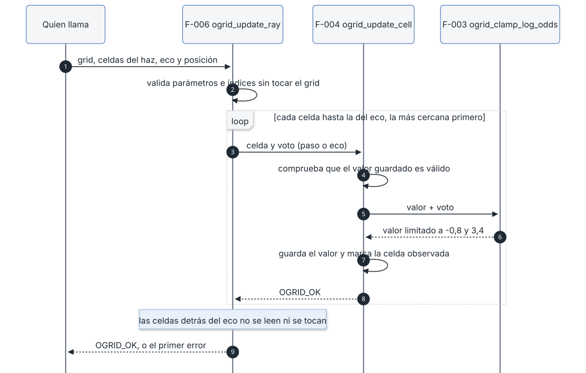

F-006 valida todo el haz antes de tocar el grid. Después recorre las celdas de la más cercana a la más lejana y llama a F-004 por cada una. F-004 comprueba el valor guardado, suma el voto, pide a F-003 que lo limite y escribe el resultado. Las celdas detrás del eco no se leen ni se modifican (contrato F-006, POST-2).

##### 2.3 Secuencia de la derivación del estado de una celda

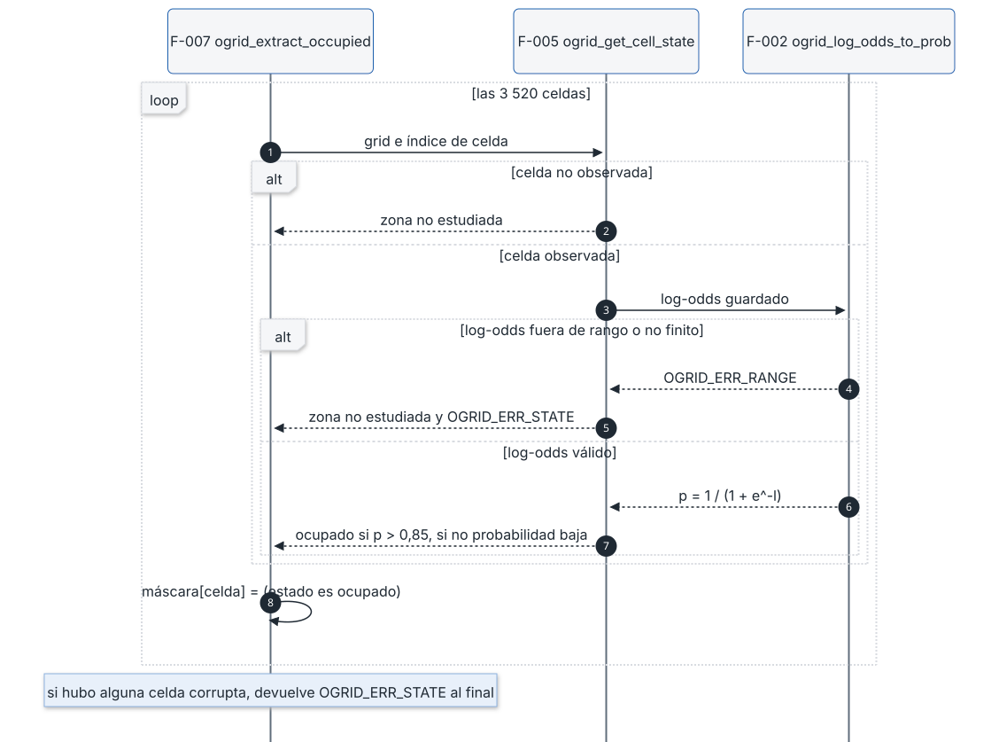

F-007 pregunta a F-005 por cada una de las 3 520 celdas. F-005 devuelve «zona no estudiada» sin mirar el log-odds si la celda no está observada. Si está observada, pide la probabilidad a F-002 y la compara con el umbral 0,85. Un valor corrupto da «zona no estudiada» con `OGRID_ERR_STATE`. F-007 pone `true` solo en las celdas ocupadas y devuelve un único `OGRID_ERR_STATE` al final si encontró alguna corrupta.

#### 3. Funciones

Cada ficha resume el contrato (`contratos/F-NNN-*.md`), explica el algoritmo del código de `src/ogrid/` y recoge los casos de `casos/casos-F-NNN.md` y las iteraciones de `log-tests.md`. Todas las funciones devuelven `ogrid_status_t`. Ninguna usa variables globales ni memoria dinámica.

##### 3.1 F-001 · `ogrid_reset_grid`

**Requisitos:** SYS-PR-08, SYS-SAF-07, SYS-IMP-01 (contrato). Diseño: §6.1, §6.2 y §6.3.

**Propósito.** Deja las 3 520 celdas en «zona no estudiada» con log-odds 0. Se usa en el arranque y al volver de FALLO, porque las mediciones anteriores dejan de ser fiables (diseno.md §6.3).

**Firma.**

```c
ogrid_status_t ogrid_reset_grid(ogrid_t *grid_out);
```

**Contrato resumido.**

- PRE-1: `grid_out` no es `NULL`. Si lo es, devuelve `OGRID_ERR_PARAM` y no toca nada.
- POST-1 y POST-2: con `OGRID_OK`, todas las celdas tienen `log_odds_lo` igual a `OGRID_LOG_ODDS_INIT` (0,0) exacto y `observed` igual a `OGRID_OBSERVED_NO`.
- POST-3: ninguna celda queda ocupada ni con probabilidad baja. POST-4: es idempotente.
- Errores: `OGRID_OK` y `OGRID_ERR_PARAM`.

**Algoritmo.** Si el puntero es nulo, devuelve `OGRID_ERR_PARAM`. Si no, recorre las celdas de la 0 a la 3 519 y escribe en cada una el log-odds inicial y `observed = OGRID_OBSERVED_NO`. No lee nunca el contenido previo, así que da igual lo que hubiera en memoria. Cuesta O(3 520) con un bucle de cota fija.

**Decisiones.**

- Escribe campo a campo y no usa `memset`: el valor inicial sale de `OGRID_LOG_ODDS_INIT`, y el patrón de bits de 0,0 como `float` no está garantizado como «todo ceros» (comentario en `ogrid_reset_grid.c`).
- Un único retorno al final, con la guarda al principio (desviación DEV-001, ver §4.4).

**Casos de test (15, TC-F001-01 a 15).**

- Resultado y exactitud: TC-01 a 05 (OK, 3 520 celdas con 0,0 bit a bit y `observed` = NO, celdas 0 y 3 519, tamaño 3 520).
- Seguridad (SYS-SAF-07): TC-06 a 08 (partir de todo ocupado o todo con probabilidad baja y comprobar que nada queda con evidencia).
- Datos sucios: TC-09 (memoria a 0xFF, con NaN).
- Idempotencia y restauración: TC-10 y TC-11.
- Errores: TC-12 a 14 (puntero nulo, sin cambios en otros datos, código distinto de RANGE y STATE).
- Aislamiento (SYS-IMP-01): TC-15 (dos grids contiguos, solo se reinicia el primero).

**Iteraciones fallidas: 4** (plan.json).

| Ejecución | Fallo | Causa raíz |
|---|---|---|
| 1 | TC-F001-15, cobertura de ramas 60 %, MISRA con 11 hallazgos | El test comparaba bytes en bruto, relleno de la estructura incluido, y el contrato no lo garantiza. El ingeniero de tests pasó a comparar campo a campo (TC-10, 13 y 15). |
| 2 | Cobertura de ramas 60 %, MISRA con 11 hallazgos | Cobertura: `gcovr` con el `llvm-cov` de Apple inventaba 16 ramas en las líneas de asignación; MISRA: reglas 2.3, 2.4 y 2.5 en las cabeceras y 8.7 en la función pública, resueltas con las desviaciones DEV-002 y DEV-003. |
| 3 | Cobertura L 90,9 % y R 20,0 % (MISRA ya sin hallazgos) | Mismo artefacto de medición de `gcovr` con `llvm-cov`; un primer intento de separar el build de cobertura del de sanitizers no lo resolvió y se deshizo. |
| 4 | Cobertura 100 % pero resultado global FAIL | Todos los controles en verde, pero el árbol de trabajo tenía cambios sin commitear (el preset de `gcc-16`), y el informe no habilita el merge (GIT-MG-02). Con la compilación con `gcc-16` la cobertura se mide bien. |

La ejecución 5 pasó. Las ejecuciones 6 y 7 son cambios de auditoría de estándares (C-PRE-04, C-DOC-04: incluir `stdint.h` y `stdbool.h` y añadir el comentario de justificación). La ejecución 8 es la repetición tras pasar `observed` a `uint8_t` (§1).

##### 3.2 F-002 · `ogrid_log_odds_to_prob`

**Requisitos:** SYS-PR-08. Diseño: §6.2.

**Propósito.** Convierte el log-odds de una celda en probabilidad de ocupación. Es la única conversión del módulo. La probabilidad es interna y no sale del módulo.

**Firma.**

```c
ogrid_status_t ogrid_log_odds_to_prob(ogrid_real_t log_odds_lo, ogrid_real_t *prob_out);
```

**Contrato resumido.**

- PRE-1: `prob_out` no es `NULL` (`OGRID_ERR_PARAM`). PRE-2: `log_odds_lo` es finito y está en [−0,8; 3,4] (`OGRID_ERR_RANGE`). Se comprueba PRE-1 antes que PRE-2.
- POST-1: `*prob_out` = 1 / (1 + e^−l) con error absoluto ≤ 1·10⁻⁶. POST-2: valores de referencia (0 → 0,5; 0,85 → 0,7005671; 1,70 → 0,8455347; 2,55 → 0,9275735; 3,4 → 0,9677045; −0,8 → 0,3100255).
- POST-3: 0 < p < 1 y estrictamente creciente. POST-5: con error, `*prob_out` no cambia.
- Errores: `OGRID_OK`, `OGRID_ERR_PARAM`, `OGRID_ERR_RANGE`.

**Algoritmo.** Comprueba el puntero. Después comprueba que l está en el intervalo con la forma positiva `(l >= MIN) && (l <= MAX)` negada: un NaN falla toda comparación, así que queda rechazado sin un caso aparte, igual que los infinitos. Si pasa, calcula `1 / (1 + expf(-l))`. Como l ≥ −0,8, el argumento de `expf` es como mucho 0,8 y no puede desbordar. Tiempo constante.

**Decisiones.** Se usa `expf` (float32) y no `exp`, para ser coherente con `ogrid_real_t` (assert estático en `ogrid_types.h`). Se comprueba el dominio antes de llamar a `<math.h>` (C-LIB-03). Un solo fichero, una sola conversión (C-NAM-06).

**Casos de test (27, TC-F002-01 a 27).**

- Valores analíticos: TC-02 a 09 (0, 0,85, 1,70, 2,55, 3,4, −0,8, valores literales del contrato y puntos interiores).
- Propiedades: TC-10 a 13 (acotación, monotonía en un barrido de 85 puntos, cadena creciente, simetría p(l) + p(−l) = 1).
- Límites y rangos inválidos: TC-14 a 19 (un ulp fuera de cada extremo, −1,0 y 4,0, NaN, ±infinito, ±`FLT_MAX`).
- Salida intacta tras error: TC-20 a 23, 25 y 26.
- Punteros nulos: TC-24 y 25. Determinismo: TC-27.

**Iteraciones fallidas: 0.** Tras la ejecución 1 hubo un cambio de auditoría del implementador: se corrigió un comentario de desbordamiento invertido y se eliminó la macro redundante `OGRID_PROB_ONE`. La ejecución 2 pasó.

##### 3.3 F-003 · `ogrid_clamp_log_odds`

**Requisitos:** SYS-PR-08, SYS-SAF-07. Diseño: §6.2.

**Propósito.** Limita un log-odds al intervalo [−0,8; 3,4]. El máximo evita que una celda saturada tarde en dejar de ser «ocupado» (5 ciclos). El mínimo garantiza que tres ecos seguidos confirmen un obstáculo.

**Firma.**

```c
ogrid_status_t ogrid_clamp_log_odds(ogrid_real_t value_lo, ogrid_real_t *clamped_lo_out);
```

**Contrato resumido.**

- PRE-1: `clamped_lo_out` no es `NULL` (`OGRID_ERR_PARAM`). PRE-2: `value_lo` es finito (`OGRID_ERR_RANGE`). PRE-1 va antes que PRE-2.
- POST-1: dentro del intervalo, el valor sale igual, exacto. POST-2 y POST-3: por debajo sale −0,8 y por encima 3,4. POST-4: idempotente. POST-5: con error, la salida no cambia.
- Errores: `OGRID_OK`, `OGRID_ERR_PARAM`, `OGRID_ERR_RANGE`.

**Algoritmo.** Cadena de comparaciones. Primero, puntero nulo. Segundo, si el valor no está entre −`FLT_MAX` y `FLT_MAX` (forma negada, que también rechaza NaN), `OGRID_ERR_RANGE`. Tercero, si es menor que el mínimo, escribe el mínimo. Cuarto, si es mayor que el máximo, escribe el máximo. Si no, copia el valor. Tiempo constante, dos comparaciones de límites.

**Decisiones.** Cualquier valor finito es admisible, aunque esté lejos del intervalo: se limita, no se rechaza. `FLT_MAX` es el límite de finitud correcto porque `ogrid_real_t` es float32 (comentario añadido por una auditoría C-TYP-02).

**Casos de test (23, TC-F003-01 a 23).** Comparaciones exactas, sin tolerancia.

- Dentro del intervalo: TC-01 a 03, y los extremos −0,8 y 3,4 (TC-04 a 06, también un ulp dentro).
- Límites y particiones: TC-07 a 12 (un ulp fuera, −1,0, −100, 3,5, 4,0, 100, ±`FLT_MAX`, valores del diseño ±10).
- Propiedades: TC-13 a 15 (idempotencia, acotación y monotonía en un barrido de −5 a 5).
- Errores: TC-16 a 19 (NaN, ±infinito, salida intacta), TC-20 y 21 (puntero nulo).
- Sin estado residual y determinismo: TC-22 y 23.

**Iteraciones fallidas: 0.** Cambio de auditoría tras la ejecución 1 (comentario sobre `FLT_MAX`). La ejecución 2 pasó.

##### 3.4 F-004 · `ogrid_update_cell`

**Requisitos:** SYS-PR-08, SYS-SAF-07. Diseño: §6.2 (regla general H-024/H-031) y paso 10.

**Propósito.** Aplica a una celda el voto de un haz: eco suma +0,85, paso sin eco suma −0,40 y celda oculta detrás de un eco no cambia. El resultado se limita a [−0,8; 3,4]. Es la regla que hace que un eco suelto no confirme un obstáculo y que tres seguidos sí.

**Firma.**

```c
ogrid_status_t ogrid_update_cell(ogrid_t *grid_io, uint32_t cell_idx, ogrid_vote_kind_t vote);
```

**Contrato resumido.**

- PRE-1: `grid_io` no es `NULL`. PRE-2: `vote` es uno de los tres votos válidos. Ambas dan `OGRID_ERR_PARAM`.
- PRE-3: `cell_idx` < 3 520 (`OGRID_ERR_RANGE`). PRE-4: el log-odds guardado es finito y está en [−0,8; 3,4] (`OGRID_ERR_STATE`). Se comprueba en ese orden y se devuelve el error de la primera que falla. PRE-4 se comprueba con cualquier voto, también con el de celda oculta.
- POST-1 y POST-2: eco y paso dejan limitar(anterior + voto) y `observed` = `OGRID_OBSERVED_YES`. POST-3: oculta no cambia nada. POST-4: solo cambia esa celda y el valor queda en el intervalo. POST-5: desde −0,8, tres ecos dejan p > 0,85. POST-6: con error, el grid no cambia.
- Errores: `OGRID_OK`, `OGRID_ERR_PARAM`, `OGRID_ERR_RANGE`, `OGRID_ERR_STATE`.

**Algoritmo.** Valida en cadena: grid y voto, índice, y valor guardado (la función auxiliar `is_stored_value_valid` usa la forma positiva de la comparación, así que rechaza NaN). Si todo es válido y el voto no es «oculta», `apply_delta` suma el voto al log-odds, llama a F-003 para limitarlo, guarda el resultado y pone `observed = OGRID_OBSERVED_YES`. Si el voto es «oculta», no hace nada. Tiempo constante.

**Decisiones.**

- Con la celda corrupta, el voto «oculta» también devuelve `OGRID_ERR_STATE`: así una celda corrupta nunca pasa inadvertida (contrato, orden de comprobación).
- Se eliminó una segunda validación dentro de `apply_delta`. Era una rama defensiva inalcanzable, porque el valor ya está validado antes; impedía llegar al 100 % de ramas. El estado devuelto por F-003 se descarta de forma explícita con `(void)`.
- Un eco o un paso marca la celda como observada, aunque esté en el mínimo y no cambie su valor (TC-F004-07).

**Casos de test (32, TC-F004-01 a 32).**

- Eco: TC-02 a 05 (+0,85, tres ecos 0,85 / 1,70 / 2,55, saturación en 3,4, desde −0,8).
- Paso: TC-06 a 09 (−0,40, mínimo exacto −0,8, eco y paso → 0,45).
- Oculta: TC-10 y 11 (celda sin observar y celda observada con 1,25, sin cambios).
- Propiedades: TC-12 a 17 (resto del grid intacto, índices 0, 3, 4 y 3 519, 400 votos mixtos dentro del intervalo, monotonía de 10 ecos, tres ecos desde −0,8 dan 1,75 > 1,7346, un eco no basta).
- Errores: TC-18 a 22 (grid nulo, voto inválido, índices 3 520, 3 521 y `UINT32_MAX`), TC-23 a 26 (celdas con NaN, ±infinito, un ulp fuera, ±10 y ±`FLT_MAX` dan `OGRID_ERR_STATE`; −0,8 y 3,4 almacenados son válidos).
- Secuencia, determinismo y orden de comprobación: TC-27, 28, 29 (oculta con celda corrupta), 30 a 32 (PARAM antes que RANGE, RANGE antes que STATE).

**Iteraciones fallidas: 2.**

| Ejecución | Fallo | Causa raíz |
|---|---|---|
| 1 | Cobertura L 96,3 %, R 91,7 % (28 casos) | Cláusulas del contrato sin ejercitar: voto «oculta» sobre celda corrupta y orden de las precondiciones. El ingeniero de tests añadió TC-F004-29 a 32. |
| 2 | Misma cobertura (32 casos) | Rama defensiva inalcanzable en `apply_delta`. El implementador quitó la segunda validación. |

La ejecución 3 pasó. La ejecución 5 es la repetición tras pasar `observed` a `uint8_t` (§1).

##### 3.5 F-005 · `ogrid_get_cell_state`

**Requisitos:** SYS-PR-08, SYS-SAF-07. Diseño: §6.2 (estados derivados, H-012).

**Propósito.** Deriva el estado de una celda: ocupado, probabilidad baja de obstáculo o zona no estudiada. No existe «libre».

**Firma.**

```c
ogrid_status_t ogrid_get_cell_state(const ogrid_t *grid, uint32_t cell_idx, ogrid_cell_state_t *state_out);
```

**Contrato resumido.**

- PRE-1: `grid` y `state_out` no son `NULL` (`OGRID_ERR_PARAM`). PRE-2: `cell_idx` < 3 520 (`OGRID_ERR_RANGE`).
- POST-1: celda no observada → `OGRID_CELL_UNSURVEYED`, con cualquier log-odds, NaN incluido. POST-2: observada y p > 0,85 → `OGRID_CELL_OCCUPIED`. POST-3: observada y p ≤ 0,85 → `OGRID_CELL_LOW_PROB`. POST-4: nunca otro valor.
- POST-5: si `observed` no es 0 ni 1, o si una celda observada tiene un log-odds corrupto, devuelve `OGRID_ERR_STATE` y `*state_out` = `OGRID_CELL_UNSURVEYED`. POST-6: con `OGRID_ERR_PARAM` u `OGRID_ERR_RANGE` la salida no cambia, y el grid nunca se modifica.
- Errores: `OGRID_OK`, `OGRID_ERR_PARAM`, `OGRID_ERR_RANGE`, `OGRID_ERR_STATE`.

**Algoritmo.** Tras validar puntero e índice, mira `observed`. Si vale `OGRID_OBSERVED_NO`, devuelve «zona no estudiada» sin mirar el log-odds. Si vale `OGRID_OBSERVED_YES`, la función auxiliar `derive_observed_state` pide la probabilidad a F-002. Si F-002 rechaza el valor, devuelve `OGRID_ERR_STATE` y «zona no estudiada». Si p > 0,85 devuelve «ocupado», y si no, «probabilidad baja». Cualquier otro valor de `observed` es una celda corrupta: `OGRID_ERR_STATE` y «zona no estudiada». Tiempo constante.

**Decisiones.** Ante datos corruptos la salida es el estado seguro «zona no estudiada», nunca «libre» ni «probabilidad baja» (SYS-SAF-07). El log-odds de una celda no observada ni se mira ni es un error, porque `reset` y las celdas ocultas pueden dejar valores sin significado. La comparación es estricta (`>`), como pide el contrato.

**Casos de test (31, TC-F005-01 a 31).**

- Estados: TC-01 a 03 (OK, no observada con cualquier log-odds), TC-04 y 05 (l = 1,70 → baja, l = 2,55 → ocupado).
- Umbral y límites: TC-06 a 09 (l = 1,73 baja y l = 1,74 ocupado, extremos −0,8, 0 y 3,4).
- Propiedades: TC-10 y 11 (monotonía y salida siempre en los tres estados).
- Datos corruptos: TC-12 a 18 (`observed` = 2, 255, 3 y 7; log-odds NaN, ±infinito y fuera de rango), TC-31 (la celda corrupta no afecta a una vecina sana).
- Errores y orden: TC-19 a 24 y TC-27 a 30 (punteros nulos, índices 3 520, 3 521 y `UINT32_MAX`, orden PARAM, RANGE, STATE).
- Inmutabilidad e independencia de celdas: TC-25 y 26.

No se prueba l exactamente en el umbral ln(0,85 / 0,15) = 1,734601: con float32 no se puede decidir p = 0,85. Se usan 1,73 y 1,74, a unos 4·10⁻⁴ de p, muy por encima del error de `expf`. Los casos de test dejan dos dudas anotadas: el contrato no fija explícitamente el orden PARAM, RANGE, STATE (TC-27 a 30 asumen el orden implícito), y una celda no observada con NaN devuelve OK (TC-03).

**Iteraciones fallidas: 0** según `plan.json`. El log (`log-tests.md`) empieza en la ejecución 2 de esta función (ambas PASS, 31 casos); la ejecución 1 consta solo en `.harness/reports/F-005/run-1.json`.

##### 3.6 F-006 · `ogrid_update_ray`

**Requisitos:** SYS-PR-08, SYS-SAF-07. Diseño: §6.2 y paso 10.

**Propósito.** Aplica un haz a las celdas que recorre, de la más cercana a la más lejana. Las anteriores al eco reciben «paso sin eco», la del eco recibe «eco» y las posteriores quedan ocultas. Sin eco, todas reciben «paso sin eco». Qué celdas cruza el haz lo calcula la geometría, que está fuera de este alcance.

**Firma.**

```c
ogrid_status_t ogrid_update_ray(ogrid_t *grid_io, const uint32_t *cells_in, uint32_t cell_count,
                                bool has_echo, uint32_t echo_pos);
```

**Contrato resumido.**

- PRE-1: `grid_io` no es `NULL`. PRE-2: `cells_in` no es `NULL` si `cell_count` > 0. Ambas dan `OGRID_ERR_PARAM`.
- PRE-3: `cell_count` ≤ 3 520. PRE-4: todos los índices son < 3 520, incluidos los de detrás del eco. PRE-5: si hay eco, `echo_pos` < `cell_count`. Las tres dan `OGRID_ERR_RANGE`.
- Orden: parámetros, rango y, por último, estado de las celdas. Con `cell_count` = 0, sin eco devuelve OK sin hacer nada y con eco devuelve `OGRID_ERR_RANGE`.
- POST-1 a POST-3: votos de paso, eco y celdas ocultas como en el propósito; las celdas que no están en el haz no cambian. POST-5: el ejemplo [10, 11, 12, 13] con eco en la posición 2 da −0,40, −0,40, +0,85 y la 13 sin cambio. POST-7: ante `OGRID_ERR_PARAM` u `OGRID_ERR_RANGE` el grid no se modifica.
- `OGRID_ERR_STATE` (propagado de F-004): las celdas anteriores a la corrupta pueden estar ya actualizadas; la corrupta y las posteriores no cambian. Una celda corrupta detrás del eco no da error, porque no se lee.
- Errores: `OGRID_OK`, `OGRID_ERR_PARAM`, `OGRID_ERR_RANGE`, `OGRID_ERR_STATE`.

**Algoritmo.** Tiene dos fases, en este orden.

1. **Validar.** Comprueba los punteros. Después `validate_ray` revisa `cell_count`, `echo_pos` y todos los índices de `cells_in`. Hasta aquí no se ha tocado el grid.
2. **Votar.** Calcula cuántas celdas procesar: hasta la del eco incluida si hay eco, o todas si no lo hay. `apply_votes` recorre esas celdas en orden y llama a F-004 con «paso» o, en la posición del eco, con «eco». Se detiene en el primer error de F-004. Las celdas de detrás del eco ni se leen ni se votan.

Para marcar «sin eco», la posición del eco se sustituye por `cell_count`, un valor que el bucle nunca alcanza; así no hace falta otro indicador. Coste O(`cell_count`) ≤ 3 520 llamadas a F-004.

**Decisiones.** Validar todo antes de modificar garantiza que un error de parámetro o de rango no deje cambios a medias (POST-7). Los índices de detrás del eco también se validan, para que el resultado no dependa de la posición del eco. Con una celda corrupta, la función se detiene y quien llama debe llevar el sistema a estado seguro (C-ERR-02) y reiniciar con F-001.

**Casos de test (46, TC-F006-01 a 46).**

- Ejemplo del contrato y particiones del eco: TC-01 a 09 (con y sin eco, eco en la primera y en la última posición, una sola celda, celdas ocultas y ajenas sin cambios).
- Valores analíticos y límites: TC-10 a 17 (0,5 + paso = 0,1, 0,5 + eco = 1,35, saturaciones en 3,4 y −0,8, varios haces seguidos, 30 haces mixtos).
- Haz vacío: TC-18 y 19 (OK) y TC-39 y 40 (con eco, `OGRID_ERR_RANGE`).
- Errores de parámetro y de rango: TC-20 a 33 y TC-41 a 44 (punteros nulos, `echo_pos` y `cell_count` fuera de rango, índice inválido en cualquier posición, haz máximo de 3 520 celdas válido, atomicidad, precedencia PARAM > RANGE > STATE).
- Celdas corruptas: TC-34 a 36 (valor fuera de rango, NaN e infinito dan `OGRID_ERR_STATE`), TC-45 y 46 (corrupta detrás del eco, no hay error).
- Haz sano y determinismo: TC-37 y 38.

**Iteraciones fallidas: 1.**

| Ejecución | Fallo | Causa raíz |
|---|---|---|
| 1 | TC-F006-34 y 36 fallan (38 casos); cobertura de ramas 96,2 % | Los tests daban por hecho que un `observed` corrupto produce `OGRID_ERR_STATE`, pero F-004 solo comprueba el log-odds. El ingeniero de tests corrigió TC-34 y 36 y añadió TC-39 a 46. |

La ejecución 2 pasó. La ejecución 3 es un cambio de auditoría (C-DOC-04) con solo comentarios.

##### 3.7 F-007 · `ogrid_extract_occupied`

**Requisitos:** SYS-PR-04, SYS-PR-08. Diseño: §6.4 y paso 11 (H-026).

**Propósito.** Marca en una máscara las celdas ocupadas (p > 0,85). Es la entrada de la agrupación en objetos (SYS-PR-04), que queda fuera de este alcance. Usa la misma regla que el estado de celda, así que ambas salidas no se contradicen.

**Firma.**

```c
ogrid_status_t ogrid_extract_occupied(const ogrid_t *grid, bool *mask_out);
```

**Contrato resumido.**

- PRE-1: `grid` y `mask_out` no son `NULL` (`OGRID_ERR_PARAM`). `mask_out` apunta a un array de 3 520 `bool`.
- POST-1: `mask_out[i]` es `true` si y solo si F-005 daría «ocupado» para esa celda. POST-2: una celda no observada nunca es `true`. POST-3: l = 1,70 es `false` y l = 2,55 es `true`.
- POST-4: una celda corrupta queda en `false`, el resto de la máscara se calcula igual y devuelve `OGRID_ERR_STATE`. POST-5: no modifica el grid, y con `OGRID_ERR_PARAM` no toca la máscara.
- Errores: `OGRID_OK`, `OGRID_ERR_PARAM`, `OGRID_ERR_STATE`.

**Algoritmo.** Tras comprobar los punteros, recorre las 3 520 celdas. Por cada una llama a F-005 con un estado inicial «zona no estudiada». Si F-005 devuelve error, anota `OGRID_ERR_STATE` y sigue. Escribe `mask_out[idx] = (estado == ocupado)`. Como F-005 deja «zona no estudiada» en caso de error, la celda corrupta queda en `false`. Al terminar devuelve `OK` o un único `OGRID_ERR_STATE`. Coste O(3 520), una llamada a F-005 por celda.

**Decisiones.** No se repite la regla de ocupación: se delega en F-005, de modo que la máscara y el estado de celda no pueden diferir. El recorrido no se detiene en la primera celda corrupta, porque el contrato exige una máscara completa. Los índices que se pasan a F-005 son siempre válidos, así que no hay ramas inalcanzables para los tests.

**Casos de test (20, TC-F007-01 a 20).**

- Punteros nulos: TC-01 a 03.
- Máscara: TC-04 a 09 (grid nuevo, celdas no observadas con cualquier log-odds, l = 1,70 `false`, l = 2,55 `true`, l = 1,73 y 1,74 en el umbral, extremos −0,8, 0 y 3,4).
- Celdas corruptas: TC-10 a 13 y TC-17 (un ulp fuera de rango, NaN, ±infinito, `observed` 2, 128 y 255, y mezcla de siete corruptas con cuatro válidas dan un único `OGRID_ERR_STATE`).
- Patrones y consistencia con F-005: TC-14 a 16 (patrón módulo 7 con 1 508 `true`, máscara igual al estado «ocupado» en todas las celdas, celdas 0 y 3 519).
- Inmutabilidad, monotonía y determinismo: TC-18 a 20.

**Iteraciones fallidas: 0.** Cambio de auditoría tras la ejecución 1 (comentario de justificación, C-DOC-04). La ejecución 2 pasó.

#### 4. Verificación

##### 4.1 Proceso (implementación y test independientes)

El código y los tests los escriben dos agentes distintos, cada uno en su sandbox, sin verse (STD-TST TST-IND-03):

- El **implementador** escribe `src/` y `include/` a partir del contrato de la función. No ve `tests/` ni los informes de cobertura.
- El **ingeniero de tests** escribe `tests/` a partir del contrato, los requisitos y el diseño, y deriva los casos de `casos/casos-F-NNN.md`. No ve `src/`.
- El orquestador no escribe código ni tests. Cada ejecución de `h test F-NNN` añade una entrada a `log-tests.md` y cada corrección registra agente, causa raíz y commit.

Cada función se integra en una rama `feature/…` y pasa a `develop` solo si `h test F-NNN` da PASS en todos los checks (STD-TST §3). Cada función tuvo como máximo 4 iteraciones fallidas, por debajo del límite de 5 (TST-LOG-04).

##### 4.2 Resultados por función

Resultado de la última ejecución registrada en `log-tests.md`. En todas, build, MISRA, tidy, format, complexity, doxygen y forbidden dan PASS, y la cobertura del fichero de la función es 100,0 % de líneas y 100,0 % de ramas.

| Función | Casos | Iteraciones fallidas | Ejecuciones en el log | Última ejecución |
|---|---|---|---|---|
| F-001 `ogrid_reset_grid` | 15 | 4 | 8 | 8, PASS |
| F-002 `ogrid_log_odds_to_prob` | 27 | 0 | 2 | 2, PASS |
| F-003 `ogrid_clamp_log_odds` | 23 | 0 | 2 | 2, PASS |
| F-004 `ogrid_update_cell` | 32 | 2 | 5 | 5, PASS |
| F-005 `ogrid_get_cell_state` | 31 | 0 | 2 (ejecuciones 2 y 3) | 3, PASS |
| F-006 `ogrid_update_ray` | 46 | 1 | 3 | 3, PASS |
| F-007 `ogrid_extract_occupied` | 20 | 0 | 2 | 2, PASS |
| **Total** | **194** | | | |

##### 4.3 Integración completa

`h test --all` en la rama `test/integration` (ejecución 1, 2026-11-02 23:08) da **PASS** en todos los checks: build, unit+integration, coverage, MISRA, tidy, format, complexity, doxygen y forbidden. Ejecuta 209 casos: los 194 unitarios y 15 de integración. La cobertura es 100,0 % de líneas y 100,0 % de ramas en los siete ficheros de `src/ogrid/`.

Los 15 casos `TC-INT-01` a `15` (`tests/integration/test_integration_ogrid.c`) usan solo la API pública, con valores calculados a mano desde los requisitos y el diseño:

| Caso | Qué comprueba |
|---|---|
| TC-INT-01 | Tras el reinicio, todas las celdas están en «zona no estudiada». |
| TC-INT-02 a 04 | Un eco no confirma, dos no confirman y tres confirman «ocupado». |
| TC-INT-05 | Los pasos bajan el valor hasta el mínimo −0,8. |
| TC-INT-06 | Tres ecos tras una racha de pasos confirman. |
| TC-INT-07 y 08 | Una celda oculta detrás del eco no cambia, ya observada o no. |
| TC-INT-09 | Un haz con pasos, eco y celdas ocultas. |
| TC-INT-10 | Un haz vacío sin eco no hace nada. |
| TC-INT-11 | Los pasos erosionan una celda ocupada. |
| TC-INT-12 | Un reinicio tras acumular evidencia devuelve todo a «zona no estudiada». |
| TC-INT-13 | Un grid mezclado no produce nunca el estado «libre». |
| TC-INT-14 | Varios ciclos completos con varios haces. |
| TC-INT-15 | La evidencia tras un reinicio empieza de cero. |

El informe de integración (`.harness/reports/integration/latest.json`) no incluye el check `cross-aarch64`. `h test --all` solo lo ejecuta si el compilador `aarch64-linux-gnu-gcc` está instalado, y no lo está en esta máquina. La portabilidad al objetivo no se ha comprobado.

##### 4.4 Cumplimiento de estándares y desviaciones

Los checks de `h test` (STD-TST §3) son:

| Check | Herramienta | Criterio | Resultado |
|---|---|---|---|
| build | CMake `host-test`, `gcc-16` | sin avisos con C-LNG-02 (`-Wall -Wextra -Wpedantic -Wconversion … -Werror`) | PASS |
| unit | Unity + CTest, ASan y UBSan | 100 % de casos | PASS (209 casos) |
| coverage | gcovr | 100 % líneas y 100 % ramas | PASS |
| misra | cppcheck con addon MISRA | 0 hallazgos no registrados | PASS |
| tidy | clang-tidy | 0 hallazgos | PASS |
| format | clang-format | 0 diferencias | PASS |
| complexity | lizard | CC ≤ 10, ≤ 60 líneas, ≤ 5 parámetros | PASS |
| doxygen | parser de `h test` | C-DOC-01/02 | PASS |
| forbidden | parser de `h test` | 0 símbolos de C-LIB-01/02 y 0 marcadores C-DOC-05 | PASS |

El check `forbidden` respalda SYS-IMP-01 (sin memoria dinámica), cuyo método de verificación es la inspección.

**Desviaciones MISRA C:2012** (`config/misra-desviaciones.md`, aprobadas por Alicia Garcia el 2026-11-02; supresiones en `config/cppcheck-suppressions.txt`):

| ID | Regla | Ámbito | Justificación | Riesgo |
|---|---|---|---|---|
| DEV-001 | 15.5 (un único punto de salida) | Proyecto | Las cláusulas de guarda al inicio mejoran la legibilidad y evitan anidamiento profundo (C-FUN-03). | Bajo: el retorno anticipado ocurre antes de cualquier efecto lateral. |
| DEV-002 | 2.3, 2.4, 2.5 (tipos, etiquetas y macros sin usar) | `include/ogrid/*.h` | Las cabeceras declaran la API y las constantes para sus consumidores; el análisis por unidad de traducción no ve usados los que esa unidad no necesita. | Bajo: son solo declaraciones, no generan código. |
| DEV-003 | 8.7 (símbolo con enlace externo usado en una sola unidad) | Funciones públicas de `src/ogrid/` | Una función pública por fichero (C-NAM-06): cada una forma la API y se usa desde otras unidades o desde los tests. | Bajo: el enlace externo es el pretendido. |

##### 4.5 Tiempos de ejecución (WCET)

**Qué es y qué no es.** Es una medida empírica del tiempo de ejecución en el equipo de desarrollo: Apple M5, macOS (Darwin arm64 25.5.0), `gcc-16` (16.2.0), preset `host-bench` en Release, sin sanitizers ni cobertura (`wcet-medidas.md`). **No es el WCET de la ECU**, cuyo procesador no está elegido (regla R-HW, diseno.md §9 y §10). El valor «máx» es el máximo observado en 3 ejecuciones, no una cota demostrada. Sirve para contrastar los objetivos de la sección 7 de los contratos y el presupuesto de diseno.md §9 (SYS-T-01, SYS-IMP-02), y para estimar; no sustituye la medida en destino. Las cifras de los escenarios y la metodología están en `casos/casos-wcet-ogrid.md`; los resultados en bruto, en `wcet-medidas.md`.

###### Método 1: cuenta de operaciones del peor camino

Se cuenta desde el código de `src/ogrid/`, sin suponer tiempos. En ninguna función hay memoria dinámica ni recursión, y todos los bucles tienen cota estática (`OGRID_CELL_COUNT` = 880 × 4 = 3 520, `ogrid_limits.h`). La operación más costosa del módulo es la exponencial `expf` de `ogrid_log_odds_to_prob`, que se llama una vez por cada celda observada que se evalúa.

| Función | Bucles y cota | Llamadas anidadas en el peor camino | Exponenciales `expf` | Resto del peor camino |
|---|---|---|---|---|
| F-001 `ogrid_reset_grid` | 1 bucle, 3 520 iteraciones | ninguna | 0 | 7 040 escrituras (2 por celda) y 1 comparación de puntero |
| F-002 `ogrid_log_odds_to_prob` | ninguno | ninguna | 1 | 3 comparaciones, 1 negación, 1 suma y 1 división |
| F-003 `ogrid_clamp_log_odds` | ninguno | ninguna | 0 | 5 comparaciones y 1 escritura |
| F-004 `ogrid_update_cell` | ninguno | 1 a F-003 | 0 | hasta 9 comparaciones, 1 suma y 2 escrituras |
| F-005 `ogrid_get_cell_state` | ninguno | 1 a F-002 (celda observada) | 1 | 6 comparaciones |
| F-006 `ogrid_update_ray` | `validate_ray`: hasta 3 520 iteraciones; `apply_votes`: hasta 3 520 iteraciones | hasta 3 520 a F-004 y, por ellas, 3 520 a F-003 | 0 | 3 520 comparaciones de índice, más las de F-004 y F-003 |
| F-007 `ogrid_extract_occupied` | 1 bucle, 3 520 iteraciones | 3 520 a F-005 y, por ellas, 3 520 a F-002 | 3 520 | 3 520 escrituras en la máscara |

Notas de la cuenta:

- F-006 llega a las 3 520 llamadas a F-004 cuando el haz tiene 3 520 celdas y no hay eco, o el eco está en la última celda; con eco antes, procesa hasta la celda del eco incluida (`apply_votes`, `process_count`). Las celdas detrás del eco solo se validan.
- F-005 con la celda no observada o corrupta (`observed` distinto de 0 y 1) no llega a F-002 y no calcula `expf`. F-007 en el peor caso tiene las 3 520 celdas observadas y válidas.
- F-002 comprueba el dominio antes de llamar a `expf` (C-LIB-03), así que no hay rutas con entradas fuera de dominio hacia `expf`.

###### Método 2: medida

El ejecutable es `tests/integration/bench_wcet_ogrid.c` (caja negra, solo la API pública de `include/ogrid/`). Metodología (`casos/casos-wcet-ogrid.md`):

- Reloj `clock_gettime_nsec_np(CLOCK_UPTIME_RAW)` en macOS, de resolución medida 41 ns. Una lectura vacía cuesta unos 8,9 ns (escenario «reloj: lectura vacía»).
- Lotes adaptativos: cada medida cronometra un lote de K llamadas (calibrado por escenario hasta que dura al menos 200 µs) y divide entre K. El error de cuantización (resolución / duración del lote) queda entre 0,02 % y 0,15 % en todos los escenarios, por debajo del 1 %.
- Entradas de peor caso: rutas con exponencial, haces de 10, 880 y 3 520 celdas, con y sin eco en la última celda (sin celdas ocultas, todas se leen), y 3 520 celdas observadas en la máscara con mitad, todas y ninguna ocupadas.
- El estado se restaura fuera del cronómetro. En los haces, cada llamada del lote usa una ventana distinta para que ninguna celda sature.
- Precalentamiento de 50 repeticiones; 2 000 repeticiones en los escenarios rápidos y 500 en los que recorren el grid. Entradas fijas, sin aleatoriedad. Resultados anti-eliminados con variables `volatile`.
- Se ejecutó 3 veces seguidas. Las tablas dan, por escenario, la mediana de las 3 medianas y el máximo de los 3 máximos, en ns por llamada.

| Función | Escenario más costoso | Mediana (ns) | Máx. observado (ns) |
|---|---|---:|---:|
| F-001 `ogrid_reset_grid` | grid de 3 520 celdas sucio | 796 | 908 |
| F-002 `ogrid_log_odds_to_prob` | barrido [−0,8; 3,4] | 1,80 | 2,08 |
| F-002 | l = −0,8 (mínimo) | 1,77 | 2,10 |
| F-003 `ogrid_clamp_log_odds` | por debajo (−5) | 0,808 | 14,6 (*) |
| F-003 | por encima (10) | 0,770 | 2,39 |
| F-004 `ogrid_update_cell` | eco desde 3,4 (saturada) | 2,08 | 3,22 |
| F-004 | eco desde 0,0 | 2,08 | 2,35 |
| F-004 | oculta desde 0,0 | 1,15 | 2,38 |
| F-005 `ogrid_get_cell_state` | observada, l = 1,70 (probabilidad baja) | 2,62 | 3,29 |
| F-005 | observada, l = 2,55 (ocupada) | 2,62 | 2,99 |
| F-006 `ogrid_update_ray` | 10 celdas, eco en la última | 22,4 | 36,7 |
| F-006 | 880 celdas, eco en la última | 1 780 | 2 710 |
| F-006 | 3 520 celdas, sin eco | 7 030 | 10 100 |
| F-006 | 3 520 celdas, eco en la última | 7 030 | 11 900 |
| F-007 `ogrid_extract_occupied` | 3 520 observadas, todas ocupadas | 9 150 | 10 600 |
| F-007 | 3 520 observadas, mitad ocupadas | 9 150 | 10 300 |
| F-007 | grid sin observar (referencia inferior) | 3 200 | 3 610 |

(*) Valor aislado de la ejecución 3 (las ejecuciones 1 y 2 dan 1,52 y 1,29 ns). No se ha investigado su causa; es compatible con una interrupción del sistema operativo u otro efecto de la máquina de medida, pero no está confirmado. Las medianas de las tres ejecuciones coinciden.

**Coste por celda.** Con el máximo observado, los haces largos (880 y 3 520 celdas) cuestan entre 2,4 y 3,4 ns por celda, y la máscara de 3 520 celdas observadas, entre 2,8 y 3,0 ns por celda (tablas «Estimaciones por haz y por celda» de `wcet-medidas.md`). Con la mediana salen unos 2,0 ns por celda en los haces (1 780 ns / 880 y 7 030 ns / 3 520) y unos 2,6 ns en la máscara (9 150 ns / 3 520). El haz de 10 celdas sale más caro por celda (hasta 3,7 ns) porque en él pesa el coste fijo de la validación y de la llamada. Reiniciar el grid cuesta 0,23 ns por celda con la mediana (796 ns / 3 520).

###### Contraste con los objetivos de los contratos

Sección 7 de cada contrato, contra el máximo observado en el equipo de desarrollo (no en la ECU):

| Función | Objetivo del contrato | Máx. observado en el M5 | ¿Se cumple en el M5? |
|---|---|---:|---|
| F-001 | muy inferior a 1 ms | 0,908 µs | Sí: unas 1 100 veces menos que 1 ms. |
| F-002 | muy inferior a 1 µs | 2,10 ns | Sí: 0,21 % de 1 µs. |
| F-003 | muy inferior a 1 µs | 14,6 ns (valor aislado; 2,39 ns sin él) | Sí: 1,5 % de 1 µs en el peor caso. |
| F-004 | muy inferior a 1 µs | 3,22 ns | Sí: 0,32 % de 1 µs. |
| F-005 | muy inferior a 1 µs | 3,29 ns | Sí: 0,33 % de 1 µs. |
| F-006 | decenas de µs por haz | 2,71 µs (880 celdas) y 11,9 µs (3 520 celdas) | Sí: por debajo del orden fijado, incluso con el haz máximo de 3 520 celdas. |
| F-007 | bajo 1 ms | 10,6 µs | Sí: 1,1 % de 1 ms. |

Estas cifras son del M5 y no prueban que los objetivos se cumplan en la ECU. Se midió con la memoria caliente (precalentamiento y lotes repetidos), de modo que no incluyen fallos de caché que sí podrían darse en el ciclo real. La medida con caché fría no se ha hecho y queda para la medida en la ECU.

###### Contraste con el presupuesto del diseño

Diseno.md §9: la entrega se limita a 128 ms (SYS-T-01) y, como la publicación espera al temporizador de 50 ms, el procesamiento de cada nube debe caber en 128 − 50 = 78 ms. SYS-IMP-02 exige además un ciclo máximo ≤ 128 ms.

El coste de proceso del grid en un ciclo es:

> t_ciclo(grid) = n_haces × t_haz + t_máscara (+ t_reset solo al arrancar o al volver de FALLO)

con t_haz = coste de `ogrid_update_ray` (F-006), t_máscara = coste de `ogrid_extract_occupied` (F-007) y t_reset = coste de `ogrid_reset_grid` (F-001). Faltan por sumar los pasos del pipeline que no están implementados (geometría de qué celdas cruza cada haz, agrupación en objetos, filtro de tamaño, confirmación de N ciclos, máquina de estados y publicación; ver «Pendientes y límites»). Este t_ciclo(grid) es por tanto una parte del procesamiento, no el total. El número de haces por ciclo depende del radar (R-HW) y no consta en los documentos: se fija con la hoja de datos del radar elegido (regla R-HW, `diseno.md` §10).

Con el máximo observado en el M5, y t_máscara = 10,6 µs:

| Haz | t_haz (máx.) | Haces que caben en 78 ms (todo el presupuesto, solo grid) | Haces con holgura: se usa solo el 10 % del presupuesto (7,8 ms) |
|---|---:|---:|---:|
| 880 celdas con eco en la última (haz más largo a lo largo de la vía) | 2,71 µs | 28 778 | 2 874 |
| 3 520 celdas con eco en la última (cota absoluta del módulo) | 11,9 µs | 6 553 | 654 |

El criterio del 10 % es una elección de este apartado para ilustrar una holgura, no un requisito del proyecto. El contrato de F-004 prevé que se la llame hasta unas decenas de miles de veces por ciclo de 50 ms (sección 7); con el máximo de 3,22 ns por llamada, cada 10 000 llamadas suman 32,2 µs en el M5.

**Sensibilidad (ilustración, no estimación).** La tabla multiplica los máximos del M5 por un factor de lentitud de la ECU respecto al M5 de 10, 50 y 100. Los factores son hipótesis para ver el orden de magnitud: no salen de ninguna medida ni de ninguna ECU (R-HW). Haces que caben en 78 ms, solo con el coste del grid y sin holgura:

| Factor | t_haz 880 celdas | t_haz 3 520 celdas | t_máscara | t_reset | Haces de 880 celdas en 78 ms | Haces de 3 520 celdas en 78 ms |
|---|---:|---:|---:|---:|---:|---:|
| 1 (M5, medido) | 2,71 µs | 11,9 µs | 10,6 µs | 0,908 µs | 28 778 | 6 553 |
| 10 | 27,1 µs | 119 µs | 106 µs | 9,08 µs | 2 874 | 654 |
| 50 | 135,5 µs | 595 µs | 530 µs | 45,4 µs | 571 | 130 |
| 100 | 271 µs | 1 190 µs | 1 060 µs | 90,8 µs | 283 | 64 |

Con un factor de 100, la máscara (1,06 ms) pasaría el objetivo de F-007 («bajo 1 ms»), y el haz de 3 520 celdas (1,19 ms) quedaría muy por encima de las «decenas de µs» de F-006. Con un factor de 10, el haz de 880 celdas (27,1 µs) sigue en decenas de µs.

###### Límites y siguiente paso

- No se ha compilado para la ECU: el build `cross-aarch64` no se ha ejecutado (§4.3), y no hay medida ni análisis de WCET en el hardware real. Hasta entonces, las cifras de este apartado solo valen para el M5.
- El máximo observado en 3 ejecuciones no es una cota: otra ejecución puede dar un valor mayor (por ejemplo, el valor aislado de F-003).
- Siguiente paso: elegir la ECU (R-HW), compilar con el preset `cross-aarch64`, medir con este mismo benchmark o analizar el WCET en destino, y volver a contrastar con los objetivos de los contratos y con el presupuesto de 78 ms con el número real de haces por nube.
- El benchmark se ejecuta con `cmake --preset host-bench && cmake --build build/host-bench && build/host-bench/bench_wcet_ogrid` (§6).

#### 5. Trazabilidad

Ver `trazabilidad.md` (generado con `h trace`). Resumen:

- **SYS-PR-08** (Must, Test): cubierto por F-001 a F-007.
- **SYS-SAF-07** (Must, Test): cubierto por F-001, F-003 y F-005, y por los casos de seguridad de F-004 y F-006 y de la integración (sin estado «libre», datos corruptos a estado seguro).
- **SYS-PR-04** (Must, Test): `trazabilidad.md` lo marca «Cubierto» por F-007, pero solo cubre la máscara de celdas ocupadas. La agrupación en objetos no está implementada.
- **SYS-IMP-01** (Must, Inspección): `trazabilidad.md` lo marca «Fuera del alcance implementado» y solo le asocia TC-F001-15. Su comprobación es el check `forbidden` de §4.4.
- El resto de requisitos de `trazabilidad.md` figuran como «Fuera del alcance implementado».

#### 6. Construcción, ejecución y despliegue

**Herramientas necesarias.** CMake 3.20 o superior; `gcc-16` (preset `host-test`); Unity en `third_party/unity` (incluido en el repositorio); `gcovr`; `cppcheck` con el addon MISRA; `clang-tidy`; `clang-format`; `lizard`; `doxygen`. Para el preset `cross-aarch64`, un compilador `aarch64-linux-gnu-gcc` o `aarch64-unknown-linux-gnu-gcc`.

**Presets de `CMakePresets.json`.**

| Preset | Uso |
|---|---|
| `host-test` | Tests: `H_TEST`, `H_COVERAGE` y `H_SANITIZE` activos (ASan y UBSan), `gcc-16`, tipo Debug. |
| `host-bench` | Medidas de tiempo (§4.5): `H_BENCH` activo, Release con `gcc-16`, sin sanitizers ni cobertura. Construye `bench_wcet_ogrid`. |
| `host-debug`, `host-release` | Compilación del módulo en el equipo, sin tests. |
| `linux-container` | Release con `gcc`, para el contenedor Linux. |
| `cross-aarch64` | Release con el toolchain `cmake/aarch64-linux-gnu.cmake`, para comprobar la portabilidad al objetivo. |

**Comandos.**

```
cmake --preset host-test
cmake --build --preset host-test
ctest --preset host-test
```

```
H="/Users/alicia/prueba-saf/.claude/harness/bin/h"
$H test F-001        # una función: los 9 checks de STD-TST §3
$H test --all        # integración completa, sobre todo el árbol
```

**Medida de tiempos (WCET empírico).** Desde la raíz del repositorio:

```
cmake --preset host-bench && cmake --build build/host-bench && build/host-bench/bench_wcet_ogrid
```

Imprime las tablas por escenario (ver §4.5). Los resultados de las 3 ejecuciones de referencia están en `wcet-medidas.md`. Solo vale para el equipo donde se ejecuta, no para la ECU.

Cada `h test` añade una entrada a `docs/03-implementacion/log-tests.md` y guarda el informe en `.harness/reports/`. `h doxygen` genera la documentación HTML en `build/doxygen/`.

**Resultado de la construcción.** Se obtiene la biblioteca estática `libogrid` (todos los `src/ogrid/*.c`, enlazada con `libm` por `expf`). Cada fichero de `tests/unit/` y de `tests/integration/` es un ejecutable de Unity.

**Despliegue.** Aún no hay aplicación: `src/app/` y `src/hal/` están vacíos (solo `.gitkeep`) y `CMakeLists.txt` solo crea el ejecutable `ogrid_app` si existen fuentes en esas carpetas. Este módulo se entrega como biblioteca estática `libogrid` junto con sus tests. El despliegue en la ECU depende del hardware y de la aplicación, que se definen cuando se elija la ECU (regla R-HW, `diseno.md` §10); quien lo integre usa el preset `cross-aarch64`, que todavía no se ha ejecutado en este entorno (decisión del usuario).

**Visor del grid.** Necesita `gcc` o `cc` y Python 3 (`tools/ogrid_demo.py` prefiere `gcc-16` si existe y, si no, usa `cc`). No usa CMake. Desde la raíz del repositorio:

```
python3 tools/ogrid_demo.py --serve    # genera los datos y sirve frontend/
```

Después se abre http://localhost:8080. El puerto se cambia con `--port`. Sin `--serve`, el script solo regenera `frontend/data/escenarios.json`. La biblioteca dinámica se deja en `build/ui/` (`.dylib` en macOS, `.so` en Linux). Ver §7.

#### 7. Interfaz de usuario

##### 7.1 Qué es el visor

El visor es una página web de solo lectura que reproduce, paso a paso, escenarios del grid de ocupación. No tiene ningún control que actúe sobre el sistema: solo consume datos (UI-TEC-03). Sus controles (escenario, anterior, siguiente, inicio, tema, elegir celda) solo cambian lo que se ve. Es independiente del HMI del tranvía, que recibe solo la lista de objetos (SYS-OUT-11) y no forma parte de este alcance.

Está hecho con HTML, JavaScript sin frameworks y Canvas 2D (UI-TEC-01). Los colores salen de variables CSS (UI-TEC-02). Los ficheros son `frontend/index.html`, `frontend/app.js` y `frontend/viewer.css`.

##### 7.2 Qué muestra

- **Ventana del grid.** 24 celdas de largo (de s = 100 a 123) por 4 carriles (d0 a d3). El tranvía queda a la izquierda y el avance de la vía va hacia la derecha.
- **Colores por probabilidad.** Cada celda se pinta con una rampa entre «p = 0» y «p = 1» según la probabilidad que da `ogrid_log_odds_to_prob` (F-002). Las celdas no estudiadas se pintan en gris.
- **Celdas ocupadas.** Borde rojo con un anillo del color de fondo debajo, para que el rojo contraste también con la celda más oscura. La marca sale de la máscara de `ogrid_extract_occupied` (F-007).
- **Leyenda** de la rampa, la zona no estudiada y el borde de ocupado.
- **Historia de la celda elegida.** Al pulsar una celda, una tabla da, para cada ciclo, su log-odds, su probabilidad y su estado (de `ogrid_get_cell_state`, F-005).
- **Todo el grid.** Dos contadores: celdas ocupadas y celdas observadas de las 3 520, no solo de la ventana.
- **Constantes del modelo,** leídas de `include/ogrid/ogrid_limits.h`: voto por eco +0,85, voto por paso sin eco −0,4, celda oculta sin cambio, límites del log-odds de −0,8 a 3,4, ocupado si p > 0,85 y grid de 880 × 4 celdas.
- **Tema claro y oscuro,** conmutable; el claro es el de partida y la elección se recuerda en `localStorage` (UI-TEC-05).

##### 7.3 Los seis escenarios

Los valores son los del log-odds de la celda que sigue cada escenario, tal como salen de `frontend/data/escenarios.json`. Al principio todas las celdas están en «zona no estudiada».

| Escenario | Celda seguida (s, d) | Log-odds por ciclo | Resultado |
|---|---|---|---|
| Un eco aislado no confirma | (110, 1) | 0,85 (p = 0,7006) | Probabilidad baja; ocupadas: 0. |
| Tres ecos seguidos confirman | (110, 1) | 0,85 / 1,70 / 2,55 (p = 0,7006 / 0,8455 / 0,9276) | Ocupado en el ciclo 3; ocupadas: 1. |
| Tras una racha de pasos, tres ecos siguen confirmando | (108, 2) | −0,4 / −0,8 / −0,8, y luego 0,05 / 0,90 / 1,75 (p = 0,852 en el último) | Ocupado en el ciclo 6; ocupadas: 1. |
| Una celda detrás de un eco no cambia | (108, 0) | −0,4 en el ciclo 1 y −0,4 en el ciclo 2 | La celda, oculta tras el eco en la celda 105, no cambia. |
| Varios haces por ciclo y un objeto de varias celdas | (110, 1) | 0,85 / 1,70 / 2,55 | Ocupado en el ciclo 3; ocupadas: 2; observadas: 50. |
| El reinicio olvida todo | (110, 1) | 0,85 / 1,70 / 2,55 y reinicio: 0 | Tras el reinicio, ocupadas 0 y observadas 0. |

En los escenarios con un solo haz se observan 11 celdas (14 en la racha de pasos y 16 en la celda oculta). El tercer escenario muestra el efecto del mínimo −0,8: desde ahí, tres ecos bastan para confirmar (diseno.md §6.2).

##### 7.4 De dónde salen los números

Los números no los calcula la página ni una copia de la lógica en otro lenguaje: los calcula el código C real del módulo. El flujo es este.


1. `tools/ogrid_demo.py` compila `src/ogrid/*.c` en una biblioteca dinámica (`build/ui/libogrid`), con `gcc-16` si existe y, si no, con `cc`, enlazada con `libm`.
2. Con `ctypes` carga esa biblioteca y llama a las funciones públicas: `ogrid_reset_grid`, `ogrid_update_ray`, `ogrid_get_cell_state`, `ogrid_log_odds_to_prob` y `ogrid_extract_occupied`.
3. Ejecuta los seis escenarios ciclo a ciclo. Después de cada ciclo guarda el estado de la ventana de 24 × 4 celdas y los totales de todo el grid.
4. Escribe todo en `frontend/data/escenarios.json`. Las constantes del modelo las lee de `ogrid_limits.h` con una expresión regular, para no duplicarlas.
5. La página (`app.js`) lee ese JSON con `fetch` y lo reproduce. Si no lo encuentra, muestra «sin datos: ejecuta tools/ogrid_demo.py --serve».

El script comprueba el código de retorno de cada llamada y falla si alguna no devuelve `OGRID_OK`.

**Qué es y qué no es.** `tools/ogrid_demo.py` y `frontend/` son herramientas de la interfaz, no código del sistema ni del núcleo C (así lo dice la cabecera del script). El código del módulo (`src/ogrid/`) no se modifica. Por eso no pasaron por el ciclo de agentes aislados (implementador e ingeniero de tests, §4.1) ni por los checks de `h test`: se consideran código no crítico, tratado según STD-UI. Esa clasificación es una decisión del proyecto y el texto de `frontend.md` no la formula con esas palabras (ver «Pendientes y límites»). Los números, en cambio, sí pasan por el código verificado de §4.

**Por qué no se usó `ui_bridge.py`.** El estándar (UI-TEC-04) prevé `tools/ui_bridge.py` para datos en vivo: un puente de MQTT a Server-Sent Events. Este módulo no publica ni consume mensajes MQTT y aún no hay aplicación que los genere (§6), así que no habría nada que escuchar. Además, el puente es para flujo en vivo y aquí se necesitan escenarios repetibles y paso a paso. Por eso el visor reproduce un fichero grabado, en la línea del modo replay que menciona UI-TEC-04 (que habla de ficheros de STD-DAT; aquí el formato es propio del visor).

#### Pendientes y límites

- **No implementado.** Agrupación de celdas en objetos (SYS-PR-04), filtro de tamaño, confirmación de N ciclos, geometría (qué celdas cruza cada haz y conversión a coordenadas de vía) y máquina de estados.
- **WCET medido solo en el equipo de desarrollo; falta medir en la ECU.** Las medidas son de un Apple M5 (§4.5) y el máximo observado no es una cota demostrada. El diseño fija un presupuesto de proceso de 78 ms por nube (128 ms − 50 ms, diseno.md §9); el número de haces por nube depende del radar (R-HW) y no consta.
- **Portabilidad al objetivo.** El build `cross-aarch64` no se ha ejecutado por falta del compilador en esta máquina.
- **Registro SAF-07 aplazado.** Las desviaciones MQ-QOS-03 (caída del broker sin evento de fallo) y MQ-PAY-03 (sin esquemas JSON de los payloads) están decididas por el usuario en el diseño (§5), pero su registro con análisis de impacto (SAF-07) está aplazado.
- **Visor sin capturas automáticas.** El aspecto visual del visor no se comprobó con capturas automáticas, porque no hay navegador en el entorno de desarrollo. Lo revisó y aprobó el usuario.
- **Visor fuera del ciclo de agentes aislados.** `tools/ogrid_demo.py` y `frontend/` no pasaron por implementador, ingeniero de tests ni `h test`. El flujo `/impl-frontend` del harness establece que el front-end no es código crítico: no pasa por el ciclo de agentes aislados, pero sí por STD-UI y por la revisión del usuario, que aprobó el visor. `tools/ogrid_demo.py` se trata igual por ser herramienta de la interfaz.
- **Visor con datos grabados.** Muestra una ventana fija de 24 × 4 celdas (s = 100 a 123) con seis escenarios grabados, no datos en vivo. No lee de MQTT ni de ninguna aplicación.
- **Tamaño de la rejilla.** El grid es fijo (880 × 4 celdas) y no se desplaza con el avance del tranvía.

#### Historial de cambios

| Versión | Fecha | Autor | Cambios |
|---|---|---|---|
| 0.1 | 2026-11-02 | Alicia Garcia | Creación |
| 0.2 | 2026-11-02 | Alicia Garcia | Fichas F-001 a F-007, diagramas de secuencia, verificación, trazabilidad, construcción y pendientes. `observed` como `uint8_t`, F-008 retirada, tests con `gcc-16` |
| 0.3 | 2026-11-03 | Alicia Garcia | Visor del grid: §1, §6 (cómo ejecutarlo), §7 (qué es, qué muestra, seis escenarios, origen de los números, diagrama de flujo de datos) y límites del visor |
| 1.0 | 2026-11-03 | Alicia Garcia | Cierre de la fase de implementación: 7 funciones del grid integradas, integración completa en PASS, visor del grid aprobado y documento cerrado |
| 1.1 | 2026-11-03 | Alicia Garcia | Fase reabierta para el WCET: apartado 4.5 (tiempos de ejecución: cuenta de operaciones, medida en el M5, contraste con contratos y con el presupuesto de 78 ms, sensibilidad), receta del benchmark en §6, §1 y «Pendientes y límites» |
| 1.2 | 2026-11-03 | Alicia Garcia | Recierre tras reabrir el diseño (v1.2: figura de arquitectura software reorganizada y documentos de viabilidad y de justificación de C cerrados); el código del módulo no cambia y se actualiza la referencia a `diseno.md` v1.2 |

### Matriz de trazabilidad

Generada por `h trace` el 2026-11-03. No editar a mano.

Tabla: Trazabilidad requisito → diseño → función → test

| Requisito | Prioridad | Verificación | Diseño (apartados) | Funciones | Casos de test | Estado |
|---|---|---|---|---|---|---|
| SYS-GEN-01 | Must | Análisis | 1. Contexto y objetivos del diseño<br>11. Trazabilidad requisito → apartado | — | — | Fuera del alcance implementado |
| SYS-GEN-02 | Should | Inspección | 1. Contexto y objetivos del diseño<br>11. Trazabilidad requisito → apartado | — | — | Fuera del alcance implementado |
| SYS-IN-01 | Must | Test | 3. Arquitectura hardware<br>4. Arquitectura software<br>5. Comunicaciones<br>9. Rendimiento y presupuesto temporal<br>11. Trazabilidad requisito → apartado | — | — | Fuera del alcance implementado |
| SYS-IN-02 | Must | Test | 3. Arquitectura hardware<br>4. Arquitectura software<br>5. Comunicaciones<br>9. Rendimiento y presupuesto temporal<br>11. Trazabilidad requisito → apartado | — | — | Fuera del alcance implementado |
| SYS-IN-03 | Must | Test | 3. Arquitectura hardware<br>4. Arquitectura software<br>5. Comunicaciones<br>9. Rendimiento y presupuesto temporal<br>11. Trazabilidad requisito → apartado | — | — | Fuera del alcance implementado |
| SYS-IN-04 | Must | Test | 3. Arquitectura hardware<br>5. Comunicaciones<br>11. Trazabilidad requisito → apartado | — | — | Fuera del alcance implementado |
| SYS-IN-05 | Must | Inspección | 3. Arquitectura hardware<br>4. Arquitectura software<br>10. Configuración (STD-CFG)<br>11. Trazabilidad requisito → apartado | — | — | Fuera del alcance implementado |
| SYS-IN-06 | Must | Test | 4. Arquitectura software<br>8. Gestión de fallos y seguridad funcional (STD-SAF)<br>10. Configuración (STD-CFG)<br>11. Trazabilidad requisito → apartado | — | — | Fuera del alcance implementado |
| SYS-IN-07 | Must | Test | 4. Arquitectura software<br>5.2 Topics MQTT (STD-MQTT)<br>8. Gestión de fallos y seguridad funcional (STD-SAF)<br>11. Trazabilidad requisito → apartado | — | — | Fuera del alcance implementado |
| SYS-PR-01 | Must | Test | 4. Arquitectura software<br>11. Trazabilidad requisito → apartado | — | — | Fuera del alcance implementado |
| SYS-PR-02 | Must | Test | 4. Arquitectura software<br>11. Trazabilidad requisito → apartado | — | — | Fuera del alcance implementado |
| SYS-PR-03 | Must | Test | 4. Arquitectura software<br>10. Configuración (STD-CFG)<br>11. Trazabilidad requisito → apartado | — | — | Fuera del alcance implementado |
| SYS-PR-04 | Must | Test | 4. Arquitectura software<br>10. Configuración (STD-CFG)<br>11. Trazabilidad requisito → apartado | F-007 `ogrid_extract_occupied` | TC-F007-01, TC-F007-02, TC-F007-03, TC-F007-04, TC-F007-14, TC-F007-15, TC-F007-16, TC-F007-20 | Cubierto |
| SYS-PR-05 | Must | Test | 4. Arquitectura software<br>6.3 Actualización y dinámica (decaimiento, estáticos vs. móviles)<br>10. Configuración (STD-CFG)<br>11. Trazabilidad requisito → apartado | — | — | Fuera del alcance implementado |
| SYS-PR-06 | Must | Análisis | 4. Arquitectura software<br>11. Trazabilidad requisito → apartado | — | — | Fuera del alcance implementado |
| SYS-PR-07 | Should | Test | 3. Arquitectura hardware<br>4. Arquitectura software<br>11. Trazabilidad requisito → apartado | — | — | Fuera del alcance implementado |
| SYS-PR-08 | Must | Test | 4. Arquitectura software<br>6.1 Representación del grid<br>6.2 Modelo inverso del sensor<br>6.5 Interfaz del módulo del grid (SYS-PR-08)<br>10. Configuración (STD-CFG)<br>11. Trazabilidad requisito → apartado | F-001 `ogrid_reset_grid`<br>F-002 `ogrid_log_odds_to_prob`<br>F-003 `ogrid_clamp_log_odds`<br>F-004 `ogrid_update_cell`<br>F-005 `ogrid_get_cell_state`<br>F-006 `ogrid_update_ray`<br>F-007 `ogrid_extract_occupied` | TC-F003-01, TC-F003-02, TC-F003-03, TC-F003-09, TC-F003-10, TC-F003-13, TC-F003-15, TC-F003-22, TC-F007-05, TC-F007-06, TC-F007-07, TC-F007-08, TC-F007-09, TC-F007-10, TC-F007-11, TC-F007-12, TC-F007-13, TC-F007-15, TC-F007-17, TC-F007-18, TC-F007-19, TC-F005-01, TC-F005-02, TC-F005-03, TC-F005-04, TC-F005-05, TC-F005-06, TC-F005-07, TC-F005-08, TC-F005-09, TC-F005-10, TC-F005-19, TC-F005-20, TC-F005-21, TC-F005-22, TC-F005-23, TC-F005-24, TC-F005-25, TC-F002-01, TC-F002-02, TC-F002-03, TC-F002-04, TC-F002-05, TC-F002-06, TC-F002-07, TC-F002-08, TC-F002-09, TC-F002-10, TC-F002-11, TC-F002-12, TC-F002-13, TC-F002-14, TC-F002-15, TC-F002-16, TC-F002-17, TC-F002-18, TC-F002-19, TC-F002-20, TC-F002-21, TC-F002-22, TC-F002-23, TC-F002-24, TC-F002-25, TC-F002-26, TC-F002-27, TC-F001-01, TC-F001-02, TC-F001-03, TC-F001-04, TC-F001-05, TC-F001-09, TC-F001-10, TC-F001-11, TC-F001-12, TC-F001-13, TC-F001-14, TC-F004-01, TC-F004-02, TC-F004-03, TC-F004-05, TC-F004-06, TC-F004-07, TC-F004-09, TC-F004-10, TC-F004-11, TC-F004-12, TC-F004-13, TC-F004-15, TC-F004-16, TC-F004-17, TC-F004-28, TC-F006-01, TC-F006-02, TC-F006-03, TC-F006-04, TC-F006-05, TC-F006-06, TC-F006-07, TC-F006-08, TC-F006-09, TC-F006-10, TC-F006-11, TC-F006-12, TC-F006-13, TC-F006-14, TC-F006-15, TC-F006-16, TC-F006-17, TC-F006-18, TC-F006-19, TC-F006-20, TC-F006-21, TC-F006-22, TC-F006-23, TC-F006-24, TC-F006-25, TC-F006-26, TC-F006-27, TC-F006-28, TC-F006-29, TC-F006-30, TC-F006-31, TC-F006-32, TC-F006-33, TC-F006-38, TC-F006-39, TC-F006-40, TC-F006-41, TC-F006-42 | Cubierto |
| SYS-PR-09 | Must | Test | 4. Arquitectura software<br>6.4 Flujo por ciclo<br>10. Configuración (STD-CFG)<br>11. Trazabilidad requisito → apartado | — | — | Fuera del alcance implementado |
| SYS-PR-10 | Must | Test | 4. Arquitectura software<br>11. Trazabilidad requisito → apartado | — | — | Fuera del alcance implementado |
| SYS-PR-11 | Must | Test | 3. Arquitectura hardware<br>4. Arquitectura software<br>10. Configuración (STD-CFG)<br>11. Trazabilidad requisito → apartado | — | — | Fuera del alcance implementado |
| SYS-DET-01 | Must | Test | 3. Arquitectura hardware<br>6.1 Representación del grid<br>10. Configuración (STD-CFG)<br>11. Trazabilidad requisito → apartado | — | — | Fuera del alcance implementado |
| SYS-DET-02 | Must | Test | 4. Arquitectura software<br>6.4 Flujo por ciclo<br>11. Trazabilidad requisito → apartado | — | — | Fuera del alcance implementado |
| SYS-DET-04 | Must | Test | 4. Arquitectura software<br>7. Modos y estados del sistema<br>10. Configuración (STD-CFG)<br>11. Trazabilidad requisito → apartado | — | — | Fuera del alcance implementado |
| SYS-DET-05 | Must | Test | 3. Arquitectura hardware<br>Justificación de la precisión angular de 0,1°<br>4. Arquitectura software<br>11. Trazabilidad requisito → apartado | — | — | Fuera del alcance implementado |
| SYS-DET-06 | Must | Test | 3. Arquitectura hardware<br>10. Configuración (STD-CFG)<br>11. Trazabilidad requisito → apartado | — | — | Fuera del alcance implementado |
| SYS-DET-07 | Must | Análisis | 3. Arquitectura hardware<br>10. Configuración (STD-CFG)<br>11. Trazabilidad requisito → apartado | — | — | Fuera del alcance implementado |
| SYS-DET-08 | Must | Test | 4. Arquitectura software<br>11. Trazabilidad requisito → apartado | — | — | Fuera del alcance implementado |
| SYS-OUT-01 | Must | Test | 4. Arquitectura software<br>5.3 Mensaje ECU → HMI (SYS-OUT-11)<br>11. Trazabilidad requisito → apartado | — | — | Fuera del alcance implementado |
| SYS-OUT-02 | Must | Test | 4. Arquitectura software<br>5.3 Mensaje ECU → HMI (SYS-OUT-11)<br>11. Trazabilidad requisito → apartado | — | — | Fuera del alcance implementado |
| SYS-OUT-03 | Must | Test | 4. Arquitectura software<br>5.3 Mensaje ECU → HMI (SYS-OUT-11)<br>11. Trazabilidad requisito → apartado | — | — | Fuera del alcance implementado |
| SYS-OUT-04 | Must | Test | 4. Arquitectura software<br>5.3 Mensaje ECU → HMI (SYS-OUT-11)<br>11. Trazabilidad requisito → apartado | — | — | Fuera del alcance implementado |
| SYS-OUT-05 | Must | Test | 4. Arquitectura software<br>5.3 Mensaje ECU → HMI (SYS-OUT-11)<br>11. Trazabilidad requisito → apartado | — | — | Fuera del alcance implementado |
| SYS-OUT-07 | Must | Test | 4. Arquitectura software<br>5. Comunicaciones<br>5.2 Topics MQTT (STD-MQTT)<br>8. Gestión de fallos y seguridad funcional (STD-SAF)<br>11. Trazabilidad requisito → apartado | — | — | Fuera del alcance implementado |
| SYS-OUT-08 | Must | Test | 4. Arquitectura software<br>5.3 Mensaje ECU → HMI (SYS-OUT-11)<br>11. Trazabilidad requisito → apartado | — | — | Fuera del alcance implementado |
| SYS-OUT-09 | Must | Test | 4. Arquitectura software<br>5. Comunicaciones<br>5.2 Topics MQTT (STD-MQTT)<br>8. Gestión de fallos y seguridad funcional (STD-SAF)<br>11. Trazabilidad requisito → apartado | — | — | Fuera del alcance implementado |
| SYS-OUT-10 | Must | Test | 4. Arquitectura software<br>5.3 Mensaje ECU → HMI (SYS-OUT-11)<br>11. Trazabilidad requisito → apartado | — | — | Fuera del alcance implementado |
| SYS-OUT-11 | Must | Test | 1. Contexto y objetivos del diseño<br>3. Arquitectura hardware<br>4. Arquitectura software<br>5. Comunicaciones<br>5.2 Topics MQTT (STD-MQTT)<br>5.3 Mensaje ECU → HMI (SYS-OUT-11)<br>6.4 Flujo por ciclo<br>10. Configuración (STD-CFG)<br>11. Trazabilidad requisito → apartado | — | — | Fuera del alcance implementado |
| SYS-T-01 | Must | Test | 1. Contexto y objetivos del diseño<br>5.3 Mensaje ECU → HMI (SYS-OUT-11)<br>8. Gestión de fallos y seguridad funcional (STD-SAF)<br>9. Rendimiento y presupuesto temporal<br>10. Configuración (STD-CFG)<br>11. Trazabilidad requisito → apartado | — | — | Fuera del alcance implementado |
| SYS-SAF-01 | Must | Inspección | 4. Arquitectura software<br>5.3 Mensaje ECU → HMI (SYS-OUT-11)<br>7. Modos y estados del sistema<br>8. Gestión de fallos y seguridad funcional (STD-SAF)<br>10. Configuración (STD-CFG)<br>11. Trazabilidad requisito → apartado | — | — | Fuera del alcance implementado |
| SYS-SAF-04 | Must | Test | 3. Arquitectura hardware<br>5. Comunicaciones<br>7. Modos y estados del sistema<br>10. Configuración (STD-CFG)<br>11. Trazabilidad requisito → apartado | — | — | Fuera del alcance implementado |
| SYS-SAF-05 | Must | Test | 4. Arquitectura software<br>7. Modos y estados del sistema<br>11. Trazabilidad requisito → apartado | — | — | Fuera del alcance implementado |
| SYS-SAF-06 | Must | Test | 4. Arquitectura software<br>5. Comunicaciones<br>5.3 Mensaje ECU → HMI (SYS-OUT-11)<br>7. Modos y estados del sistema<br>10. Configuración (STD-CFG)<br>11. Trazabilidad requisito → apartado | — | — | Fuera del alcance implementado |
| SYS-SAF-07 | Must | Test | 4. Arquitectura software<br>5.3 Mensaje ECU → HMI (SYS-OUT-11)<br>6.2 Modelo inverso del sensor<br>6.4 Flujo por ciclo<br>7. Modos y estados del sistema<br>11. Trazabilidad requisito → apartado | F-001 `ogrid_reset_grid`<br>F-003 `ogrid_clamp_log_odds`<br>F-005 `ogrid_get_cell_state` | TC-F003-04, TC-F003-05, TC-F003-06, TC-F003-07, TC-F003-08, TC-F003-11, TC-F003-12, TC-F003-14, TC-F003-16, TC-F003-17, TC-F003-18, TC-F003-19, TC-F003-20, TC-F003-21, TC-F003-23, TC-F005-11, TC-F005-12, TC-F005-13, TC-F005-14, TC-F005-15, TC-F005-16, TC-F005-17, TC-F005-18, TC-F005-26, TC-F005-27, TC-F005-28, TC-F005-29, TC-F005-30, TC-F005-31, TC-F001-06, TC-F001-07, TC-F001-08, TC-F004-04, TC-F004-08, TC-F004-14, TC-F004-18, TC-F004-19, TC-F004-20, TC-F004-21, TC-F004-22, TC-F004-23, TC-F004-24, TC-F004-25, TC-F004-26, TC-F004-27, TC-F004-29, TC-F004-30, TC-F004-31, TC-F004-32, TC-F006-34, TC-F006-35, TC-F006-36, TC-F006-37, TC-F006-43, TC-F006-44, TC-F006-45, TC-F006-46 | Cubierto |
| SYS-SAF-08 | Must | Test | 7. Modos y estados del sistema<br>8. Gestión de fallos y seguridad funcional (STD-SAF)<br>9. Rendimiento y presupuesto temporal<br>10. Configuración (STD-CFG)<br>11. Trazabilidad requisito → apartado | — | — | Fuera del alcance implementado |
| SYS-SAF-09 | Must | Test | 7. Modos y estados del sistema<br>8. Gestión de fallos y seguridad funcional (STD-SAF)<br>11. Trazabilidad requisito → apartado | — | — | Fuera del alcance implementado |
| SYS-SAF-10 | Must | Test | 7. Modos y estados del sistema<br>8. Gestión de fallos y seguridad funcional (STD-SAF)<br>11. Trazabilidad requisito → apartado | — | — | Fuera del alcance implementado |
| SYS-SAF-11 | Must | Test | 7. Modos y estados del sistema<br>8. Gestión de fallos y seguridad funcional (STD-SAF)<br>11. Trazabilidad requisito → apartado | — | — | Fuera del alcance implementado |
| SYS-SAF-12 | Must | Test | 4. Arquitectura software<br>6.4 Flujo por ciclo<br>7. Modos y estados del sistema<br>8. Gestión de fallos y seguridad funcional (STD-SAF)<br>10. Configuración (STD-CFG)<br>11. Trazabilidad requisito → apartado | — | — | Fuera del alcance implementado |
| SYS-SAF-13 | Must | Test | 3. Arquitectura hardware<br>7. Modos y estados del sistema<br>8. Gestión de fallos y seguridad funcional (STD-SAF)<br>10. Configuración (STD-CFG)<br>11. Trazabilidad requisito → apartado | — | — | Fuera del alcance implementado |
| SYS-SAF-14 | Must | Test | 7. Modos y estados del sistema<br>8. Gestión de fallos y seguridad funcional (STD-SAF)<br>10. Configuración (STD-CFG)<br>11. Trazabilidad requisito → apartado | — | — | Fuera del alcance implementado |
| SYS-SAF-15 | Must | Test | 7. Modos y estados del sistema<br>11. Trazabilidad requisito → apartado | — | — | Fuera del alcance implementado |
| SYS-SAF-16 | Must | Test | 3. Arquitectura hardware<br>5. Comunicaciones<br>7. Modos y estados del sistema<br>8. Gestión de fallos y seguridad funcional (STD-SAF)<br>11. Trazabilidad requisito → apartado | — | — | Fuera del alcance implementado |
| SYS-SAF-18 | Must | Test | 7. Modos y estados del sistema<br>11. Trazabilidad requisito → apartado | — | — | Fuera del alcance implementado |
| SYS-SAF-19 | Must | Test | 4. Arquitectura software<br>7. Modos y estados del sistema<br>11. Trazabilidad requisito → apartado | — | — | Fuera del alcance implementado |
| SYS-IMP-01 | Must | Inspección | 4. Arquitectura software<br>6.1 Representación del grid<br>11. Trazabilidad requisito → apartado | — | TC-F001-15 | Fuera del alcance implementado |
| SYS-IMP-02 | Must | Análisis | 4. Arquitectura software<br>8. Gestión de fallos y seguridad funcional (STD-SAF)<br>11. Trazabilidad requisito → apartado | — | — | Fuera del alcance implementado |
| SYS-IMP-03 | Must | Inspección | 1. Contexto y objetivos del diseño<br>3. Arquitectura hardware<br>11. Trazabilidad requisito → apartado | — | — | Fuera del alcance implementado |
| SYS-IMP-04 | Must | Inspección | 3. Arquitectura hardware<br>5. Comunicaciones<br>5.2 Topics MQTT (STD-MQTT)<br>11. Trazabilidad requisito → apartado | — | — | Fuera del alcance implementado |
| SYS-IMP-06 | Must | Inspección | 1. Contexto y objetivos del diseño<br>11. Trazabilidad requisito → apartado | — | — | Fuera del alcance implementado |
| SYS-IMP-07 | Must | Inspección | 1. Contexto y objetivos del diseño<br>11. Trazabilidad requisito → apartado | — | — | Fuera del alcance implementado |
| SYS-IMP-08 | Must | Inspección | 1. Contexto y objetivos del diseño<br>11. Trazabilidad requisito → apartado | — | — | Fuera del alcance implementado |
| SYS-IMP-10 | Must | Inspección | 1. Contexto y objetivos del diseño<br>11. Trazabilidad requisito → apartado | — | — | Fuera del alcance implementado |
| SYS-IMP-11 | Must | Inspección | 1. Contexto y objetivos del diseño<br>4. Arquitectura software<br>11. Trazabilidad requisito → apartado | — | — | Fuera del alcance implementado |
| SYS-IMP-12 | Must | Inspección | 1. Contexto y objetivos del diseño<br>11. Trazabilidad requisito → apartado | — | — | Fuera del alcance implementado |
| H-01 |  |  | 1. Contexto y objetivos del diseño<br>Justificación de la precisión angular de 0,1°<br>6.1 Representación del grid | — | — | Fuera del alcance implementado |
| H-02 |  |  | 4. Arquitectura software | — | — | Fuera del alcance implementado |
| H-03 |  |  | 4. Arquitectura software | — | — | Fuera del alcance implementado |
| H-04 |  |  | 3. Arquitectura hardware | — | — | Fuera del alcance implementado |
| H-05 |  |  | 3. Arquitectura hardware | — | — | Fuera del alcance implementado |
| H-06 |  |  | 3. Arquitectura hardware | — | — | Fuera del alcance implementado |
| H-07 |  |  | 3. Arquitectura hardware<br>10. Configuración (STD-CFG) | — | — | Fuera del alcance implementado |
| H-08 |  |  | — | — | — | Fuera del alcance implementado |

