# Harness de ingeniería · prueba SAF

Conjunto de estándares, comandos, agentes, skills, hooks y scripts de [Claude Code](https://claude.com/claude-code) para desarrollar la práctica (grid de ocupación dinámico con radar frontal) por **fases con puertas**: requisitos → diseño → implementación → oferta, con un dosier final. Versión actual: ver `VERSION`.

## 1. Cómo lanzar el harness

El harness vive en esta carpeta (`harness/`) y se **instala** en `.claude/` del proyecto. `.claude/` no se versiona, porque la instalación contiene rutas absolutas de tu máquina.

### 1.1 Requisitos

Claude Code instalado, `git` y `python3`. El resto lo comprueba `h doctor`, que indica qué instalar. En macOS:

```bash
brew install pandoc cmake cppcheck llvm clang-format shellcheck doxygen
npm install -g @mermaid-js/mermaid-cli
pipx install lizard && pipx install gcovr            # o pip3 install --user lizard gcovr
pip3 install --user python-docx python-pptx paho-mqtt
```

Opcionales: `docker` (despliegue), `mosquitto` (broker local), `ruby` (mocks CMock) y un compilador cruzado `aarch64-linux-gnu-gcc` (compilación para la ECU).

En macOS conviene compilar los tests con GNU `gcc` (`brew install gcc`): el `llvm-cov` de Apple hace que `gcovr` invente ramas y falle la cobertura. El proyecto lo fija en un preset de CMake (`CMAKE_C_COMPILER`); el harness elige el `gcov` que corresponde.

### 1.2 Instalar

```bash
# en la raíz del proyecto (crea/usa ./.claude)
./harness/install.sh --target .
# en cualquier otra ruta (usa <ruta>/.claude; si la ruta ya es un .claude, se usa tal cual)
./harness/install.sh --target ~/otro-proyecto
# actualizar / desinstalar (respeta ficheros modificados a mano; --force para forzar)
./harness/install.sh --target . --update
./harness/install.sh --target . --uninstall
```

El instalador copia `commands/`, `agents/` y `skills/` a `.claude/`, el runtime a `.claude/harness/`, sustituye `@@HARNESS@@` por la ruta absoluta, fusiona hooks y permisos en `.claude/settings.json` (entradas marcadas `h-harness`) y añade `@harness/CLAUDE.harness.md` a `.claude/CLAUDE.md`. Guarda un manifiesto con sha256 para actualizar y desinstalar con seguridad.

### 1.3 Arrancar el proyecto

1. Abre Claude Code en la carpeta del proyecto (`claude`).
2. Ejecuta `/harness-init` (o `.claude/harness/bin/h init`): crea la configuración (`harness.config.json`), el estado de fases (`.harness/state.json`), las carpetas de `docs/`, instala los hooks de git y crea la rama `develop`. Pregunta el nombre del proyecto, el código corto, el autor, el cliente y el prefijo del módulo C.
3. Empieza la primera fase: `/req-iniciar <fichero o texto con los requisitos>`.
4. Sigue el flujo de la sección 2. En cualquier momento, `/fase-estado` (o `h gate status`) muestra en qué fase estás.

El CLI también se puede usar a mano. Conviene definir `H=".claude/harness/bin/h"` y probar `$H --help`, `$H doctor` y `$H gate status`.

## 2. Flujo

```mermaid
flowchart LR
  A[/harness-init/] --> R1[/req-iniciar/] --> R2[/req-iterar/] --> R3[/req-cerrar/]:::hl
  R3 --> D1[/diseno-iniciar/] --> D2[/diseno-revisar/] --> D3[/diseno-alternativa/] --> D4[/diseno-comparar/] --> D5[/diseno-cerrar/]:::hl
  D5 --> I1[/impl-iniciar/] --> I2[/impl-funcion/] --> I3[/impl-integrar/] --> I4[/impl-cerrar/]:::hl
  I4 --> O1[/oferta-iniciar/] --> O2[/oferta-seccion/] --> O3[/oferta-presentacion/] --> O4[/oferta-cerrar/]:::hl
  I4 --> X[/dosier-generar/]
  classDef hl stroke-width:2px
```



| Fase | Comandos | Resultado |
|---|---|---|
| Transversal | `/harness-init`, `/fase-estado`, `/fase-reabrir`, `/plantilla-registrar`, `/diagrama` | estructura, estado, plantilla Word X registrada |
| 1 · Requisitos | `/req-iniciar`, `/req-iterar`, `/req-exportar`, `/req-cerrar` | `requisitos.md` + Word con el formato de la plantilla X |
| 2 · Diseño | `/diseno-iniciar`, `/diseno-revisar`, `/diseno-alternativa`, `/diseno-comparar`, `/diseno-exportar`, `/diseno-cerrar` | diseño revisado, alternativas, comparativa ponderada, Word con diagramas |
| 3 · Implementación | `/impl-iniciar`, `/impl-funcion`, `/impl-test`, `/impl-integrar`, `/impl-frontend`, `/impl-exportar`, `/impl-cerrar` | código C verificado función a función, log de tests, trazabilidad, Word |
| 4 · Oferta | `/oferta-iniciar`, `/oferta-seccion`, `/oferta-exportar`, `/oferta-presentacion`, `/oferta-cerrar` | oferta en Word + PowerPoint |
| Dosier | `/dosier-generar` | fases 1-3 unidas con contexto, en Word |

Los comandos `*-cerrar` y `/fase-reabrir` solo los puede lanzar el usuario (`disable-model-invocation`) y además exigen el checklist automático (`h gate check`). Reabrir una fase bloquea las posteriores hasta recerrarla, y el nuevo cierre genera una etiqueta `X-v1.N`.

## 3. Garantías deterministas

| Qué | Cómo |
|---|---|
| No se avanza de fase sin cerrar la anterior | `.harness/state.json` + `h gate require` en cada comando + hook `phase_guard.py` que bloquea escrituras en carpetas de fases bloqueadas o cerradas |
| Test independiente del código | agentes `implementador` e `ingeniero-tests` en sandboxes separados, hook `guard_paths.py` en su frontmatter, canarios, feedback saneado, entregas movidas solo por `h sandbox collect` |
| Una función tras otra | `h impl set/next` y `h git finish` exigen la anterior integrada y el último `h test` en PASS sobre HEAD |
| Estándares de código | `h test`: ASan/UBSan, cobertura 100 % líneas/ramas, MISRA (cppcheck), clang-tidy, clang-format, lizard, Doxygen, símbolos prohibidos |
| Git | hooks `commit-msg`, `pre-commit` (ramas protegidas, nombres, formato, shellcheck), `pre-push`; merges `--no-ff` y tags por `h git`/`h gate` |
| Estilo visual único | `tokens/tokens.json` → CSS, Mermaid, Word (plantilla base) y PowerPoint |

## 4. Componentes

```
harness/
  install.sh, VERSION, CLAUDE.harness.md
  standards/   15 estándares
  commands/    28 comandos (español, prefijo de fase)
  agents/      7 agentes
  skills/      9 skills
  hooks/       phase_guard.py, guard_paths.py (Claude Code)
  git-hooks/   commit-msg, pre-commit, pre-push
  bin/h        CLI único → scripts/hcli.py + scripts/hlib/*
  tokens/      tokens.json, tokens.css, mermaid-config.json
  templates/   docx (plantillas Word + original .pages), docs, c-project, frontend, deploy
  tests/       run.sh (autotests), e2e.sh (4 fases completas)
```

### 4.1 Agentes (`agents/`)

| Agente | Qué hace |
|---|---|
| `analista-requisitos` | Normaliza requisitos al formato STD-REQ y detecta ambigüedades, huecos y contradicciones; no inventa valores |
| `revisor-diseno` | Revisa el diseño contra los requisitos y los estándares y devuelve hallazgos (Fallo, Hueco, Mejora, Validado); no modifica el diseño |
| `arquitecto-alternativas` | Desarrolla diseños alternativos que no se implementan, con requisitos afectados, recursos extra y viabilidad |
| `implementador` | Escribe una función en C a partir de su contrato, dentro de su sandbox, sin ver nunca los tests |
| `ingeniero-tests` | Escribe los tests Unity de una función a partir de su contrato y requisitos, sin ver nunca la implementación |
| `auditor-estandares` | Revisa el código entregado contra las reglas de STD-C que las herramientas no comprueban; solo lectura |
| `redactor-tecnico` | Redacta documentos técnicos (implementación, contexto del dosier, secciones de la oferta) a partir del material existente |

### 4.2 Skills (`skills/`)

| Skill | Para qué |
|---|---|
| `fases` | Proceso por fases con puertas: en qué fase estás, qué se puede tocar y qué falta para cerrar |
| `requisitos` | Formato de la plantilla de requisitos (ISO 29148 + EARS, códigos SYS/H) e iteración con registro de dudas |
| `export-word` | Exportación a Word con la plantilla registrada |
| `diagramas` | Diagramas Mermaid con la paleta del proyecto |
| `matriz-ponderada` | Matrices de decisión ponderadas para comparar alternativas |
| `implementacion-aislada` | Ciclo de implementación con código y tests independientes |
| `git-flujo` | Ramas, commits, merges, etiquetas y push automatizados con `h git` |
| `oferta` | Construcción de la oferta (nueve secciones, presupuesto, plazo) y su presentación |
| `dosier` | Dosier que une requisitos, diseño e implementación |

### 4.3 Estándares (`standards/`)

`00-indice.md` es el índice con todos los identificadores de regla.

| Estándar | Fichero | Ámbito |
|---|---|---|
| STD-PRO | `proceso.md` | Proceso por fases y reglas de comportamiento |
| STD-REQ | `requisitos-redaccion.md` | Redacción de requisitos |
| STD-DOC | `documentacion.md` | Estructura y estilo de los documentos |
| STD-C | `c-codificacion.md` | Código C: MISRA, nombres, funciones, errores |
| STD-TST | `testing.md` | Tests independientes, cobertura y log |
| STD-GIT | `git.md` | Ramas, commits, merges, etiquetas y hooks |
| STD-SAF | `seguridad-funcional.md` | Seguridad funcional, fallos y modos |
| STD-CFG | `configuracion.md` | Parámetros con rango y validación |
| STD-DAT | `datos-prueba.md` | Datos de prueba y grabaciones de radar |
| STD-MQTT | `mqtt.md` | Topics, payloads y QoS |
| STD-NET | `ethernet.md` | Red y direccionamiento |
| STD-LOG | `logging.md` | Registros y niveles |
| STD-UI | `frontend.md` | Estilo visual, interfaz y diagramas |
| STD-SH | `shell.md` | Scripts de shell |
| STD-DEP | `despliegue.md` | Despliegue |

### 4.4 Hooks

- **Claude Code** (`hooks/`): `phase_guard.py` bloquea las escrituras en carpetas de fases bloqueadas o cerradas; `guard_paths.py` aísla al implementador y al ingeniero de tests en sus sandboxes.
- **Git** (`git-hooks/`, activos mediante `.githooks/` tras `/harness-init`): `commit-msg` (formato Conventional Commits, asunto de hasta 72 caracteres, trailer `Refs:`), `pre-commit` (ramas protegidas, nombres de rama, formato, shellcheck) y `pre-push` (exige el último `h test` en verde sobre las ramas de función).

### 4.5 CLI `h`

`bin/h` es el único punto de entrada: `h --help` lista todo. Los más usados:

| Grupo | Subcomandos |
|---|---|
| Proyecto | `init`, `doctor`, `scaffold` |
| Fases | `gate status\|check\|close\|reopen\|require` |
| Requisitos | `req lint\|questions` |
| Documentos | `export <doc>`, `template register\|inspect\|validate\|build-base`, `diagram render`, `matrix render` |
| Git | `git start\|start-phase\|start-feature\|finish\|release` |
| Implementación | `impl validate\|next\|status\|set`, `sandbox prepare\|collect\|clean`, `test F-NNN\|--all`, `log change`, `trace` |
| Oferta y dosier | `offer budget\|section\|status`, `pptx build`, `dossier build` |

### 4.6 Plantillas, tokens y plantilla Word

`templates/` contiene las plantillas Word, los documentos Markdown de cada fase, el proyecto C con CMake (`c-project`), el `frontend` y el despliegue. `tokens/` es la fuente de verdad visual (`tokens.json`, de la que derivan `tokens.css` y `mermaid-config.json`).

La plantilla de requisitos (`templates/docx/origen/Requirements_2.pages`) está recreada en `.docx` porque Pages no puede leerse fuera de macOS:

- `plantilla-requisitos.docx`: título, párrafos de convenciones (ISO/IEC/IEEE 29148 + EARS, códigos `SYS-<cat>-<nn>` / `H-<nn>`, Source `R1–R4`/«Derivado», `[X]` pendientes) y una tabla con filas de sección; añade las columnas Priority, Verification, Acceptance criterion y Status (por eso es A4 apaisado).
- `plantilla-documentos.docx`: el mismo estilo generalizado al resto de documentos, con portada e índice.

Se regeneran con `h template build-base`. Si exportas la plantilla desde Pages a Word (Archivo → Exportar a → Word), `/plantilla-registrar` la usa directamente.

## 5. Autotests

```bash
harness/tests/run.sh          # unitarios + hooks + instalador + exportación + shellcheck
harness/tests/run.sh --e2e    # además, recorrido completo de las 4 fases con un proyecto C real
```

## 6. Dónde queda cada cosa en el proyecto

| Qué | Dónde |
|---|---|
| Estado de fases | `.harness/state.json` (`h gate status`) |
| Configuración del proyecto | `harness.config.json` |
| Mapa de la plantilla Word | `templates/docx/plantilla-*.map.json` (en `.claude/harness/` tras instalar) |
| Documentos de fase | `docs/01-requisitos`, `docs/02-diseno`, `docs/03-implementacion`, `docs/04-oferta`, `docs/dosier` |
| Exportaciones Word y PowerPoint | `docs/export/` (no versionado; se regeneran con `h export`) |
| Informes de test | `.harness/reports/` (no versionado) y el log versionado `docs/03-implementacion/log-tests.md` |
