# Harness de ingeniería · prueba SAF

Conjunto de estándares, comandos, agentes, skills, hooks y scripts de Claude Code para desarrollar la práctica (grid de ocupación dinámico con radar frontal) por **fases con puertas**: requisitos → diseño → implementación → oferta, más un dosier final.

## Instalación

```bash
# en la raíz del proyecto (crea/usa ./.claude)
./harness/install.sh --target .
# en cualquier otra ruta (usa <ruta>/.claude; si la ruta ya es un .claude, se usa tal cual)
./harness/install.sh --target ~/otro-proyecto
# actualizar / desinstalar (respeta ficheros modificados a mano; --force para forzar)
./harness/install.sh --target . --update
./harness/install.sh --target . --uninstall
```

El instalador copia `commands/`, `agents/` y `skills/` a `.claude/`, el runtime a `.claude/harness/`, sustituye `@@HARNESS@@` por la ruta absoluta, fusiona hooks y permisos en `.claude/settings.json` (entradas marcadas `h-harness`) y añade `@harness/CLAUDE.harness.md` a `.claude/CLAUDE.md`. Guarda un manifiesto con sha256 para actualizar y desinstalar con seguridad. Como la instalación contiene rutas absolutas de tu máquina, `.claude/` no se versiona.

Después, en Claude Code: `/harness-init` (o `.claude/harness/bin/h init`). `h doctor` indica qué instalar en macOS:

```bash
brew install pandoc cmake cppcheck llvm clang-format shellcheck doxygen
npm install -g @mermaid-js/mermaid-cli
pip3 install --user python-docx python-pptx gcovr lizard paho-mqtt
```

## Flujo



```mermaid
flowchart LR
  A[/harness-init/] --> R1[/req-iniciar/] --> R2[/req-iterar/] --> R3[/req-cerrar/]:::hl
  R3 --> D1[/diseno-iniciar/] --> D2[/diseno-revisar/] --> D3[/diseno-alternativa/] --> D4[/diseno-comparar/] --> D5[/diseno-cerrar/]:::hl
  D5 --> I1[/impl-iniciar/] --> I2[/impl-funcion/] --> I3[/impl-integrar/] --> I4[/impl-cerrar/]:::hl
  I4 --> O1[/oferta-iniciar/] --> O2[/oferta-seccion/] --> O3[/oferta-presentacion/] --> O4[/oferta-cerrar/]:::hl
  I4 --> X[/dosier-generar/]
  classDef hl stroke-width:2px
```

| Fase | Comandos | Resultado |
|---|---|---|
| Transversal | `/harness-init`, `/fase-estado`, `/fase-reabrir`, `/plantilla-registrar`, `/diagrama` | estructura, estado, plantilla Word X registrada |
| 1 · Requisitos | `/req-iniciar`, `/req-iterar`, `/req-exportar`, `/req-cerrar` | `requisitos.md` + Word con el formato de la plantilla X |
| 2 · Diseño | `/diseno-iniciar`, `/diseno-revisar`, `/diseno-alternativa`, `/diseno-comparar`, `/diseno-exportar`, `/diseno-cerrar` | diseño revisado, alternativas, comparativa ponderada, Word con diagramas |
| 3 · Implementación | `/impl-iniciar`, `/impl-funcion`, `/impl-test`, `/impl-integrar`, `/impl-frontend`, `/impl-exportar`, `/impl-cerrar` | código C verificado función a función, log de tests, trazabilidad, Word |
| 4 · Oferta | `/oferta-iniciar`, `/oferta-seccion`, `/oferta-exportar`, `/oferta-presentacion`, `/oferta-cerrar` | oferta en Word + PowerPoint |
| Dosier | `/dosier-generar` | fases 1-3 unidas con contexto, en Word |

Los comandos `*-cerrar` y `/fase-reabrir` solo los puede lanzar el usuario (`disable-model-invocation`) y además exigen el checklist automático (`h gate check`).

## Garantías deterministas

| Qué | Cómo |
|---|---|
| No se avanza de fase sin cerrar la anterior | `.harness/state.json` + `h gate require` en cada comando + hook `phase_guard.py` que bloquea escrituras en carpetas de fases bloqueadas o cerradas |
| Test independiente del código | agentes `implementador` e `ingeniero-tests` en sandboxes separados, hook `guard_paths.py` en su frontmatter, canarios, feedback saneado, entregas movidas solo por `h sandbox collect` |
| Una función tras otra | `h impl set/next` y `h git finish` exigen la anterior integrada y el último `h test` en PASS sobre HEAD |
| Estándares de código | `h test`: ASan/UBSan, cobertura 100 % líneas/ramas, MISRA (cppcheck), clang-tidy, clang-format, lizard, Doxygen, símbolos prohibidos |
| Git | hooks `commit-msg`, `pre-commit` (ramas protegidas, nombres, formato, shellcheck), `pre-push`; merges `--no-ff` y tags por `h git`/`h gate` |
| Estilo visual único | `tokens/tokens.json` → CSS, Mermaid, Word (plantilla base) y PowerPoint |

## Contenido

```
harness/
  install.sh, VERSION, CLAUDE.harness.md
  standards/   STD-PRO, STD-C, STD-TST, STD-GIT, STD-UI, STD-DOC, STD-REQ, STD-MQTT, STD-LOG,
               STD-NET, STD-SH, STD-DEP, STD-SAF, STD-CFG, STD-DAT
  commands/    28 comandos (español, prefijo de fase)
  agents/      analista-requisitos, revisor-diseno, arquitecto-alternativas, implementador,
               ingeniero-tests, auditor-estandares, redactor-tecnico
  skills/      fases, requisitos, export-word, diagramas, matriz-ponderada,
               implementacion-aislada, git-flujo, oferta, dosier
  hooks/       phase_guard.py, guard_paths.py (Claude Code)
  git-hooks/   commit-msg, pre-commit, pre-push
  bin/h        CLI único → scripts/hcli.py + scripts/hlib/*
  tokens/      tokens.json, tokens.css, mermaid-config.json
  templates/   docx (plantilla base), docs, c-project, frontend, deploy
  tests/       run.sh (autotests), e2e.sh (4 fases completas)
```

## CLI `h`

`h --help` lista todo. Los más usados: `h gate status|check|close|reopen`, `h req lint`, `h export <doc>`, `h template register|inspect|validate`, `h diagram render`, `h matrix render`, `h impl validate|next|status`, `h sandbox prepare|collect|check-impl`, `h test F-NNN|--all`, `h log change`, `h trace`, `h git start-phase|start-feature|finish|release`, `h offer budget|section`, `h pptx build`, `h dossier build`.

## Autotests

```bash
harness/tests/run.sh          # unitarios + hooks + instalador + exportación + shellcheck
harness/tests/run.sh --e2e    # además, recorrido completo de las 4 fases con un proyecto C real
```
