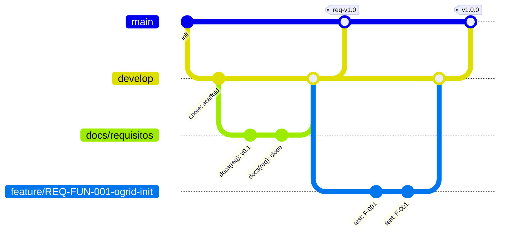

# STD-GIT · Estándar de trabajo con git

| Campo | Valor |
|---|---|
| Versión | 1.0.0 |
| Ámbito | Este repositorio, incluido el propio harness |
| Automatización | `h git …` + hooks en `.githooks/` (instalados por `h init`) |

## 1. Ramas



| ID | Nivel | Regla |
|---|---|---|
| GIT-BR-01 | OBL | `main`: solo versiones integradas y verificadas. Solo recibe merges desde `develop` (o `release/*`). |
| GIT-BR-02 | OBL | `develop`: rama de integración del proyecto. Solo recibe merges de ramas de trabajo. |
| GIT-BR-03 | OBL | Commits directos en `main` y `develop` prohibidos (hook `pre-commit`). Solo merges, realizados por `h git finish` / `h git release`. |
| GIT-BR-04 | OBL | Ramas de trabajo, siempre desde `develop`, en kebab-case (minúsculas salvo el ID de requisito, que conserva su formato). Validación: `h git check-branch <nombre>`: |

| Prefijo | Uso | Ejemplo |
|---|---|---|
| `feature/<REQ>-<func>` | una función de la implementación | `feature/REQ-FUN-004-ogrid-update-cell` |
| `fix/<REQ\|issue>-<desc>` | corrección tras integrar | `fix/REQ-PER-002-latency` |
| `docs/<fase>` | trabajo documental de una fase | `docs/requisitos`, `docs/diseno`, `docs/implementacion`, `docs/oferta`, `docs/dosier` |
| `test/<alcance>` | tests de integración | `test/integration` |
| `ui/<desc>` | front-end (no crítico; se integra con aprobación del usuario) | `ui/grid-viewer` |
| `harness/<desc>` | cambios en el propio harness | `harness/doc-export` |
| `release/<x.y.z>` | estabilización previa a `main` (opcional) | `release/1.0.0` |

| ID | Nivel | Regla |
|---|---|---|
| GIT-BR-05 | OBL | Una rama `feature/*` contiene **una sola función** del plan. No se abre la siguiente hasta que la anterior está integrada en `develop` con su test en verde. |
| GIT-BR-06 | OBL | Las ramas integradas se conservan en remoto (trazabilidad) y se borran solo en local. |

## 2. Commits

| ID | Nivel | Regla |
|---|---|---|
| GIT-CM-01 | OBL | Conventional Commits 1.0 en inglés: `<tipo>(<ámbito>): <resumen en imperativo, ≤ 72 caracteres, sin punto final>`. |
| GIT-CM-02 | OBL | Tipos: `feat`, `fix`, `test`, `docs`, `refactor`, `perf`, `build`, `ci`, `chore`, `style`, `revert`. Ámbitos: módulo C (`ogrid`, `hal`, `app`), fase (`req`, `design`, `impl`, `offer`, `dossier`), `harness`, `ui`, `deploy`. |
| GIT-CM-03 | OBL | Trailer `Refs:` con los IDs afectados cuando existan: `Refs: REQ-FUN-004, F-004, TC-F004-03`. |
| GIT-CM-04 | OBL | Commits atómicos: compila y pasa los hooks. Tests y código de una función van en commits distintos (`test(...)`, `feat(...)`), porque los generan agentes distintos. |
| GIT-CM-05 | OBL | Prohibido `--no-verify`, `push --force` sobre `main`/`develop` y reescribir historia publicada. |
| GIT-CM-06 | OBL | Los merges usan el mensaje por defecto de git (`Merge branch '<rama>' into <destino>`) más el trailer `Refs:`. |

Ejemplo:
```
feat(ogrid): implement log-odds cell update

Clamp log-odds to [LO_MIN, LO_MAX] to avoid saturation.

Refs: REQ-FUN-004, F-004
```

## 3. Integración

| ID | Nivel | Regla |
|---|---|---|
| GIT-MG-01 | OBL | Siempre `git merge --no-ff` (se conserva la rama en el historial). |
| GIT-MG-02 | OBL | `feature/* → develop` solo si `h test F-NNN` = PASS sobre el último commit de la rama (lo comprueba `h git finish`). |
| GIT-MG-03 | OBL | `develop → main` solo al cerrar una fase (`h gate close`), con el checklist de la fase en verde y, si existe código C, `h test --all` = PASS. El tag de fase se pone sobre el merge en `main`. |
| GIT-MG-04 | OBL | Tras integrar: `git push origin <rama> develop main --follow-tags`. Si el push falla (credenciales), se informa y se deja pendiente; nunca se fuerza. |
| GIT-MG-05 | OBL | Conflictos: se resuelven en la rama de trabajo (merge de `develop` en ella), nunca en `develop`. |

## 4. Versiones y etiquetas

| ID | Nivel | Regla |
|---|---|---|
| GIT-TG-01 | OBL | SemVer en `main`: `vMAJOR.MINOR.PATCH`. |
| GIT-TG-02 | OBL | Al cerrar una fase, tag anotado: `req-vX.Y`, `design-vX.Y`, `impl-vX.Y`, `offer-vX.Y`. Reabrir una fase y volver a cerrarla incrementa `Y`. |
| GIT-TG-03 | OBL | El harness se versiona con `harness-vX.Y.Z` (fichero `harness/VERSION`). |

## 5. Hooks locales (`.githooks/`, `git config core.hooksPath .githooks`)

| Hook | Comprueba |
|---|---|
| `commit-msg` | GIT-CM-01/02 (acepta mensajes de merge y revert de git) |
| `pre-commit` | GIT-BR-03, nombre de rama GIT-BR-04, `clang-format` sobre `.c/.h` cambiados, `shellcheck` sobre `.sh` cambiados, ficheros > 5 MB |
| `pre-push` | en `feature/*` ejecuta `h test <F-NNN>` de la rama; en `develop`/`main` exige el último informe PASS |

## 6. Qué no se versiona

`build/`, `.harness/sandbox/`, `.harness/reports/`, `docs/**/export/`, `*.docx`/`*.pptx` generados (se adjuntan a releases), `.claude/` (instalación local del harness, contiene rutas absolutas). Sí se versiona `.harness/state.json` (estado de fases).
