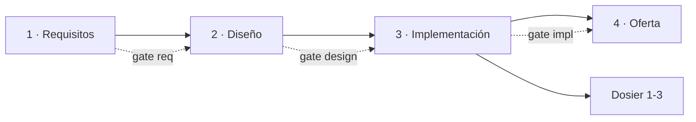

# STD-PRO · Proceso por fases y reglas para los assets

| Campo | Valor |
|---|---|
| Versión | 1.0.0 |
| Ámbito | Comandos, agentes, skills y scripts del harness; cualquier sesión de Claude en este proyecto |

## 1. Fases y puertas

| ID | Nivel | Regla |
|---|---|---|
| PRO-01 | OBL | Una fase solo empieza si la anterior está **cerrada** (`h gate require <fase>`). El hook `phase_guard.py` impide escribir en carpetas de fases bloqueadas y en las de fases ya cerradas. |
| PRO-02 | OBL | Cerrar una fase requiere **dos condiciones**: el comando explícito del usuario (`/req-cerrar`, `/diseno-cerrar`, `/impl-cerrar`, `/oferta-cerrar`, marcados `disable-model-invocation`) y el checklist automático de `h gate check <fase>` en verde. |
| PRO-03 | OBL | Reabrir una fase cerrada solo con `/fase-reabrir <fase> <motivo>` (usuario). Queda registrado en `.harness/state.json` y las fases posteriores vuelven a bloquearse hasta recerrar. |
| PRO-04 | OBL | Estado de todas las fases: `/fase-estado` (`h gate status`). |

## 2. Reglas de comportamiento para Claude y sus agentes

| ID | Nivel | Regla |
|---|---|---|
| PRO-A-01 | OBL | **Ante cualquier duda, preguntar** con `AskUserQuestion` (máx. 4 preguntas por ronda, opción recomendada primero). Si no se puede preguntar, registrar la duda en el log de la fase y detenerse. |
| PRO-A-02 | OBL | **No inventar**: ni requisitos, ni elementos de diseño, ni datos de la oferta (precios, plazos, nombres). Las propuestas se marcan `[PROPUESTA]` y requieren aceptación. |
| PRO-A-03 | OBL | Leer los estándares aplicables antes de producir un artefacto y citar sus IDs en revisiones y hallazgos. |
| PRO-A-04 | OBL | Toda escritura pasa por la rama git que corresponde (STD-GIT) y por los scripts `h` cuando existen (no reimplementar a mano lo que hace un script). |
| PRO-A-05 | OBL | Agentes con aislamiento (`implementador`, `ingeniero-tests`) solo trabajan dentro de su sandbox y verifican el canario antes de empezar. |
| PRO-A-06 | OBL | Idioma: conversación y documentos en español; código, commits y nombres de rama en inglés. |

## 3. Mapa de assets

| Fase | Comandos | Agentes | Skills |
|---|---|---|---|
| Transversal | `/harness-init`, `/fase-estado`, `/fase-reabrir`, `/plantilla-registrar`, `/diagrama` | `redactor-tecnico` | `fases`, `export-word`, `diagramas` |
| 1 · Requisitos | `/req-iniciar`, `/req-iterar`, `/req-exportar`, `/req-cerrar` | `analista-requisitos` | `requisitos` |
| 2 · Diseño | `/diseno-iniciar`, `/diseno-revisar`, `/diseno-alternativa`, `/diseno-comparar`, `/diseno-exportar`, `/diseno-cerrar` | `revisor-diseno`, `arquitecto-alternativas` | `matriz-ponderada` |
| 3 · Implementación | `/impl-iniciar`, `/impl-funcion`, `/impl-test`, `/impl-integrar`, `/impl-frontend`, `/impl-exportar`, `/impl-cerrar` | `implementador`, `ingeniero-tests`, `auditor-estandares` | `implementacion-aislada`, `git-flujo` |
| 4 · Oferta | `/oferta-iniciar`, `/oferta-seccion`, `/oferta-exportar`, `/oferta-presentacion`, `/oferta-cerrar`, `/dosier-generar` | `redactor-tecnico` | `oferta`, `dosier` |
