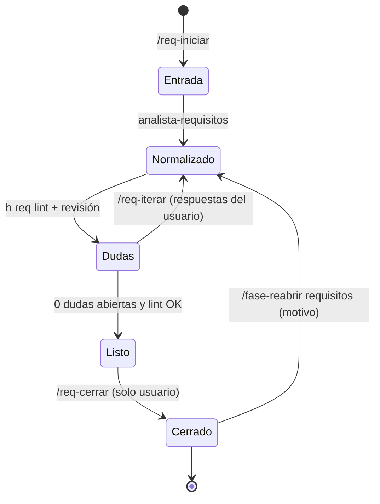

# STD-REQ · Redacción y gestión de requisitos

| Campo | Valor |
|---|---|
| Versión | 1.0.0 |
| Referencia | ISO/IEC/IEEE 29148:2018 + plantillas EARS + reglas de calidad INCOSE |
| Plantilla | `Requirements_2.pages` del usuario, recreada en `templates/docx/plantilla-requisitos.docx` |
| Verificación | `h req lint` (automático) + agente `analista-requisitos` |

## 1. Calidad de cada requisito

| ID | Nivel | Regla | Detección automática |
|---|---|---|---|
| REQ-Q-01 | OBL | Necesario y único: un requisito, una necesidad. Sin "y/o" que mezclen dos obligaciones. | aviso si contiene " y " + 2 verbos "deberá" |
| REQ-Q-02 | OBL | EARS: «El sistema deberá …» para requisitos siempre activos y «Si …, entonces el sistema deberá …» para la respuesta ante fallos. Otras formas EARS («Cuando…», «Mientras…», «Donde…») solo con aviso. Las hipótesis no usan «deberá». | sí |
| REQ-Q-03 | OBL | Sin términos vagos: *adecuado, rápido, suficiente, robusto, aproximadamente, etc., fácil, normalmente, mínimo posible, en tiempo real* (sin cifra). | sí (lista en `h req lint`) |
| REQ-Q-04 | OBL | Verificable: criterio de aceptación con magnitud, unidad y condición (`latencia ≤ 100 ms en el percentil 99 con 512 ecos/nube`). | sí (busca número + unidad) |
| REQ-Q-05 | OBL | Sin solución de diseño salvo que el usuario la imponga como restricción (Tipo = Restricción). | revisión |
| REQ-Q-06 | OBL | Consistente: sin contradicciones con otros requisitos (unidades, rangos, tiempos). | revisión |
| REQ-Q-07 | OBL | Sin valores pendientes al cerrar: ni `[X]`, ni `[PENDIENTE…]`, `[PROPUESTA]`, `TBD`, `TODO`, `??` (decisión del usuario: todo `[X]` se resuelve antes de `/req-cerrar`). | sí |

## 2. Codificación, secciones y atributos

**Códigos**: `SYS-<categoría>-<nn>` para requisitos del sistema y `H-<nn>` para hipótesis. Cada código va en la sección de la plantilla que le corresponde (el lint lo comprueba):

| Sección (`##` en el markdown) | Prefijo |
|---|---|
| Normativa | `SYS-GEN-` |
| Entradas | `SYS-IN-` |
| Procesamiento | `SYS-PR-` |
| Detección y prestaciones | `SYS-DET-` |
| Salida | `SYS-OUT-` |
| Tiempo | `SYS-T-` |
| Seguridad y modos de funcionamiento | `SYS-SAF-` |
| Implementación | `SYS-IMP-` |
| Hipótesis | `H-` |

**Atributos** (columna del Word entre paréntesis):

| Atributo | Valores | SYS | H |
|---|---|---|---|
| Descripción (Description) | EARS (REQ-Q-02) | obligatorio | obligatorio |
| Tipo (Type) | Funcional · No funcional · Restricción · Hipótesis | obligatorio | `Hipótesis` |
| Origen (Source) | `R1`–`R4` (requisitos del enunciado, admite lista `R1, R3`) · `Derivado` (o `Derivado de <código>`) | obligatorio | obligatorio |
| Prioridad (Priority) | Must · Should · Could · Won't | obligatorio | opcional |
| Método de verificación (Verification) | Test · Análisis · Inspección · Demostración | obligatorio | opcional |
| Criterio de aceptación (Acceptance criterion) | condición medible | obligatorio | opcional |
| Estado (Status) | Borrador · En revisión · Aprobado | obligatorio | obligatorio |

**Valores pendientes**: en el markdown se escriben `[PENDIENTE: valor propuesto]` (o `[PENDIENTE]` sin propuesta); en el Word aparecen como `[valor]` / `[X]`, la convención de la plantilla. Cada uno tiene su duda `Q-NNN` abierta.

**Word**: una única tabla `Code | Description | Type | Source | Priority | Verification | Acceptance criterion | Status` con filas de sección, A4 apaisado, sin portada ni índice (decisiones del usuario del 2026-11-01).

## 3. Ciclo de iteración

- `dudas.md` es una tabla `ID | Requisito | Pregunta | Respuesta | Estado (Abierta/Resuelta/Descartada)`. IDs `Q-NNN`, nunca se reutilizan.
- Cada iteración incrementa la versión menor del documento (`0.1`, `0.2`, …) y se commitea en `docs/requisitos` con `docs(req): …`.
- Al cerrar: versión `1.0`, Estado de todos los requisitos = Aprobado, tag `req-v1.0`.
