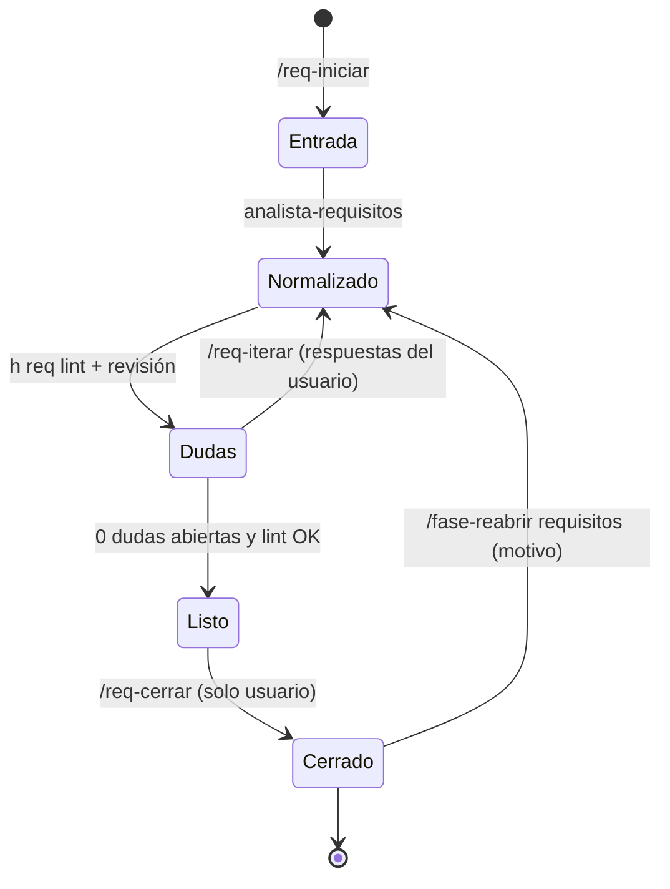

# STD-REQ · Redacción y gestión de requisitos

| Campo | Valor |
|---|---|
| Versión | 1.0.0 |
| Referencia | Reglas de calidad INCOSE (Guide for Writing Requirements) adaptadas |
| Verificación | `h req lint` (automático) + agente `analista-requisitos` |

## 1. Calidad de cada requisito

| ID | Nivel | Regla | Detección automática |
|---|---|---|---|
| REQ-Q-01 | OBL | Necesario y único: un requisito, una necesidad. Sin "y/o" que mezclen dos obligaciones. | aviso si contiene " y " + 2 verbos "deberá" |
| REQ-Q-02 | OBL | Forma "El sistema deberá <verbo> …" (o el subsistema concreto). | sí |
| REQ-Q-03 | OBL | Sin términos vagos: *adecuado, rápido, suficiente, robusto, aproximadamente, etc., fácil, normalmente, mínimo posible, en tiempo real* (sin cifra). | sí (lista en `h req lint`) |
| REQ-Q-04 | OBL | Verificable: criterio de aceptación con magnitud, unidad y condición (`latencia ≤ 100 ms en el percentil 99 con 512 ecos/nube`). | sí (busca número + unidad) |
| REQ-Q-05 | OBL | Sin solución de diseño salvo que el usuario la imponga como restricción (Tipo = Restricción). | revisión |
| REQ-Q-06 | OBL | Consistente: sin contradicciones con otros requisitos (unidades, rangos, tiempos). | revisión |
| REQ-Q-07 | OBL | Sin marcadores `TBD`, `TODO`, `[PENDIENTE…]`, `[PROPUESTA]`, `??` al cerrar. | sí |

## 2. Atributos obligatorios

| Atributo | Valores |
|---|---|
| Descripción | texto "El sistema deberá…" |
| Tipo | Funcional · Rendimiento · Seguridad funcional · Interfaz · Entorno · Restricción · No funcional |
| Prioridad | Must · Should · Could · Won't |
| Origen | enunciado de la práctica, usuario, norma, derivado de `<ID>` |
| Método de verificación | Test · Análisis · Inspección · Demostración |
| Criterio de aceptación | condición medible |
| Estado | Borrador · En revisión · Aprobado |

## 3. Ciclo de iteración

- `dudas.md` es una tabla `ID | Requisito | Pregunta | Respuesta | Estado (Abierta/Resuelta/Descartada)`. IDs `Q-NNN`, nunca se reutilizan.
- Cada iteración incrementa la versión menor del documento (`0.1`, `0.2`, …) y se commitea en `docs/requisitos` con `docs(req): …`.
- Al cerrar: versión `1.0`, Estado de todos los requisitos = Aprobado, tag `req-v1.0`.
